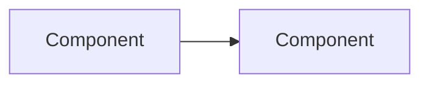

# M0 Process Implementation Plan

> **For agentic workers:** REQUIRED SUB-SKILL: Use superpowers:subagent-driven-development (recommended) or superpowers:executing-plans to implement this plan task-by-task. Steps use checkbox (`- [ ]`) syntax for tracking.

**Goal:** Turn the approved process document into a working project setup: a private GitHub repository with the agreed layout, labels, milestones, templates, the first M1 issues, and a `v0.0.0` release that closes milestone M0.

**Architecture:** Everything in M0 is configuration and documentation, no product code. Files are committed locally first (bootstrap commits on `main`, the one allowed exception to the PR rule), then the repository is created on GitHub and pushed, then GitHub-side objects (labels, milestones, issues, release) are created through `gh`. Each task ends with a `gh` or `git` command whose output proves the deliverable exists.

**Tech Stack:** git, GitHub CLI `gh` 2.93, GitHub REST API via `gh api`, Markdown, GitHub issue forms (YAML).

**Spec:** `docs/process.md` (Draft v1, approved 2026-09-07).

## Global Constraints

- Repository: private `maldrakar/todo-app`, default branch `main` (spec section 3).
- All repository and GitHub artifacts are written in English (spec section 3).
- Remote operations go through `gh` (spec section 3).
- M0 commits are bootstrap commits and go directly to `main`. From tag `v0.0.0` onward every change goes through a PR (spec section 3).
- Labels are exactly: type `feature`, `bug`, `arch`, `infra`, `docs`, `spike`, `epic`; area `core`, `ui-apple`, `ui-web` (spec section 4).
- Milestones: `M0 Process`, `M1 Core architecture`, `M2 Feature-module architecture`, `M3 Product functionality` (spec section 4 and 11).
- Issue body fields: Context, Goal, Acceptance criteria, Out of scope (spec section 4).
- Squash merge only, branch deleted on merge, squash commit message is the PR title (spec section 6).
- Versions are `v0.N.0` with `N` the milestone number; M0 closes with `v0.0.0` (spec section 9 and 11).
- Git identity for this repository is already set locally to the owner's GitHub email; do not change it.
- Every commit message ends with the trailer `Co-Authored-By: Claude Fable 5.1 <noreply@anthropic.com>`.

---

## File map

| Path | Responsibility |
| ---- | -------------- |
| `README.md` | What the project is, target platforms, where the process lives |
| `CHANGELOG.md` | Keep a Changelog; `[Unreleased]` plus `[0.0.0]` |
| `CLAUDE.md` | Digest of `docs/process.md` loaded into every engineer session |
| `docs/brief.md` | The owner's original brief, moved from `spec.md`, kept verbatim |
| `docs/process.md` | Already exists; not modified by this plan |
| `docs/adr/0000-adr-template.md` | Template every ADR is copied from |
| `docs/specs/TEMPLATE.md` | Template every spec is copied from |
| `docs/plans/m0-process.md` | This plan |
| `.github/ISSUE_TEMPLATE/task.yml` | Issue form with the four fields |
| `.github/ISSUE_TEMPLATE/config.yml` | Disables blank issues |
| `.github/PULL_REQUEST_TEMPLATE.md` | PR body skeleton |

Directories `docs/adr`, `docs/specs`, `docs/plans` become tracked through the template files above; git does not track empty directories.

---

### Task 1: Repository skeleton

**Files:**
- Create: `README.md`
- Create: `CHANGELOG.md`
- Create: `docs/brief.md` (moved from `spec.md`)
- Create: `docs/adr/0000-adr-template.md`
- Create: `docs/specs/TEMPLATE.md`

**Interfaces:**
- Consumes: nothing.
- Produces: `CHANGELOG.md` with a `[0.0.0]` section that Task 10 uses as release notes; `docs/brief.md` linked from `README.md`.

- [ ] **Step 1: Move the brief**

```bash
cd /Users/aabanschikov/todo-app
mv spec.md docs/brief.md
```

Then prepend a two-line English note so the file's status is clear. Final content of `docs/brief.md`:

```markdown
# Project brief

The owner's original brief from September 2026, kept verbatim in Russian as the starting point of the project. The process it asks for is defined in `process.md`.

---

# Spec
## О проекте и ближайших планах
Мы с тобой будем проектировать и реализовывать приложения с напоминаниями, чем-то похожее на приложение Things 3. В первую очередь нам нужно будет определиться как будем вести проект, как будет проходить инкремент нашего продукта, как мы будем вести бэклог задач. После этого предлагаю обсудить и выбрать общую архитектуру хранения, поиска, и тд, а также архитектуру каждого feature-модуля проекта. И уже только после этого постепенно начнем делать сам проект с точки зрения функциональности.
## Требования и ограничения
- Приложение по итогу будет кроссплатформенным, как минимум среди поддерживаемых платформ будет iOS, MacOS, iPadOS, WatchOS, WASM
- Вся общая часть (core) приложения должна быть написана на Embedded Swift и компилироваться под платформы, указанные выше. При этом UI часть будет соответственно платформоспецифичной, например для Apple-экосистемы вероятно это будет SwiftUI, а для Web React, но конкретные технологии обсудим и выберем позже при реализации
- Работать с удаленным репозиторием будем через CLI-утилиту Гитхаба `gh`, которая уже должна быть тебе доступна
```

- [ ] **Step 2: Write `README.md`**

```markdown
# todo-app

A reminders app in the spirit of Things 3, with one shared core and native UI per platform.

- Target platforms: iOS, macOS, iPadOS, watchOS, and the web via WASM.
- The shared core is written in Embedded Swift and compiles for every target above.
- UI is platform-specific: SwiftUI is the likely choice for Apple platforms, React for the web. Both are decided during implementation.

## Status

Milestone `M0 Process` is complete: the project process is defined and the repository is set up. There is no product code yet; `M1 Core architecture` is next.

## Documents

- [`docs/brief.md`](docs/brief.md): the original project brief.
- [`docs/process.md`](docs/process.md): how the project is run, from backlog to release.
- [`docs/adr/`](docs/adr/): architecture decision records.
- [`docs/specs/`](docs/specs/): design specs. [`docs/plans/`](docs/plans/): implementation plans.
- [`CHANGELOG.md`](CHANGELOG.md): what changed in each version.

## Building

Nothing to build yet. Build instructions arrive with the first core package in M1.
```

- [ ] **Step 3: Write `CHANGELOG.md`**

```markdown
# Changelog

All notable changes to this project are documented in this file. The format follows [Keep a Changelog](https://keepachangelog.com/en/1.1.0/). Version numbers follow the milestone numbering described in `docs/process.md`.

## [Unreleased]

## [0.0.0] - 2026-09-07

### Added

- Project process in `docs/process.md`: roles, backlog in GitHub Issues and Milestones, task lifecycle, spec review flow, ADRs, increment closing, CI constraints.
- Repository bootstrap: README, `CLAUDE.md`, ADR and spec templates, issue and PR templates.
- GitHub setup: labels, milestones M0 to M3, first M1 issues.
```

- [ ] **Step 4: Write `docs/adr/0000-adr-template.md`**

```markdown
# ADR-0000: Title in the imperative, stating the decision

- Status: Proposed | Accepted | Superseded by ADR-NNNN
- Date: YYYY-MM-DD
- Related: spec or issue links

## Context

What situation forces a decision. The constraints that matter, in two to five sentences. Link the spec or issue where the discussion happened.

## Decision

The decision itself, stated as a fact: "The core stores data as ...". One paragraph. If alternatives were considered, name them and say in one sentence each why they lost.

## Consequences

What becomes easier, what becomes harder, and what future work is now constrained. Include the cost of reversing this decision.
```

- [ ] **Step 5: Write `docs/specs/TEMPLATE.md`**

```markdown
# Spec: Topic

- Status: Draft | Approved
- Owner review: Artifact link
- Issue: #N

Written for the owner. The bar is readability: describe modules and their contracts, and describe types only where the design depends on them. Every type defined outside this document gets a one-line reminder at its first mention and an entry in the glossary.

## Problem

What is missing or wrong today, and who feels it.

## Goals and non-goals

- Goal:
- Non-goal:

## Chosen approach

The design in prose, at the level of modules and responsibilities.

## Rejected alternatives

| Alternative | Why it lost |
| ----------- | ----------- |
|             |             |

## Components and data flow



## Open questions

- 

## Risks

- 

## Glossary of external types

| Type | Defined in | One-line reminder |
| ---- | ---------- | ----------------- |
|      |            |                   |
```

- [ ] **Step 6: Verify the tree**

Run:

```bash
cd /Users/aabanschikov/todo-app && git status --short && ls docs docs/adr docs/specs docs/plans
```

Expected: `spec.md` shows as deleted-untracked (it was never tracked, so it simply disappears), five new files listed as `??`, and the four `docs` directories each contain the files above.

- [ ] **Step 7: Commit**

```bash
cd /Users/aabanschikov/todo-app
git add README.md CHANGELOG.md docs/brief.md docs/adr/0000-adr-template.md docs/specs/TEMPLATE.md
git commit -F - <<'MSG'
chore: bootstrap repository layout

Add README, CHANGELOG with 0.0.0, the original brief, and the ADR and
spec templates described in docs/process.md section 3.

Co-Authored-By: Claude Fable 5.1 <noreply@anthropic.com>
MSG
```

---

### Task 2: CLAUDE.md

**Files:**
- Create: `CLAUDE.md`

**Interfaces:**
- Consumes: `docs/process.md` sections 2 to 9.
- Produces: the digest every future session reads. Nothing else in this plan depends on it.

- [ ] **Step 1: Write `CLAUDE.md`**

```markdown
# CLAUDE.md

Digest of `docs/process.md`. When the two disagree, `docs/process.md` wins.

## Language

Everything in the repository and on GitHub is in English. Conversation with the owner is in Russian.

## Roles

- Owner: Artur, GitHub `maldrakar`. Reviews specs and PRs and has the final say on every merge.
- Engineer: Claude. Proposes designs, grooms the backlog, implements, opens PRs, keeps `CHANGELOG.md` and docs current.

## Rules that are never broken

- Never push to `main`. Every change goes through a PR.
- Never merge without an explicit OK from the owner in chat, unless the owner merges in GitHub.
- Create issues only after agreement in chat. Exception: a bug found mid-task is filed at once with `bug` and mentioned in chat.
- Remote operations go through `gh`.

## Backlog

- GitHub Issues. Milestones are increments: `M0 Process`, `M1 Core architecture`, `M2 Feature-module architecture`, `M3 Product functionality`.
- Issue body has four sections: Context, Goal, Acceptance criteria, Out of scope. Priority inside a milestone is the order of issues, not a label.
- Labels: type `feature` `bug` `arch` `infra` `docs` `spike` `epic`; area `core` `ui-apple` `ui-web`.
- Epic: an issue labeled `epic` that links the spec and plan. Children are attached as sub-issues through `gh api graphql`; a task list in the epic body is the fallback.

## Sizes of work

Say the classification out loud before starting; when in doubt go heavier, never downgrade mid-task.

- Spike: a feasibility question. The answer goes into the issue; any code is throwaway.
- Bounded: a small change to an existing flow. Short design in chat, owner OK, then code.
- Architectural: new subsystem or module. Brainstorm, spec in `docs/specs/`, Artifact review, plan in `docs/plans/`. The same issue becomes the epic and the plan's tasks become its sub-issues.

## Task lifecycle

1. Take the top open issue of the current milestone and classify it.
2. Branch `<type>/<issue>-<slug>`, for example `feature/12-task-repository`. Test-first.
3. Before the PR: build, tests, self-review of the diff.
4. PR title in Conventional Commits with a scope from `core` `apple` `web` `docs` `infra` `ci`, for example `feat(core): add task repository`. Body follows the PR template and ends with `Closes #N`.
5. Squash merge, one commit per issue, branch deleted. The squash message is the PR title.

Definition of Done: acceptance criteria met, tests green, CI green, spec or ADR updated if architecture changed, no `TODO` without a linked issue.

## Specs and ADRs

- Spec (`docs/specs/`, copy `TEMPLATE.md`) is written for the owner. Every type defined outside the document gets a one-line reminder at first mention and an entry in the glossary.
- Review: publish the spec as an Artifact rendered from the markdown; the owner comments in threads; update the markdown, republish with a Revision notes block on top, reply and resolve. Approval is an explicit "approved" in chat; then the spec merges through a `docs` PR. Markdown is the source of truth, HTML is never committed.
- ADR (`docs/adr/`, copy `0000-adr-template.md`): written after a spec is approved for decisions that constrain future work, and mid-implementation for unplanned decisions that are expensive to reverse. Proposed through an `arch` PR.

## Closing a milestone

All issues closed, CI green, `CHANGELOG.md` moves Unreleased into `[0.N.0]`, tag `v0.N.0`, `gh release create`, something runnable on at least one platform.

## Toolchain notes

- Swift 6.2 and Xcode 26.3 locally. The core is Embedded Swift for iOS, macOS, iPadOS, watchOS and WASM.
- CI runs on macOS runners, which cost 10x minutes on a private repository. Keep CI lean.
```

- [ ] **Step 2: Verify it reads correctly**

Run:

```bash
cd /Users/aabanschikov/todo-app && head -3 CLAUDE.md && grep -c '^## ' CLAUDE.md
```

Expected: the first line is `# CLAUDE.md`, and the section count is `9`.

- [ ] **Step 3: Commit**

```bash
cd /Users/aabanschikov/todo-app
git add CLAUDE.md
git commit -F - <<'MSG'
docs: add CLAUDE.md process digest

Co-Authored-By: Claude Fable 5.1 <noreply@anthropic.com>
MSG
```

---

### Task 3: GitHub issue and PR templates

**Files:**
- Create: `.github/ISSUE_TEMPLATE/task.yml`
- Create: `.github/ISSUE_TEMPLATE/config.yml`
- Create: `.github/PULL_REQUEST_TEMPLATE.md`

**Interfaces:**
- Consumes: the four issue fields from the spec.
- Produces: the section headings `Context`, `Goal`, `Acceptance criteria`, `Out of scope` that Tasks 8 and 9 reproduce in issue bodies created through `gh`.

- [ ] **Step 1: Write `.github/ISSUE_TEMPLATE/task.yml`**

```yaml
name: Task
description: A unit of work tracked in a milestone
body:
  - type: textarea
    id: context
    attributes:
      label: Context
      description: Why this task exists. Link the spec, epic or discussion it comes from.
    validations:
      required: true
  - type: textarea
    id: goal
    attributes:
      label: Goal
      description: What is true when this task is done, in one or two sentences.
    validations:
      required: true
  - type: textarea
    id: acceptance
    attributes:
      label: Acceptance criteria
      description: Checkable statements. Each one is verified before the PR is opened.
      value: |
        - [ ]
    validations:
      required: true
  - type: textarea
    id: out-of-scope
    attributes:
      label: Out of scope
      description: What this task deliberately does not do.
```

- [ ] **Step 2: Write `.github/ISSUE_TEMPLATE/config.yml`**

```yaml
blank_issues_enabled: false
```

- [ ] **Step 3: Write `.github/PULL_REQUEST_TEMPLATE.md`**

```markdown
## What changed

## How it was verified

## Links

Closes #
```

- [ ] **Step 4: Verify the YAML parses**

Run:

```bash
cd /Users/aabanschikov/todo-app && ruby -ryaml -e 'YAML.load_file(".github/ISSUE_TEMPLATE/task.yml"); YAML.load_file(".github/ISSUE_TEMPLATE/config.yml"); puts "yaml ok"'
```

Expected: `yaml ok`.

- [ ] **Step 5: Commit**

```bash
cd /Users/aabanschikov/todo-app
git add .github
git commit -F - <<'MSG'
chore: add issue form and PR template

Co-Authored-By: Claude Fable 5.1 <noreply@anthropic.com>
MSG
```

---

### Task 4: Commit this plan

**Files:**
- Create: `docs/plans/m0-process.md` (this file, already written)

- [ ] **Step 1: Commit**

```bash
cd /Users/aabanschikov/todo-app
git add docs/plans/m0-process.md
git commit -F - <<'MSG'
docs: add M0 implementation plan

Co-Authored-By: Claude Fable 5.1 <noreply@anthropic.com>
MSG
git status --short
```

Expected: `git status --short` prints nothing.

---

### Task 5: Create the GitHub repository and push

**Files:** none.

**Interfaces:**
- Consumes: the local `main` branch with Tasks 1 to 4 committed.
- Produces: remote `origin` pointing at `maldrakar/todo-app`; every later task addresses the repository as `maldrakar/todo-app`.

- [ ] **Step 1: Create the repository and push `main`**

```bash
cd /Users/aabanschikov/todo-app
gh repo create maldrakar/todo-app --private --source=. --remote=origin --push \
  --description "Reminders app with an Embedded Swift core and native UI per platform"
```

Expected: output ends with the repository URL and the push summary for `main`.

- [ ] **Step 2: Configure merging to match the process**

```bash
gh repo edit maldrakar/todo-app \
  --enable-squash-merge --enable-merge-commit=false --enable-rebase-merge=false \
  --delete-branch-on-merge --enable-issues --enable-wiki=false --enable-projects=false
gh api -X PATCH repos/maldrakar/todo-app \
  -f squash_merge_commit_title=PR_TITLE -f squash_merge_commit_message=PR_BODY >/dev/null
```

- [ ] **Step 3: Verify**

Run:

```bash
gh repo view maldrakar/todo-app --json visibility,defaultBranchRef,squashMergeAllowed,mergeCommitAllowed,rebaseMergeAllowed,deleteBranchOnMerge \
  --jq '{visibility, branch: .defaultBranchRef.name, squashMergeAllowed, mergeCommitAllowed, rebaseMergeAllowed, deleteBranchOnMerge}'
git -C /Users/aabanschikov/todo-app remote -v | head -1
```

Expected:

```
{"visibility":"PRIVATE","branch":"main","squashMergeAllowed":true,"mergeCommitAllowed":false,"rebaseMergeAllowed":false,"deleteBranchOnMerge":true}
origin  git@github.com:maldrakar/todo-app.git (fetch)
```

---

### Task 6: Labels

**Files:** none.

**Interfaces:**
- Produces: the ten labels by exact name, used by Tasks 8 and 9.

- [ ] **Step 1: Remove GitHub's default labels that are not in the set**

```bash
for l in documentation duplicate enhancement "good first issue" "help wanted" invalid question wontfix; do
  gh label delete "$l" --repo maldrakar/todo-app --yes 2>/dev/null || true
done
```

- [ ] **Step 2: Create or update the project labels**

```bash
R=maldrakar/todo-app
gh label create feature --repo $R --force --color 1D76DB --description "New product behavior"
gh label create bug     --repo $R --force --color D73A4A --description "Something behaves incorrectly"
gh label create arch    --repo $R --force --color 5319E7 --description "Architecture: specs, ADRs, structural changes"
gh label create infra   --repo $R --force --color 0E8A16 --description "Repository, tooling, CI"
gh label create docs    --repo $R --force --color 006B75 --description "Documentation only"
gh label create spike   --repo $R --force --color FBCA04 --description "Feasibility question; code is throwaway"
gh label create epic    --repo $R --force --color B60205 --description "Parent issue grouping sub-issues under one theme"
gh label create core     --repo $R --force --color C5DEF5 --description "Area: shared Embedded Swift core"
gh label create ui-apple --repo $R --force --color C5DEF5 --description "Area: iOS, macOS, iPadOS, watchOS UI"
gh label create ui-web   --repo $R --force --color C5DEF5 --description "Area: web UI on WASM"
```

- [ ] **Step 3: Verify**

Run:

```bash
gh label list --repo maldrakar/todo-app --json name --jq '[.[].name] | sort | join(" ")'
```

Expected exactly:

```
arch bug core docs epic feature infra spike ui-apple ui-web
```

---

### Task 7: Milestones

**Files:** none.

**Interfaces:**
- Produces: milestone titles used verbatim by `--milestone` in Tasks 8 and 9, and the `M0 Process` milestone number used by Task 10.

- [ ] **Step 1: Create the four milestones**

```bash
R=maldrakar/todo-app
gh api repos/$R/milestones -f title="M0 Process" \
  -f description="Define how the project is run: backlog, task lifecycle, spec reviews, releases. Deliverable: docs/process.md and the bootstrapped repository." >/dev/null
gh api repos/$R/milestones -f title="M1 Core architecture" \
  -f description="Storage, search, sync model and the Embedded Swift toolchain for all targets. Deliverable: core test suite and a command-line demo." >/dev/null
gh api repos/$R/milestones -f title="M2 Feature-module architecture" \
  -f description="How a feature module is structured, wired and tested." >/dev/null
gh api repos/$R/milestones -f title="M3 Product functionality" \
  -f description="Product features. Scope is planned after M2." >/dev/null
```

- [ ] **Step 2: Verify**

Run:

```bash
gh api repos/maldrakar/todo-app/milestones --jq '.[] | "\(.number) \(.title) \(.state)"'
```

Expected:

```
1 M0 Process open
2 M1 Core architecture open
3 M2 Feature-module architecture open
4 M3 Product functionality open
```

---

### Task 8: M0 issues, created and closed

The M0 work was done before the backlog existed. Two issues record it so the milestone has content and the closing ritual in Task 10 is real.

**Files:** none.

**Interfaces:**
- Consumes: labels from Task 6, milestone `M0 Process` from Task 7, commit hashes from `git log`.
- Produces: issues #1 and #2, both closed.

- [ ] **Step 1: Create issue #1**

```bash
cd /Users/aabanschikov/todo-app
gh issue create --repo maldrakar/todo-app --title "Define the project process" \
  --label docs --milestone "M0 Process" --body-file - <<'EOF'
### Context

The project starts from the brief in `docs/brief.md`, which asks to settle how the project is run before any architecture or code.

### Goal

An approved `docs/process.md` describing roles, backlog, task lifecycle, spec reviews, ADRs and increment closing.

### Acceptance criteria

- [x] Process document reviewed by the owner through an Artifact page and approved in chat.
- [x] Document committed on `main`.

### Out of scope

Architecture decisions; they belong to M1.
EOF
```

- [ ] **Step 2: Create issue #2**

```bash
gh issue create --repo maldrakar/todo-app --title "Bootstrap the repository" \
  --label infra --milestone "M0 Process" --body-file - <<'EOF'
### Context

`docs/process.md` section 3 defines the repository layout and section 11 lists the M0 deliverables.

### Goal

A private repository with the agreed layout, labels, milestones, templates and `CLAUDE.md`, ready for M1 work through PRs.

### Acceptance criteria

- [x] Repository `maldrakar/todo-app` exists, private, squash-merge only, branches deleted on merge.
- [x] Labels and milestones match `docs/process.md` section 4.
- [x] Issue form and PR template in `.github/`.
- [x] `README.md`, `CHANGELOG.md`, `CLAUDE.md`, `docs/brief.md`, ADR and spec templates on `main`.

### Out of scope

CI; it arrives with the first core package (section 10).
EOF
```

- [ ] **Step 3: Close both with a reference to the commits**

```bash
cd /Users/aabanschikov/todo-app
P=$(git log --format=%h --grep='address review round 1' -1)
B=$(git log --format=%h --grep='bootstrap repository layout' -1)
gh issue close 1 --repo maldrakar/todo-app --comment "Done in $P: docs/process.md approved by the owner on 2026-09-07."
gh issue close 2 --repo maldrakar/todo-app --comment "Done in $B and the following bootstrap commits; labels, milestones and templates configured through gh."
```

- [ ] **Step 4: Verify**

Run:

```bash
gh issue list --repo maldrakar/todo-app --milestone "M0 Process" --state all --json number,title,state,labels --jq '.[] | "\(.number) \(.state) \(.labels[0].name) \(.title)"'
```

Expected:

```
2 CLOSED infra Bootstrap the repository
1 CLOSED docs Define the project process
```

---

### Task 9: First M1 issues

**Files:** none.

**Interfaces:**
- Consumes: labels from Task 6, milestone `M1 Core architecture` from Task 7.
- Produces: issues #3 and #4, open, which become the first items picked up after M0 closes.

- [ ] **Step 1: Create the toolchain spike**

```bash
gh issue create --repo maldrakar/todo-app --title "Spike: Embedded Swift toolchain for WASM and watchOS" \
  --label spike --label core --milestone "M1 Core architecture" --body-file - <<'EOF'
### Context

The brief requires the shared core to be Embedded Swift and to compile for iOS, macOS, iPadOS, watchOS and WASM. Before designing storage and search we need to know what Embedded Swift can and cannot do on the two least common targets, WASM and watchOS, with the toolchain we have (Swift 6.2, Xcode 26.3).

### Goal

A written answer in this issue: which toolchain builds an Embedded Swift package for WASM and for watchOS, which language and library features are unavailable (Foundation, existentials, reflection, allocation behavior), and how tests can run for the core.

### Acceptance criteria

- [ ] A minimal Embedded Swift package builds for macOS, WASM and watchOS from the command line, and the exact commands are recorded here.
- [ ] The list of unavailable features that affect storage, search and module boundaries is recorded here.
- [ ] A recommendation for how core tests run (host build, WASM runtime, or both) is recorded here.
- [ ] Any code written for this spike is discarded; nothing is merged.

### Out of scope

Choosing the storage engine or the module architecture. Those are decided in the architecture issue that follows this spike.
EOF
```

- [ ] **Step 2: Create the architecture discussion issue**

```bash
gh issue create --repo maldrakar/todo-app --title "Core storage and search architecture" \
  --label arch --label core --milestone "M1 Core architecture" --body-file - <<'EOF'
### Context

The brief asks to choose the overall architecture for storage, search and related concerns before any feature work. This is an architectural task under `docs/process.md` section 5: it starts with a brainstorming session and a spec, and after the plan is approved this issue becomes the epic for the implementation.

### Goal

An approved spec in `docs/specs/` describing how the core stores tasks, how it searches them, and what the sync model is, within the constraints found by the toolchain spike.

### Acceptance criteria

- [ ] Spec reviewed through an Artifact page and approved by the owner in chat.
- [ ] ADRs extracted from the spec and merged.
- [ ] Implementation plan written in `docs/plans/` and this issue relabeled `epic` with the plan's tasks as sub-issues.

### Out of scope

Feature-module architecture (M2) and any UI.
EOF
```

- [ ] **Step 3: Verify**

Run:

```bash
gh issue list --repo maldrakar/todo-app --milestone "M1 Core architecture" --json number,title,labels --jq '.[] | "\(.number) \([.labels[].name] | join(",")) \(.title)"'
```

Expected:

```
4 arch,core Core storage and search architecture
3 core,spike Spike: Embedded Swift toolchain for WASM and watchOS
```

---

### Task 10: Release v0.0.0 and close M0

**Files:** none.

**Interfaces:**
- Consumes: `CHANGELOG.md` `[0.0.0]` section from Task 1, milestone number `1` from Task 7, issues #1 and #2 closed in Task 8.
- Produces: tag `v0.0.0`, a GitHub Release, milestone `M0 Process` closed.

- [ ] **Step 1: Confirm the milestone has no open issues**

Run:

```bash
gh issue list --repo maldrakar/todo-app --milestone "M0 Process" --state open --json number --jq 'length'
```

Expected: `0`.

- [ ] **Step 2: Tag and push**

```bash
cd /Users/aabanschikov/todo-app
git tag -a v0.0.0 -m "M0 Process: project process defined, repository bootstrapped"
git push origin v0.0.0
```

- [ ] **Step 3: Create the release from the changelog section**

```bash
cd /Users/aabanschikov/todo-app
awk '/^## \[0.0.0\]/{f=1; next} /^## \[/{f=0} f' CHANGELOG.md > /private/tmp/claude-501/-Users-aabanschikov-todo-app/e8ec0d69-e98f-420e-8246-7de5b0be6bdd/scratchpad/release-notes-0.0.0.md
gh release create v0.0.0 --repo maldrakar/todo-app --title "v0.0.0 M0 Process" --notes-file /private/tmp/claude-501/-Users-aabanschikov-todo-app/e8ec0d69-e98f-420e-8246-7de5b0be6bdd/scratchpad/release-notes-0.0.0.md
```

- [ ] **Step 4: Close the milestone**

```bash
gh api -X PATCH repos/maldrakar/todo-app/milestones/1 -f state=closed --jq '"\(.title) \(.state)"'
```

Expected: `M0 Process closed`.

- [ ] **Step 5: Verify the release**

Run:

```bash
gh release view v0.0.0 --repo maldrakar/todo-app --json tagName,name,isDraft --jq '"\(.tagName) \(.name) draft=\(.isDraft)"'
```

Expected: `v0.0.0 v0.0.0 M0 Process draft=false`.

---

## After the plan

From this point the PR rule is in force: no more commits on `main`. The next task is issue #3, the toolchain spike, in milestone `M1 Core architecture`.
