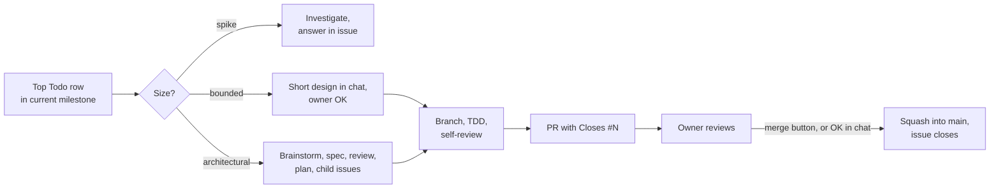

# Project Process

Status: Approved v1, 2026-09-07. Owner: Artur. Author: Claude.
This document is the living description of how the project is run. It is
the deliverable of milestone `M0 Process` and is revised whenever the
process changes.

## 1. Purpose and scope

This document answers three questions: how work is tracked, how a task
travels from an idea to `main`, and what closes an increment of the
product. Product and architecture decisions are out of scope here; they
live in specs and ADRs (see sections 7 and 8).

## 2. Roles

- **Owner (Artur):** sets product direction, reviews specs and pull
  requests, has the final say on every merge.
- **Engineer (Claude):** proposes designs, grooms the backlog, implements
  tasks, opens pull requests, keeps the changelog and documentation
  current.

The engineer never merges into `main` without an explicit go-ahead from
the owner. New issues are created only after agreement in chat, with one
exception: a bug discovered mid-task is filed immediately with the `bug`
label and mentioned in the conversation.

`CLAUDE.md` is a digest of this document, and it is the only one of the
two that the engineer has in context by default. The digest therefore
carries the rules that apply constantly, and this document is opened
deliberately: before architectural work (section 5), before a spec
review (section 7), before closing an increment (section 9), and
whenever the digest is silent or ambiguous on the point at hand. A rule
never lives in the digest alone; it is written here first and summarized
there.

## 3. Repository

- Private repository `maldrakar/todo-app`, default branch `main`.
- `main` is never pushed to directly. The only exception is the
  bootstrap commit that creates the initial structure. GitHub branch
  protection is not available for private repositories on the free plan,
  so this is a process rule, not an enforced one.
- All artifacts in the repository and on GitHub (code, comments, commits,
  issues, docs) are written in English. Conversation happens in Russian.
- Remote operations go through the GitHub CLI (`gh`).

Layout at bootstrap:

```
README.md                 what the project is and how to build it
CHANGELOG.md              Keep a Changelog format, with an Unreleased section
CLAUDE.md                 short digest of this process for the engineer
docs/brief.md             the original project brief
docs/process.md           this document
docs/style.md             the code rules the owner's reviews established
docs/adr/NNNN-title.md    architecture decision records
docs/specs/<topic>.md     design specs, one per architectural piece of work
docs/plans/<topic>.md     implementation plans derived from approved specs
.github/ISSUE_TEMPLATE/   issue templates
.github/PULL_REQUEST_TEMPLATE.md
.github/workflows/        CI, added together with the first core package
```

## 4. Backlog

The backlog lives in GitHub Issues. Milestones represent product
increments. A GitHub Project holds the backlog's order and each issue's
status. Specs and ADRs live in the repository.

**Issues.** One task is one issue. The issue template has four fields:
Context, Goal, Acceptance criteria, Out of scope. Priority inside a
milestone is expressed by order, not by a label: the order of the rows
in the project's `Backlog` view.

**Labels.** Deliberately minimal; new ones are added when a real need
appears.

| Kind | Labels |
| ---- | ------ |
| Type | `feature`, `bug`, `arch`, `infra`, `docs`, `spike`, `epic` |
| Area | `core`, `ui-apple`, `ui-web` |

**Epics.** A large theme is an issue labeled `epic`. It links to the
spec and the plan, and its child tasks are attached as GitHub sub-issues,
so GitHub shows progress on the parent. `gh` has no flag for sub-issues,
so the link is made through `gh api graphql`; a task list in the epic
body is the fallback if that fails. The epic closes when all children
are closed.

**Milestone versus epic.** They are two different axes. A milestone is a
built-in GitHub entity and answers "in which increment": an issue has at
most one, it carries a progress counter and filters, but no body, no
nesting and no spec. An epic is an ordinary issue and answers "about
what": it groups tasks by theme and holds the links to the spec and
plan. An issue belongs to at most one milestone and at most one epic.
Example: milestone `M1 Core architecture` holds the epic "Storage" with
a spike, ADRs and implementation tasks as children, the epic "Search",
and a standalone `infra` issue "CI workflow" that belongs to no epic.

**Milestones.** Each milestone is one increment and maps to one version
tag (section 9). The initial set follows the brief:

| Milestone | Content |
| --------- | ------- |
| `M0 Process` | This document, repository bootstrap, backlog setup |
| `M1 Core architecture` | Storage, search, sync model, Swift toolchain for all targets |
| `M2 Feature-module architecture` | How a feature module is structured, wired and tested |
| `M3 Navigation` | The navigation epic (#67): routes, windows, links, restoration and the first iPhone build, brought forward on 2026-10-14 so that product screens are built on settled mechanics |
| `M4+` | Product functionality, planned after M3 |

**Project.** The private GitHub Project `Todo app`
(`users/maldrakar/projects/2`), linked to this repository, holds what
an issue and a milestone cannot: the order of the backlog and the status
of each issue. Milestones stay the increments and version tags (section
9); the project does not replace them. Its items are issues only, a
pull request showing on its issue through `Closes #N`. Every open issue
is an item, those without a milestone included. Only GitHub's built-in
fields are used: Status, Milestone, Labels, Parent issue, Sub-issues
progress and Linked pull requests.

| Status | Meaning |
| ------ | ------- |
| `Todo` | Not started |
| `In progress` | The engineer is working on it |
| `In review` | The owner's move: a spec, a plan or a pull request waits for review |
| `Done` | Closed |

The project has two views. `Backlog` is a table of every open issue
grouped by milestone, and its row order is the priority: the owner
reprioritizes by dragging rows, and the engineer reorders them when
grooming and says so in chat. `Board` lays the current milestone's
issues out by status.

The project's workflows add every new issue of the repository and every
sub-issue of an item, set `Todo` on an added item, `In review` when a
pull request is linked to the issue, and `Done` when the issue closes;
moving an item to `Done` closes its issue. The engineer moves the rest
by hand: `In progress` when work on the issue starts, `In review` when a
spec or plan is published for the owner's review, back to `In progress`
when a review asks for changes, and to `In review` again when they are
pushed. The owner never has to move a status.

## 5. Sizes of work

Every task is classified before work starts, and the classification is
said out loud in chat so the owner can override it.

| Size | When | Produces |
| ---- | ---- | -------- |
| Spike | A feasibility question: "can we", "is it possible" | An answer written into the issue. Any code is throwaway. |
| Bounded | A small change to a flow that already exists in the repo | A short design in chat, the owner's OK, then code |
| Architectural | A new subsystem, a feature module, a change to interfaces others depend on | A spec (section 7), the owner's review of it, an implementation plan whose task table and interfaces the owner reviews; the issue becomes an epic and the plan's tasks become its sub-issues |

When in doubt, the heavier size is chosen. If hidden complexity shows up
mid-task, the task is upgraded, never downgraded.

An architectural issue is not replaced by a new one. After the plan is
approved, the same issue gets the `epic` label, the plan's tasks are
created as its sub-issues, and the spec and plan PRs reference it.

## 6. Task lifecycle



1. **Pick.** The engineer takes the top `Todo` row of the current
   milestone in the project's `Backlog` view, classifies it (section 5)
   and moves it to `In progress` (section 4).
2. **Branch.** `<type>/<issue-number>-<slug>`, for example
   `feature/12-task-repository`. Development is test-first.
3. **Verify.** Before opening a PR: build, tests, a self-review of the
   diff against the spec, the plan and `docs/style.md`, and a review
   pass by a second agent over the finished diff, pointed at the same
   three documents and asked to justify every finding with a line and a
   failure scenario. A finding is confirmed by a failing test before the
   code changes. A change to the list screen also runs its walks,
   `scripts/ui-walks.sh` (`README.md`, "Walking the list screen"), and
   the PR says which ran and how they ended.
4. **Pull request.** Follows the PR template: what changed, how it was
   verified, `Closes #N`. The title uses Conventional Commits with a
   scope, for example `feat(core): add task repository`. Scopes: `core`,
   `apple`, `web`, `docs`, `infra`, `ci`. Linking the PR moves its issue
   to `In review`.
5. **Review and merge.** The owner reviews. A review that asks for
   changes moves the issue back to `In progress` until they are pushed.
   Merging happens either by the owner in GitHub or by the engineer via
   `gh pr merge` after an explicit OK in chat. Squash merge, one commit
   per issue, the branch is deleted and the issue closes automatically.
   The squash commit message is the PR title, so `main` history reads as
   a list of Conventional Commits.

**Working from a plan.** A task that comes from a plan (section 7)
starts by reading its section against the code its dependencies
actually shipped, because the plan was written before any of it
compiled. A departure from the section is made in the task's own PR and
stated in the PR body with its reason. The section itself is not
rewritten to match: after the merge the code, the tests, the ADRs and
the changelog are the record. What is updated, in the same PR, is the
section of every later task that depends on the changed interface.

**Open questions.** A question the engineer cannot settle alone is asked
in chat before the PR is opened, or goes into a thread on the PR, where
the reactions below track it. The PR body is not the place: text there
carries no reaction, so a question written into it has no way to show
that it is still open, and the ones written there so far went
unanswered.

**Code rules.** `docs/style.md` holds the rules the owner's reviews have
established: tightest visibility, no member without a caller, no policy
of the client in a lower layer, immutable values, one shape everywhere
it fits, no trap on data from outside. It is written for the engineer
and for every agent that implements or reviews a diff, and both get it
before they start. The owner edits it directly; a rule that a review
establishes twice is added to it in the PR that got the review.

**Reactions on review comments.** The reaction on a comment is left by
its recipient, not by its author, and a comment without one has not been
triaged yet.

| Reaction | From the owner, on the engineer's comment | From the engineer, on the owner's comment |
| -------- | ----------------------------------------- | ----------------------------------------- |
| 👍 | Accepted, implement it | Understood, implementing it as written |
| 👀 | Still under discussion, do not implement | There is a counter-argument or a question, and it goes into the thread before any code is written |
| 👎 | Rejected, do not raise it again | The owner withdrew the comment after that discussion |

The engineer's 👎 is set only with the owner's agreement; disagreement is
expressed as 👀 with the argument in the thread, and the owner decides.
Once a review has been read, no comment is left without a reaction, and
👀 is a temporary state that resolves into 👍 or 👎. Only 👍 threads are
implemented, and a thread is resolved after the change is pushed. This
covers comments on pull requests and issues; spec review in an Artifact
has no reactions and follows section 7.

**Definition of Done** for a task: acceptance criteria met, tests written
and green, CI green, the diff holds to `docs/style.md`, spec or ADR
updated if behavior or architecture changed, no `TODO` in code without a
linked issue.

## 7. Specs and how they are reviewed

A spec has two readers with different needs. The owner needs to make a
decision: what is being built, why this way, where the boundaries are,
what the risks are. The engineer needs to execute: every type, every
interface, every file. A single document written for both drifts to the
engineer's level of detail and becomes hard for the owner to read. So
the two are separated.

**Spec** (`docs/specs/<topic>.md`) is written for the owner.

- Sections: Problem, Goals and non-goals, Chosen approach, Rejected
  alternatives with reasons, Components and data flow (as diagrams),
  Open questions, Risks.
- Length is whatever the topic needs. The bar is readability, not page
  count.
- Types are described when the design genuinely depends on them, for
  example module contracts in the feature-module architecture. Every
  type defined outside the document gets a one-line reminder at its
  first mention, and the spec ends with a glossary of the external types
  it relies on, so the reader never has to recall them from memory.
- Diagrams are Mermaid blocks inside the markdown. GitHub renders them,
  and so does the review page below.

**Review flow.**

1. The engineer publishes the spec as a private Artifact page rendered
   from the markdown: text, tables and diagrams, with comment threads.
2. The owner reads it there and leaves comments in threads.
3. The engineer reads the threads, updates the markdown, republishes the
   page, replies in each thread and resolves it. Every republished page
   opens with a Revision notes block: what changed since the previous
   version and which thread prompted it. The text diff itself lives in
   git, since every revision of the spec is a commit in its PR.
4. Approval is an explicit "approved" from the owner in chat. The spec
   is then merged into `main` through a PR labeled `docs`.

The markdown in the repository is the source of truth. The Artifact is a
rendered view for review and is regenerated from the markdown; HTML is
never committed as a spec. The page is rendered and checked in both
themes with the scripts in `tools/spec-review`, whose README holds the
steps.

**Plan** (`docs/plans/<topic>.md`, copy `TEMPLATE.md`) is written for
the engineer and is derived from the approved spec. It fixes what the
tasks are, in what order, and what each one promises to the next; it
does not carry the implementation. The first plan of M1 did, at 5,400
lines of which four fifths were Swift written without a compiler, and
for the tasks with real logic in them half to all of that code was
rewritten once it met the compiler, the tests and a measurement, while
the task table, the global constraints and the interfaces between tasks
held from the day they were approved. So a plan holds:

- Global constraints and a file map, once for the whole plan.
- Per task, 50 to 100 lines: the goal and the files it touches; its
  interface as signatures, meaning types, methods, errors and their
  visibility, since that is what later tasks depend on; the invariants
  in prose, the "why" a signature cannot say; the list of tests, one
  line each saying what the test proves; and the facts verified by hand
  together with the traps found on the way.
- Code only where it already ran: a spike's result, a compiler probe, a
  measured query. Code that has not been executed is a draft, and a
  draft belongs in the task's branch, not in the plan.

The owner reviews the task table, which becomes the child issues of the
epic, and the interface of each task, because names, visibility and
members without a caller are exactly what a code review would otherwise
catch one task too late. Once a task ships, its section is history: a
departure is stated in the PR and fixed forward into the sections that
depend on it (section 6), never back into the shipped one.

The spec template held through its first use in M1 without change. The
plan template is untested until the first plan of M2 and is expected to
change after it.

## 8. Architecture decision records

A decision that constrains future work is recorded as an ADR in
`docs/adr/NNNN-title.md` with Context, Decision and Consequences. An ADR
is proposed through a PR labeled `arch`; merging the PR moves it from
Proposed to Accepted. Superseded ADRs are kept and marked as such.

ADRs appear at two moments:

- **After a spec is approved.** The decisions in it that constrain
  future work are extracted into ADRs, in the same PR as the spec or
  right after it.
- **During implementation**, when an unplanned decision is made that
  would be expensive to reverse.

Example for M1. The toolchain spike ends with ADR-0001 "Build the core
in full Swift on the standard library and FoundationEssentials", which
constrains every module. The spec "Core storage and search" is approved,
and out of it comes ADR-0002 "Persistence is an append-only event log on
top of SQLite", which constrains sync and search. Later, implementation
runs into the size of the web bundle, and ADR-0003 "The search index is
rebuilt on open instead of persisted" records that. Naming a function is
not an ADR; anything a newcomer would ask "why is it this way" about is.

## 9. Closing an increment

A milestone is closed when all of the following hold:

- Every issue in the milestone is closed.
- CI is green on `main`.
- `CHANGELOG.md` moves the Unreleased section into a versioned one.
- `main` is tagged `v0.N.0` and a GitHub Release is created with
  `gh release create`.
- The project's `Board` view is filtered to the next milestone.
- There is something runnable on at least one platform. For M0 that is
  the repository with the process in place; for M1, the core test suite
  and a command-line demo of the core.

Versions are `v0.N.0` with `N` equal to the milestone number until the
first public release.

## 10. Continuous integration

CI is two jobs, and both run on every pull request, on `main` and on
demand. The Linux job runs build, the test suite on the host, the same
suite on wasm32 under WasmKit, and a release wasm build checked against
the size budget in `scripts/wasm-size.sh`, which is one script so that
the run in CI and the run on a laptop are the same command. The macOS job first checks
that Xcode's toolchain is the version `.swift-version` pins, then
compiles the core, and the Apple UI library from `Apps/Apple`, against
the iOS and watchOS SDKs, builds and tests `Apps/Apple`, and builds
both packages with Xcode's toolchain too. Those builds stay because
Apple accepts store builds from Xcode's toolchain, and because they are
what shows that, from Xcode 27 on, the pinned toolchain and Xcode's are
one version (ADR-0008). Its last step builds the iPhone and iPad app
from the Xcode project for the simulator, unsigned, together with the
list screen's walks, which CI builds and never runs: they are run by
hand (section 6).

Constraint: the macOS job runs on pull requests only while the
repository is public. The repository was made public on 2026-10-24, when
the private plan's minutes ran out, and GitHub-hosted runners, the
macOS one included, cost nothing on a public repository. A private
repository on the free plan has 2000 Actions minutes per month, and
macOS runners consume them at a 10x multiplier, which leaves roughly
200 macOS minutes. If the repository goes private again, the macOS job
goes back to `main` and on demand, and a change that needs it before a
merge starts it from the Actions tab.

## 11. M0 deliverables

1. Local repository initialized, private GitHub repository created via
   `gh`, bootstrap commit with the layout from section 3.
2. Labels, the four milestones, issue and PR templates.
3. `docs/process.md` (this document), `CLAUDE.md`, `docs/brief.md`.
4. First M1 issues: a spike on the Embedded Swift toolchain for WASM and
   watchOS, and the storage and search architecture discussion.
5. Tag `v0.0.0` and a release, so the increment-closing ritual runs once
   end to end.

## 12. Known gaps

- `main` is protected by convention only (section 3).
- The plan template and the owner's review of task interfaces are
  untested until the first plan of M2; section 7 is expected to change
  after it.
- `docs/style.md` was written from the reviews of M1's first seven tasks
  and is not complete; it grows with each review.
- Part of the project's setup lives only in GitHub's web interface. The
  API sets a field's options, an item's position and a view's name,
  layout, filter and visible fields, but not a view's grouping or
  sorting and not the workflows, which it can only read or delete. If
  the project is ever rebuilt, section 4 is its description and those
  settings are made by hand.
