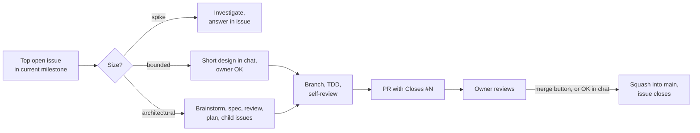

# Project Process

Status: Approved v1, 2026-09-07. Owner: Artur. Author: Claude.
This document is the living description of how the project is run. It is
the deliverable of milestone `M0 Process` and is revised whenever the
process changes.

## 1. Purpose and scope

This document answers three questions: how work is tracked, how a task
travels from an idea to `main`, and what closes an increment of the
product. Product and architecture decisions are out of scope here; they
live in specs and ADRs (see sections 7 and 8).

## 2. Roles

- **Owner (Artur):** sets product direction, reviews specs and pull
  requests, has the final say on every merge.
- **Engineer (Claude):** proposes designs, grooms the backlog, implements
  tasks, opens pull requests, keeps the changelog and documentation
  current.

The engineer never merges into `main` without an explicit go-ahead from
the owner. New issues are created only after agreement in chat, with one
exception: a bug discovered mid-task is filed immediately with the `bug`
label and mentioned in the conversation.

## 3. Repository

- Private repository `maldrakar/todo-app`, default branch `main`.
- `main` is never pushed to directly. The only exception is the
  bootstrap commit that creates the initial structure. GitHub branch
  protection is not available for private repositories on the free plan,
  so this is a process rule, not an enforced one.
- All artifacts in the repository and on GitHub (code, comments, commits,
  issues, docs) are written in English. Conversation happens in Russian.
- Remote operations go through the GitHub CLI (`gh`).

Layout at bootstrap:

```
README.md                 what the project is and how to build it
CHANGELOG.md              Keep a Changelog format, with an Unreleased section
CLAUDE.md                 short digest of this process for the engineer
docs/brief.md             the original project brief
docs/process.md           this document
docs/adr/NNNN-title.md    architecture decision records
docs/specs/<topic>.md     design specs, one per architectural piece of work
docs/plans/<topic>.md     implementation plans derived from approved specs
.github/ISSUE_TEMPLATE/   issue templates
.github/PULL_REQUEST_TEMPLATE.md
.github/workflows/        CI, added together with the first core package
```

## 4. Backlog

The backlog lives in GitHub Issues. Milestones represent product
increments. Specs and ADRs live in the repository.

**Issues.** One task is one issue. The issue template has four fields:
Context, Goal, Acceptance criteria, Out of scope. Priority inside a
milestone is expressed by order, not by a label.

**Labels.** Deliberately minimal; new ones are added when a real need
appears.

| Kind | Labels |
| ---- | ------ |
| Type | `feature`, `bug`, `arch`, `infra`, `docs`, `spike`, `epic` |
| Area | `core`, `ui-apple`, `ui-web` |

**Epics.** A large theme is an issue labeled `epic`. It links to the
spec and the plan, and its child tasks are attached as GitHub sub-issues,
so GitHub shows progress on the parent. `gh` has no flag for sub-issues,
so the link is made through `gh api graphql`; a task list in the epic
body is the fallback if that fails. The epic closes when all children
are closed.

**Milestone versus epic.** They are two different axes. A milestone is a
built-in GitHub entity and answers "in which increment": an issue has at
most one, it carries a progress counter and filters, but no body, no
nesting and no spec. An epic is an ordinary issue and answers "about
what": it groups tasks by theme and holds the links to the spec and
plan. An issue belongs to at most one milestone and at most one epic.
Example: milestone `M1 Core architecture` holds the epic "Storage" with
a spike, ADRs and implementation tasks as children, the epic "Search",
and a standalone `infra` issue "CI workflow" that belongs to no epic.

**Milestones.** Each milestone is one increment and maps to one version
tag (section 9). The initial set follows the brief:

| Milestone | Content |
| --------- | ------- |
| `M0 Process` | This document, repository bootstrap, backlog setup |
| `M1 Core architecture` | Storage, search, sync model, Swift toolchain for all targets |
| `M2 Feature-module architecture` | How a feature module is structured, wired and tested |
| `M3+` | Product functionality, planned after M2 |

## 5. Sizes of work

Every task is classified before work starts, and the classification is
said out loud in chat so the owner can override it.

| Size | When | Produces |
| ---- | ---- | -------- |
| Spike | A feasibility question: "can we", "is it possible" | An answer written into the issue. Any code is throwaway. |
| Bounded | A small change to a flow that already exists in the repo | A short design in chat, the owner's OK, then code |
| Architectural | A new subsystem, a feature module, a change to interfaces others depend on | A spec (section 7), the owner's review, an implementation plan; the issue becomes an epic and the plan's tasks become its sub-issues |

When in doubt, the heavier size is chosen. If hidden complexity shows up
mid-task, the task is upgraded, never downgraded.

An architectural issue is not replaced by a new one. After the plan is
approved, the same issue gets the `epic` label, the plan's tasks are
created as its sub-issues, and the spec and plan PRs reference it.

## 6. Task lifecycle



1. **Pick.** The engineer takes the top open issue of the current
   milestone and classifies it (section 5).
2. **Branch.** `<type>/<issue-number>-<slug>`, for example
   `feature/12-task-repository`. Development is test-first.
3. **Verify.** Before opening a PR: build, tests, and a self-review of the
   diff.
4. **Pull request.** Follows the PR template: what changed, how it was
   verified, `Closes #N`. The title uses Conventional Commits with a
   scope, for example `feat(core): add task repository`. Scopes: `core`,
   `apple`, `web`, `docs`, `infra`, `ci`.
5. **Review and merge.** The owner reviews. Merging happens either by the
   owner in GitHub or by the engineer via `gh pr merge` after an explicit
   OK in chat. Squash merge, one commit per issue, the branch is deleted
   and the issue closes automatically. The squash commit message is the
   PR title, so `main` history reads as a list of Conventional Commits.

**Definition of Done** for a task: acceptance criteria met, tests written
and green, CI green, spec or ADR updated if behavior or architecture
changed, no `TODO` in code without a linked issue.

## 7. Specs and how they are reviewed

A spec has two readers with different needs. The owner needs to make a
decision: what is being built, why this way, where the boundaries are,
what the risks are. The engineer needs to execute: every type, every
interface, every file. A single document written for both drifts to the
engineer's level of detail and becomes hard for the owner to read. So
the two are separated.

**Spec** (`docs/specs/<topic>.md`) is written for the owner.

- Sections: Problem, Goals and non-goals, Chosen approach, Rejected
  alternatives with reasons, Components and data flow (as diagrams),
  Open questions, Risks.
- Length is whatever the topic needs. The bar is readability, not page
  count.
- Types are described when the design genuinely depends on them, for
  example module contracts in the feature-module architecture. Every
  type defined outside the document gets a one-line reminder at its
  first mention, and the spec ends with a glossary of the external types
  it relies on, so the reader never has to recall them from memory.
- Diagrams are Mermaid blocks inside the markdown. GitHub renders them,
  and so does the review page below.

**Review flow.**

1. The engineer publishes the spec as a private Artifact page rendered
   from the markdown: text, tables and diagrams, with comment threads.
2. The owner reads it there and leaves comments in threads.
3. The engineer reads the threads, updates the markdown, republishes the
   page, replies in each thread and resolves it. Every republished page
   opens with a Revision notes block: what changed since the previous
   version and which thread prompted it. The text diff itself lives in
   git, since every revision of the spec is a commit in its PR.
4. Approval is an explicit "approved" from the owner in chat. The spec
   is then merged into `main` through a PR labeled `docs`.

The markdown in the repository is the source of truth. The Artifact is a
rendered view for review and is regenerated from the markdown; HTML is
never committed as a spec.

**Plan** (`docs/plans/<topic>.md`) is written for the engineer and is
derived from the approved spec. It carries the full detail. The owner
reviews only its task breakdown, which becomes the child issues of the
epic.

The spec template will be calibrated after the first real spec in M1.

## 8. Architecture decision records

A decision that constrains future work is recorded as an ADR in
`docs/adr/NNNN-title.md` with Context, Decision and Consequences. An ADR
is proposed through a PR labeled `arch`; merging the PR moves it from
Proposed to Accepted. Superseded ADRs are kept and marked as such.

ADRs appear at two moments:

- **After a spec is approved.** The decisions in it that constrain
  future work are extracted into ADRs, in the same PR as the spec or
  right after it.
- **During implementation**, when an unplanned decision is made that
  would be expensive to reverse.

Example for M1. The toolchain spike ends with ADR-0001 "Build the core
in full Swift on the standard library and FoundationEssentials", which
constrains every module. The spec "Core storage and search" is approved,
and out of it comes ADR-0002 "Persistence is an append-only event log on
top of SQLite", which constrains sync and search. Later, implementation
runs into the size of the web bundle, and ADR-0003 "The search index is
rebuilt on open instead of persisted" records that. Naming a function is
not an ADR; anything a newcomer would ask "why is it this way" about is.

## 9. Closing an increment

A milestone is closed when all of the following hold:

- Every issue in the milestone is closed.
- CI is green on `main`.
- `CHANGELOG.md` moves the Unreleased section into a versioned one.
- `main` is tagged `v0.N.0` and a GitHub Release is created with
  `gh release create`.
- There is something runnable on at least one platform. For M0 that is
  the repository with the process in place; for M1, the core test suite
  and a command-line demo of the core.

Versions are `v0.N.0` with `N` equal to the milestone number until the
first public release.

## 10. Continuous integration

CI appears together with the first core Swift package: build and tests
on a macOS runner for every pull request. Additional targets (WASM,
watchOS) are added as they appear.

Constraint: a private repository on the free plan has 2000 Actions
minutes per month, and macOS runners consume them at a 10x multiplier,
which leaves roughly 200 macOS minutes. CI stays lean. If that becomes
tight, the options are a Linux runner for the WASM target or making the
repository public.

## 11. M0 deliverables

1. Local repository initialized, private GitHub repository created via
   `gh`, bootstrap commit with the layout from section 3.
2. Labels, the four milestones, issue and PR templates.
3. `docs/process.md` (this document), `CLAUDE.md`, `docs/brief.md`.
4. First M1 issues: a spike on the Embedded Swift toolchain for WASM and
   watchOS, and the storage and search architecture discussion.
5. Tag `v0.0.0` and a release, so the increment-closing ritual runs once
   end to end.

## 12. Known gaps

- `main` is protected by convention only (section 3).
- The spec template and review flow are untested until the first M1
  spec; section 7 is expected to change after it.
