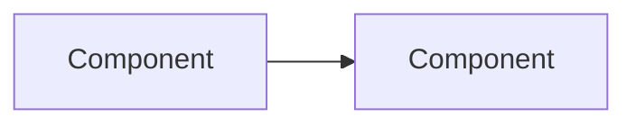

# Spec: Topic

- Status: Draft | Approved
- Owner review: Artifact link
- Issue: #N

Written for the owner. The bar is readability: describe modules and their contracts, and describe types only where the design depends on them. Every type defined outside this document gets a one-line reminder at its first mention and an entry in the glossary.

## Problem

What is missing or wrong today, and who feels it.

## Goals and non-goals

- Goal:
- Non-goal:

## Chosen approach

The design in prose, at the level of modules and responsibilities.

## Rejected alternatives

| Alternative | Why it lost |
| ----------- | ----------- |
|             |             |

## Components and data flow

## Open questions

- 

## Risks

- 

## Glossary of external types

| Type | Defined in | One-line reminder |
| ---- | ---------- | ----------------- |
|      |            |                   |
