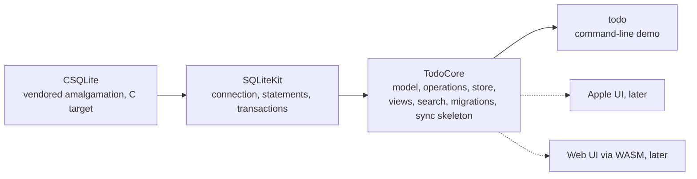
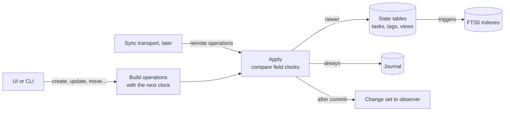
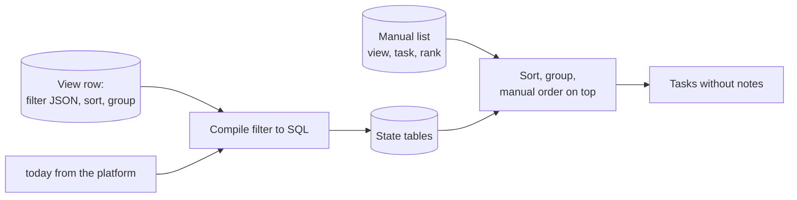
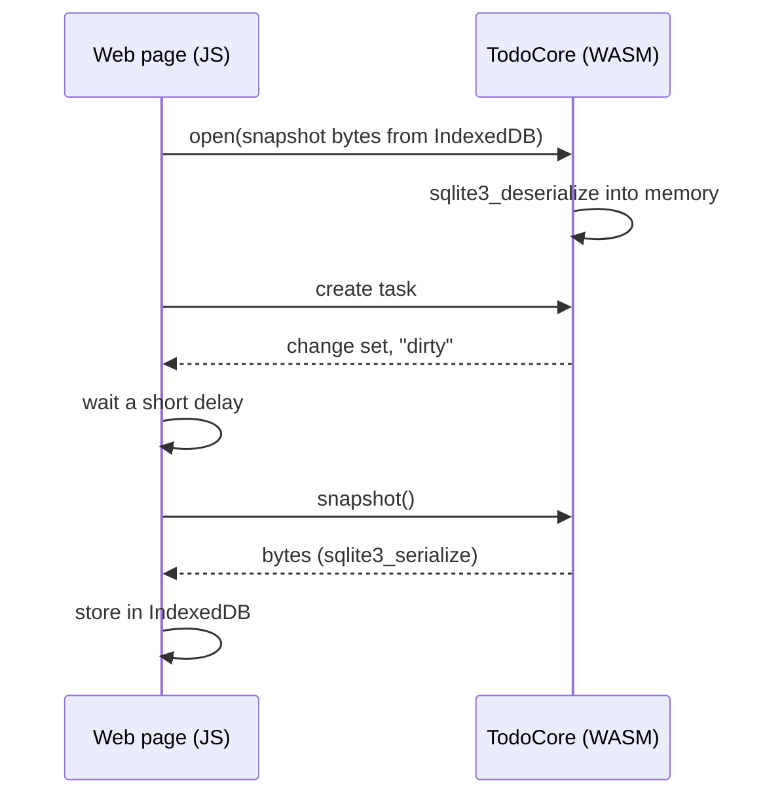

# Spec: Core storage and search

- Status: Approved 2026-09-11
- Owner review: https://claude.ai/code/artifact/91d34f57-8594-4a09-9017-1cc02bf2fb62
- Issue: #4

## Problem

The core has no data layer yet. Before any feature module or UI exists, three questions have to be settled, because every later module depends on the answers and the answers are expensive to change once data sits on users' devices:

1. **How the core stores tasks** on every target: iOS, macOS, iPadOS, watchOS and the web through WASM. ADR-0001 sets the limits: full Swift, standard library and FoundationEssentials only, no ICU, `Int64` for identifiers and timestamps.
2. **How the core searches**: quick find across titles and full-text search in notes, in Russian and English, without ICU.
3. **What the sync model is.** The owner uses several devices. Sync itself arrives later, but the data format must be ready for it from the first version: retrofitting sync into a format that was not designed for it means migrating users' data.

The decisions below were made with the owner in a brainstorming session on 2026-09-09. This document records them for review.

## Goals and non-goals

Goals:

- One storage implementation in Swift that runs unchanged on all five targets, with the same test suite on the host and on wasm32.
- A flat data model: tasks, tags, views. Any grouping the user wants is a saved view with a filter, not a container type.
- Local-first and offline-always. Every change is recorded as an operation that a future sync transport ships to other devices and merges without asking the user.
- Quick find by substring across titles, word-based ranked search in notes, both case- and diacritic-insensitive without ICU.
- Markdown notes of a few megabytes in total do not slow down list queries.
- Schema evolution by migration. Operations received by an older app version are kept and applied after it upgrades.
- A command-line demo as the runnable deliverable of M1.

Non-goals:

- The sync transport itself (own server, CloudKit, WatchConnectivity), journal compaction and tombstone purging. Designed for, not built.
- Repeating tasks, reminder times, notifications. These are M3 product features and arrive by migration.
- Merging concurrent edits inside the text of one note. In M1 the last write wins per field; a real merge is an open question below, not a permanent limitation.
- Undo and redo, attachments, sharing between users, encryption at rest.
- Any UI, and reactive bindings such as Observation or Combine. The core reports what changed; UI layers wrap it.
- The structure of feature modules. That is M2.

## Chosen approach

Five decisions, in the order they were made, then the mechanics that follow from them.

### 1. Sync model: local-first with an operation journal, transport later

The core keeps the current state and a journal of operations. In M1 nothing leaves the device, but the journal is the unit a future transport ships, and the merge rule is implemented and tested now against an in-memory transport. Sync quality comes from the journal and the merge rule, not from the storage engine, so the transport can be anything later.

### 2. Storage engine: SQLite, vendored, the same everywhere

SQLite is compiled into the core from the amalgamation as a C target of the package. It is the only C dependency of the core and its only runtime dependency outside the standard library and FoundationEssentials; it is an amendment to ADR-0001 and gets its own ADR. The system SQLite on Apple platforms is not used: one version and one set of compile flags on every target keep the behaviour and the tests identical on the host and in wasm32.

Why SQLite rather than an in-memory model with a journal file: notes in Markdown can grow to megabytes and should not be loaded to show a list, and full-text search with Unicode folding is built into SQLite (FTS5) without ICU. The cost is about half a megabyte of gzip on the web bundle and a persistence bridge in the browser, described under Persistence.

### 3. Search: FTS5 with trigram for titles and unicode61 for notes

Two full-text indexes, maintained by triggers together with the tables:

| Index | Over | Tokenizer | Behaviour |
| ----- | ---- | --------- | --------- |
| Titles | tasks, tags, views | `trigram` | substring match anywhere in the title, case- and diacritic-insensitive: "отч" finds "Квартальный отчёт" |
| Notes | task notes | `unicode61` with prefix index | word and word-prefix match, ranked by bm25, with a highlighted snippet |

Queries shorter than three characters cannot use the trigram index and fall back to a scan over a folded copy of the titles; thousands of titles make that instant. Both tokenizers are built into SQLite and need no ICU.

What SQLite folds by itself is the Latin ranges, where "ё" is a letter of its own rather than an "е" with a mark, so a person who typed "отчет" did not find "Квартальный отчёт" (#47). The indexes are therefore built over a generated copy of each indexed column in which "ё" is written "е", and a query is folded the same way before it is asked; the copy is computed on read and costs nothing on disk. The snippet a notes search returns is cut out of the original text, so what a person reads back is the spelling they wrote.

### 4. Data model: flat tasks, tags, views

Three entities. The Things container hierarchy (areas, projects, headings) is deliberately absent: the owner finds fixed containers inflexible. Grouping is the user's choice, expressed as a view.

**Task.** Notes are the last column and list queries do not read them, so a large note costs nothing until opened.

| Field | Type | Meaning |
| ----- | ---- | ------- |
| id | UUID | generated on creation |
| title | text | |
| notes | text | Markdown |
| status | open, done, canceled | with the moment of completion |
| when | day or empty | the calendar day the task is scheduled for |
| deadline | day or empty | |
| parent | task id or empty | a project is a task with children; a checklist is the same thing one level down |
| rank | order key | position among siblings |
| tags | set of tag ids | many-to-many |
| trashed | flag | in the Trash, restorable |
| deleted | flag | tombstone for sync; the row stays, nothing shows it |
| created, updated | timestamps | |

**Tag.** Id, title, optional parent tag, rank, deleted, timestamps.

**View.** Id, title, optional parent view, rank, filter, sort, group-by, deleted, timestamps. Views form a tree of any depth: the parent link gives the sidebar its folders, and rank is the position among sibling views, the order in which they appear there. A separate table holds the *manual list* of a view: rows of (view, task, rank) for the tasks the user has dragged inside that view, in the order they were dropped; everything else follows the sort. The built-in views Inbox, Today, Upcoming, Logbook and Trash are ordinary rows with fixed ids, so every device creates the same rows and sync does not duplicate them. The user may edit, nest or delete them.

A view with children is shown as sections: each child view in rank order, then the parent's own results that no child claims. A view without a filter has no results of its own and serves as a folder. Headings come out of the same rule: a heading inside a project view is a child view whose filter is "listed in this view", so it holds exactly the tasks the user dragged under it, in their order. Folders in the sidebar, headings inside a view and any deeper mix of the two are one mechanism.

A *day* is a calendar day stored as a count of days since 1970-01-01. The core converts to and from year-month-day with plain arithmetic and never asks what day it is: the platform passes "today" with every query. Time zones therefore never enter the core. A *timestamp* is milliseconds since 1970-01-01 as `Int64`.

An *order key* is a short string generated between its two neighbours (fractional indexing), so moving one item never renumbers the others, and two devices reordering concurrently produce two valid keys instead of a conflict. Equal keys are broken by id.

Tasks, tags and views each carry an optional parent link, so each forms a tree. A merge can make a link circular when two devices move items into each other concurrently, or point at a parent that was deleted. Such a link is ignored when reading: the item shows at the root until the user moves it again. Nothing is rejected at apply time, because a rejection on one device and not on another would make them diverge.

Two Things concepts were dropped on purpose: the "Someday" bucket and the "This evening" flag. A tag or a view covers both, and adding a bucket later is one migration.

### 5. State is primary, the journal serves sync

The tables above hold the truth for reading. The journal holds the truth for sync. Every change is an *operation*: entity kind, entity id, field, value, clock, device. Creating a task is a batch of operations with one clock; a row appears at the first operation for an unknown id. Moving to the Trash is the operation `trashed = true`; emptying the Trash is `deleted = true`, the tombstone. Set-like data (a task's tags, manual order in a view) are entities keyed by the pair, with the same rule.

The *clock* is a hybrid logical clock: wall-clock milliseconds plus a counter, encoded as one `Int64`, with the device id as tie-break. It is monotonic on a device and orders events across devices once they exchange journals.

**What a device is.** A device is one live replica: one database, opened by one store at a time, writing under one id. The id belongs to the installation and not to the database — the core takes it from the platform at every open and mints none of its own — because nothing inside a database tells the original from a copy. Restoring a backup on a second machine, or reloading the snapshot the web page saved, gives bytes identical to the ones still in use elsewhere, and two live replicas under one id never merge: each drops the other's operations as its own, and a tie on the clock is broken the same way on both sides, so they diverge with nothing to show for it. Copying a database is therefore giving the copy an identity of its own, and that is the one thing the platform owes the core here. What the database itself keeps is the set of ids it has written under: a push sends the rows of every one of them, so a copy still delivers what the machine it came from never managed to send. What arrives is applied whatever id it carries, this device's own included: an identity that outlives its database can outlive its data as well, and a device that kept its identity and lost the database opens empty and takes its whole history back from its peers. Two stores over one database is the case that remains, and the platform does not open one: they would hold two clocks and two change callbacks over one journal, and an edit can lose a tie the other store never saw.

An example with two devices whose wall clocks disagree by five seconds:

| Step | Device A | Device B, wall clock 5 s behind |
| ---- | -------- | ------------------------------- |
| 1 | renames a task; the operation carries the clock (12:00:00.000, counter 0, A) | |
| 2 | | renames the same task at what it believes is 11:59:57.000: clock (11:59:57.000, 0, B) |
| 3 | journals are exchanged | journals are exchanged |
| 4 | B's clock is earlier: A keeps its own title, B's operation stays in the journal unapplied | A's clock is later: B takes A's title, and B's clock jumps forward to 12:00:00.000 |
| 5 | | B's next edit carries (12:00:00.000, 1, B): ordered after everything B has seen, whatever its wall clock says |

Step 5 is the hybrid part: the counter carries causality when wall clocks are wrong. Two operations with the same time and counter can only come from two different devices and are ordered by device id, so every device makes the same choice. Had A and B changed different fields, both changes would have survived, because clocks are compared per field.

**Applying an operation.** For every (entity, field) the store keeps the clock of the last write. An operation applies if its clock is later, otherwise it is dropped from the state but kept in the journal. This is last-write-wins per field: a title changed on one device and a date changed on another both survive. Local edits and remote operations go through the same path, so sync has no logic of its own beyond moving journal rows.

**Unknown fields.** An operation for a field the current schema does not know is stored in the journal marked "not applied". The migration that adds the field replays such operations in clock order. This is why M1 carries no placeholder columns for reminders or repeat rules: they arrive in M3 without loss on devices that lag behind.

**Sync skeleton in M1.** A transport protocol with two actions, "give me operations after this cursor" and "here are operations from elsewhere", and one implementation, in memory, for tests. The test that matters: two stores edit the same task differently, exchange journals, and end in the same state. Without it, "ready for sync" is a promise.

### Filters, sorting, grouping

A filter is a tree stored as JSON in the view row. Conditions: status in a set; `when` and `deadline` relative to today (today, before or after an offset, between two offsets) or empty; has tag; parent equals or is empty; listed in a view's manual list; trashed; combined with and, or, not. The core compiles the tree into one SQL query; "today" comes from the query context. A view's filter implicitly excludes trashed and deleted tasks unless it mentions `trashed`.

Sort keys: `when`, `deadline`, title, created, completed, updated, rank. Group-by: day of `when`, day of `deadline`, tag, parent, status. The sort gives the groups their order — a group appears where the sort put its first task — and the manual list orders the tasks inside a group. Grouping by nothing is one group, which is how an ungrouped view puts its pinned tasks first: one rule and not two, so the flat list of a view is the groups of its own result laid end to end. A page is more than that list when the view has children, since it draws each child as a section and subtracts what the child claimed.

Dragging a task from one group into another is therefore not an operation on the manual list at all: it sets the field the view groups by. A task dropped from the 20th into the 18th has its `when` set to the 18th. The field says which group and not where inside it, and where inside it is the manual list's business: what the core places today is the head or the tail of that list, because ranking after a neighbour needs a neighbour already in it. A drop between two tasks that were never dragged is therefore not one call, and which of the two the product does — drop to the edge of the group, or pin the neighbours the drop lands between — is a question for the interface in M3. That covers the fields the core can set — the `when` day, the deadline day, the parent, and the status, where a drop into "done" completes the task and it leaves a view filtered to open. It is not offered in a view grouped by tag: a task carries a set of tags and is grouped under the smallest of them, so there is no one field a drop could set. The gesture belongs to the UI, over writes the core already has; the core promises only the order above.

An unknown condition kind, which happens when an older app receives a view saved by a newer one, is a typed error "view needs a newer app", never a wrong list.

**Cost.** Compiling a filter is a string build, and the prepared statement is cached per view until the view changes, so nothing is parsed on every list. Execution relies on indexes over status, `when`, `deadline`, parent, the tag table, and the manual-list table, which a grouped read consults in a second statement keyed by the view; at the scale of a personal list, thousands of tasks, a view query takes well under a millisecond. The test suite checks the query plans of the built-in views with `EXPLAIN QUERY PLAN`, so a filter that degrades into a full scan of the tasks table fails a test instead of surprising a user. If a view still turns out slow in practice, the remedies in order are a composite index for that filter shape, then a materialised membership table for that view kept up to date from the change set. Neither is expected in M1.

Default built-in views, to be tuned in M3:

| View | Filter | Sort, group |
| ---- | ------ | ----------- |
| Inbox | open, no `when`, no parent | rank |
| Today | open, `when` on or before today | `when`, so what is overdue comes first |
| Upcoming | open, `when` after today | `when`, grouped by day |
| Logbook | done or canceled | completed, newest first; the UI groups by local day |
| Trash | trashed | updated, newest first |

Every view puts the tasks of its manual list first inside their own group, so this column describes the rest of the list. Grouping by the day of completion happens in the UI, which knows the time zone; the core groups only by the calendar-day fields, `when` and `deadline`, since a completion timestamp becomes a day only in a time zone the core never has.

**Trash and hierarchy.** A task is in the Trash if it is marked itself or any ancestor is. That is computed in the query rather than pushed down to children as operations; otherwise moving a child on one device and trashing its parent on another would conflict.

### Platform boundary

The core does not know the time, the current day, or where the file is. The platform supplies:

- at open: a file path (Apple) or the bytes of the previous snapshot (web);
- with every query: today's day;
- a clock function for journal timestamps, injected so tests control it;
- an observer that receives a change set after every committed transaction.

### Persistence per platform

| Platform | Storage | Notes |
| -------- | ------- | ----- |
| iOS, iPadOS, macOS, watchOS | SQLite file in WAL mode | path from the platform; an App Group container on iOS and watchOS so widgets and extensions can read the same file later; one connection per process |
| Web | SQLite in memory, snapshot to IndexedDB | at open the core restores the database from the bytes the page passes in (`sqlite3_deserialize`); after each transaction the change set doubles as a "dirty" signal, the page asks for a snapshot (`sqlite3_serialize`) after a short delay and stores it; no timers in the core |

The watch has its own database like any other device; exchange with the phone is one of the future sync transports, not a storage special case.

The web scheme loses the last few seconds of edits if the tab dies before the delayed snapshot. A real virtual file system over OPFS is possible later; the core's interface does not change.

### Migrations

The schema version lives in `PRAGMA user_version`. Migrations are an ordered list of steps in Swift, run in one transaction at open. After the schema steps, the store replays journal operations that were not applied because their field was unknown. M1 ships schema version 1.

### Concurrency and API shape

The store is a plain class with a synchronous API and typed errors. It is not thread-safe and uses no Swift concurrency inside; the platform decides how to confine it, an actor or the main thread on Apple, the single thread of the page on the web. This keeps the core's behaviour identical on the host and on wasm32 and independent of how task executors work there.

The API, at the level that matters for review:

- open with a path or a snapshot; snapshot out;
- write: create, update, trash, restore, delete, move, reorder, set tags, for tasks, tags and views; every write becomes operations and goes through apply;
- read: tasks of a view for a given today, one task, its notes, children of a task, tags, views;
- search: quick find over titles, full-text search over notes;
- sync: operations after a cursor, receive operations;
- observe: a change set (which tasks, tags, views were touched) after each commit. UI re-queries the views it shows.

### Testing, CI and the demo

- One swift-testing suite. It runs on the host and, unchanged, on wasm32 under WasmKit. The second run checks 32-bit `Int`, the FoundationEssentials boundary, and that SQLite really builds and works inside wasm.
- CI: build, host tests and wasm tests on a Linux runner; a macOS runner only compiles for the iOS and watchOS SDKs, no tests there. This keeps macOS minutes, which cost tenfold, to a minimum.
- Size budget for the web build after gzip, reported and enforced by CI. The 4.5 MB this document first
  named was an estimate made before the core existed: the floor measured in #3 plus half a megabyte for the
  code the core would add. Measured, that code costs four times the guess, so the table now holds bytes that
  were weighed rather than expected. What CI weighs is `wasm-size-probe`, an executable that calls the public
  API the way a web client will and carries no demo code, since the linker keeps only what a client calls
  (#23):

| Item | Bytes after `gzip -9` |
| ---- | --------------------- |
| Standard library, FoundationEssentials and SQLite, no core code reachable (#3, 2026-09-11) | 3,743,306 |
| The whole public API of the core reachable (`wasm-size-probe`, 2026-09-20) | 6,541,190 |
| Ceiling, CI fails above it (`scripts/wasm-size.sh`) | 6,815,744 |

The ceiling is a regression guard on the core as it stands, not a target to shrink towards. A budget for the
web build proper — the core plus the client's own part, against a real bundle — is set in the milestone that
builds that client. Reaching a number like the original 4.5 MB means going after what the second row added
over the first: the core's own code and the JSON coding it pulls in, whose only user is the filter codec.
SQLite and FoundationEssentials are inside the floor and are not the difference between the two rows.

- The demo is a `todo` command-line tool over a database file: add, list a view, complete, tag, search, move under a parent. It is the runnable deliverable of M1 and a living example of the API for the UI layers. It is also the seed of a future command-line client of the app, for people and for AI agents acting on their behalf, so it uses only the public API of the core and prints output that scripts can consume.

## Rejected alternatives

| Alternative | Why it lost |
| ----------- | ----------- |
| Sync from M1 through an own backend | Server, authentication and protocol multiply the scope; it is a separate system, not the core. The journal makes it possible later without changing the format. |
| CloudKit for Apple, CloudKit JS for the web | Ties the product to Apple IDs and makes the web second-class. Remains possible as one transport over the journal. |
| No sync ever | Simplest storage, but the owner uses several devices, and sync bolted onto a format that ignored it means migrating user data. |
| State in memory, snapshot plus journal in a file, no SQLite | Pure Swift and the smallest web bundle, and enough for thousands of short titles. Lost to Markdown notes: megabytes of text would be loaded for every list, and full-text search with Unicode folding would be hand-written. |
| A repository port with SQLite on Apple and an own format on the web | Two implementations of every query and test, and sync would have to understand both formats. |
| System SQLite on Apple, amalgamation only for the web | Two versions with different flags; the trigram tokenizer with diacritic removal needs a recent build that Apple's library does not guarantee. |
| Things-style containers: areas, projects, headings | Fixed grouping the owner does not want; three levels of manual order to sync. Views give the same lists by filter. |
| Project as a tag | No hierarchy at all, but a project needs its own notes, deadline and completion; a tag has none, and checklists would need a fourth entity. |
| Project as a separate entity | A second table with almost the same fields as a task and its own operations. A task with children covers it. |
| Headings as a fourth entity | A heading is a child view with a manual list; a separate entity would duplicate the ordering and sync rules views already have. |
| Journal as the source of truth, state derived (event sourcing) | Full history and rebuild from scratch, but the journal can never be compacted and every schema change replays the history. A personal task list does not need the history. |
| Own CRDT, including text merging for notes | No library exists under ADR-0001's constraints; writing one is out of proportion for M1. |
| Cascading trash by emitting operations to children | Conflicts with a concurrent move of a child on another device. Computed in the query instead. |

## Components and data flow

Modules of the package and who imports what:

The write path. A local edit and a remote operation enter the same door:

The read path of a view:

Persistence on the web, where the page owns durability:

## Open questions

- **Journal compaction and tombstone purge.** Both need to know that every device has received an operation, which only a transport can tell. Left open until the transport is designed. Growth estimate: about a hundred bytes per operation, so a year of heavy use is tens of megabytes at most.
- **Web durability.** Whether the snapshot scheme stays or a virtual file system over OPFS replaces it is decided by measurement once the web UI exists.
- **Product tuning of built-in views** and whether a "Someday" bucket returns as a field. M3 decisions; the schema accepts either.
- **Merging concurrent edits of one note.** Last write wins in M1, but the losing operation stays in the journal, so nothing is lost at the data level, and a later merge strategy can recover even conflicts that happened before it existed. Candidates, to be chosen together with the transport: keep both versions and let the user pick, a three-way merge by lines as in git, or a text CRDT for notes only.

## Risks

- **FoundationEssentials on WASI is unverified for `UUID` and the current time.** The toolchain spike did not exercise them. The first task of the plan is a smoke test: an empty package with SQLite, `UUID` and a timestamp builds and passes a test on wasm32. If either fails, identifiers come from the platform's random source instead.
- **SQLite as a SwiftPM C target on wasm32 in full Swift mode** was proven by the spike only in embedded mode. Same smoke test.
- **Concurrent edits of one note** on two offline devices: the later one wins in M1. The losing text stays in the journal, and a proper merge is the open question above.
- **The web loses the last seconds before a snapshot** if the tab dies. Accepted; see the open question.
- **Trigram with diacritic removal needs a recent SQLite.** We vendor the current release, so this is under our control, but it rules out the system library for good.
- **CI minutes.** The macOS runner does compile checks only; if the budget still gets tight, the process document already names the fallbacks.

## Decisions to record as ADRs after approval

1. Persistence is vendored SQLite on every platform, an amendment to ADR-0001's dependency rule.
2. Changes are a journal of field-level operations with hybrid logical clocks, merged by last-write-wins per field; state tables are primary, the journal serves sync.
3. The data model is flat: tasks with an optional parent, tags, and views defined by filters and nested to any depth; no container entities.

## Glossary of external types

| Type | Defined in | One-line reminder |
| ---- | ---------- | ----------------- |
| `UUID` | FoundationEssentials | 128-bit random identifier; available on every target under ADR-0001, to be confirmed on WASI by the smoke test |
| `Int64` timestamp | Swift standard library | milliseconds since 1970-01-01; `Int` is 32-bit on wasm32, so the width is explicit |
| FTS5 | SQLite | SQLite's full-text search extension: virtual tables with tokenizers, prefix matching and bm25 ranking |
| `trigram`, `unicode61` | SQLite FTS5 | built-in tokenizers: three-character windows for substring search, and Unicode word splitting with case folding and optional diacritic removal |
| bm25 | SQLite FTS5 | a standard relevance score for ranking full-text matches |
| WAL | SQLite | write-ahead log journal mode; readers do not block the writer and a crash cannot corrupt the file |
| `PRAGMA user_version` | SQLite | an integer stored in the database header, used here as the schema version |
| `sqlite3_serialize`, `sqlite3_deserialize` | SQLite C API | copy a whole database to a byte buffer and back; the web persistence bridge |
| Hybrid logical clock | distributed systems literature | wall-clock time plus a counter; orders events across devices without trusting their clocks to agree |
| Fractional indexing | distributed systems literature | order keys generated between neighbours so inserts and moves never renumber other items |
| App Group | Apple platforms | a shared container that an app and its extensions on the same device can read and write |
| OPFS | Web platform | Origin Private File System, a browser-private file store with synchronous access from workers |
| WasmKit | swift.org toolchain | the WebAssembly runtime bundled with SwiftPM that runs `swift test` for wasm32 |
| swift-testing | swift.org toolchain | the Swift testing library used for the whole suite |
