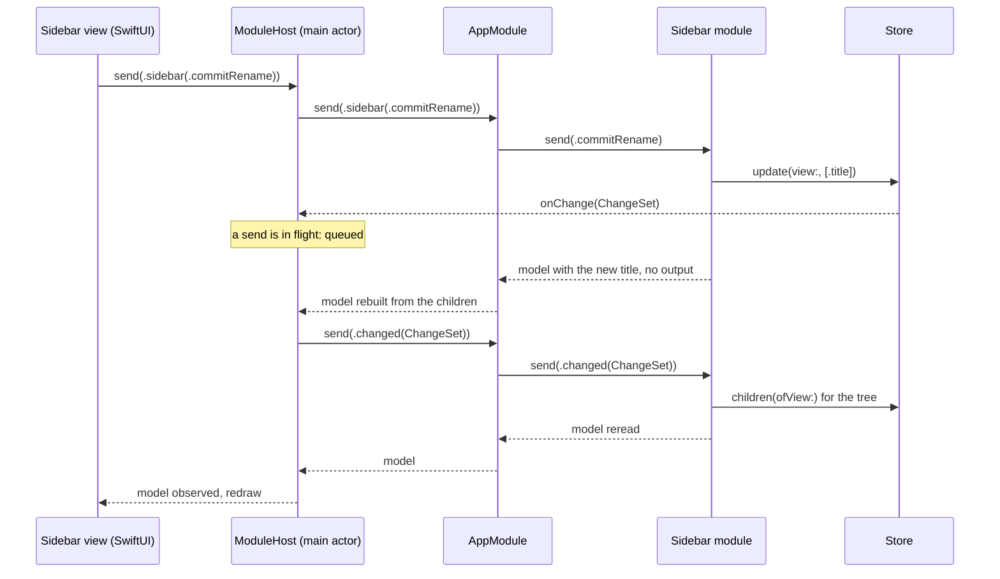

# Spec: Feature-module architecture

- Status: Draft
- Owner review: https://claude.ai/artifact/CnGxEhqK4jDubEmcxgTZJF
- Issue: #63

## Problem

The core exists and nothing puts it on a screen. `M1 Core architecture` shipped a store that keeps tasks, tags and views, answers queries, searches, and reports a `ChangeSet` (the set of ids a committed transaction touched) after every write; it left the structure of feature modules and any UI as non-goals. Before the first product feature, three questions have to be settled, because every feature written afterwards repeats the answers and the answers are expensive to change once a dozen screens exist:

1. **Where the logic of a feature lives.** Once, in the shared Swift core that already builds for iOS, macOS, iPadOS, watchOS and the web, or once per platform, next to each UI.
2. **What crosses the boundary between logic and UI**, in both directions, so that SwiftUI, UIKit where it is needed, and later React draw the same feature without owning any of its decisions.
3. **How modules compose, reach the store and get tested**, and what the runnable deliverable of the milestone is.

A fourth question came with the third: how the Apple app is built and checked, when the core is built by SwiftPM alone and has no Xcode project (ADR-0001).

The decisions below were made with the owner in a brainstorming session on 2026-09-20. This document records them for review.

## Goals and non-goals

Goals:

- The logic of a feature is written once, in Swift, in the shared core, with no UI import, and its tests run on the host and on wasm32 under WasmKit like the core's own.
- Views hold no logic on any platform. A view renders a model it is given and sends events; every decision about what to show is made before the view sees it.
- The contract between a module and its view survives a wire: the model and the events are data, so a React page over wasm can be a view like any other. That readiness is held by a test now, not by a web host.
- One shape of composition: a root module composes child modules, and an app is one tree of modules whose views mirror it.
- A runnable macOS app built by SwiftPM alone, with one real module, the sidebar, so that every path of the contract has been walked once before the second module is written.
- The code builds with Xcode's own toolchain as well as with the pinned swift.org one, so that a store build is possible without a rewrite.

Non-goals:

- The web host, and the format the model takes on the way to JavaScript. JSON, protobuf or something of our own is decided by measurement on a real bundle, together with the web host.
- The UIKit host. Designed for, not built: the contract makes it a second adapter over the same protocol.
- Every module but the sidebar: task lists, the task editor, quick entry, search, settings. Navigation beyond "the sidebar chose a view and the app shows its title".
- The product behaviour of the sidebar beyond what M2 needs to exercise the contract: drag and reorder, collapsing folders, deleting views, task counts, projects in the sidebar.
- Today's day and the change of the calendar day. No module in M2 makes a query by date; the door it will enter through is named below.
- The formatting service and its platform implementations. No module in M2 spells a date or a number; the door is described below and the first list module in M3 builds it.
- Asynchronous effects such as sync over a network, and reactive frameworks in the core (Combine, Observation, a UDF library).
- The Xcode project, signing and App Store distribution; the identity in the Keychain; recovery from a database that fails to open.
- The three gaps between the public API and a web client that the wasm size probe found (#23): `Filter.json()` internal, `JournalOperation` unbuildable without `SQLiteKit`, no public way to get today's `Day`. The sidebar needs none of them; they belong with the web host.

## Chosen approach

Five decisions, in the order they were made, then the sidebar, the changes to the core, and how it is all tested.

### 1. Logic lives in the shared core, as unidirectional data flow

A feature module is a Swift type that holds the state of one feature, answers every event with a new model, and never imports a UI framework. The view on each platform is a function of the model: it draws what the model says and sends an event when the person does something. The module answers with a new model, and the view redraws. The same happens when the world changes: the store reports what a commit touched, the module gets that as an event and answers with a new model. There is no second path.

This is the pattern known as unidirectional data flow, the Elm architecture or MVI, and it is chosen for three reasons. It is the only arrangement in which a feature's tests run on wasm32 before a web page exists, because the tests need a store in memory and a sequence of events and nothing else. It gives the watch, the command line and the web the same feature for free, since a module has no idea what draws it. And it makes "the view holds no logic" a rule that a review can check, because a view that decides anything is a view with an `if` over a domain value, and that is visible in a diff.

Views are therefore deliberately "dumb", in the good sense. What a view keeps is what only it can know: scroll position, focus, hover, the window size, a drag in progress. It does nothing beyond drawing, formatting included: a model carries "Tomorrow" or "Mon 22 Sep" as a finished string, not a `Day` for the view to spell. The core has no ICU (ADR-0001), so the spelling itself cannot live in the shared code; it lives behind a formatting service whose protocol is shared and whose implementation is the platform's, and the module calls it while building the model (section 4). The view then decides nothing at all, and the web page receives strings it can draw without knowing what a day since 1970 is.

### 2. The module contract

One protocol for every module, the root included, because it has exactly one caller: the host in the app target that wraps any module for its UI. The design depends on this contract, so it is spelled out.

```swift
public protocol FeatureModule: AnyObject {
    associatedtype Model: Equatable & Codable & Sendable
    associatedtype Event: Equatable & Codable & Sendable
    associatedtype Output: Equatable & Sendable

    var model: Model { get }
    func send(_ event: Event) -> Output?
}
```

Three types per module, nested so that their names never collide with SwiftUI's or Foundation's (`docs/style.md`, the rule on exported names):

| Type | What it is |
| ---- | ---------- |
| `Model` | A value: exactly what the view draws, with every decision made. Strings, flags, lists of rows with ids so that an event can name a row. Never a `TodoTask` or a `TaskView`, only their reflection for one screen. Dates and numbers already spelled, through the formatting service, so the view and the wire get finished strings. |
| `Event` | An enumeration with associated values, and the one door for everything that reaches the module: a tap, a keystroke, `.changed(ChangeSet)` from the store, later a sync result or the change of the day. |
| `Output` | What the module tells its parent because it cannot do it itself. The sidebar's is `.selected(ViewID)`: showing the list is the app's business. The root's `Output` is `Never`. |

A module is a `final class`, because it has a lifetime and a reference to the `Store` (the core's data layer, one per database), and its state beyond `model` is private. `send` is synchronous and runs on the store's thread: when it returns, `model` is already the new one.

Rules, each with its reason:

- **`send` never throws.** What the store refuses becomes part of the model, and the view shows it. An error thrown outward reaches the view, which would then have to decide something, and it holds no logic.
- **The model is a value returned, not a value pushed.** A module publishes nothing and subscribes to nothing. The store's `onChange` is one closure, so the fan-out of a `ChangeSet` to the modules lives in the composition root, not in the modules.
- **One door.** An event from a person and an event from the world enter the same `send`. A module with two entry points grows logic in both.
- **Local UI state stays in the view**: scroll, focus, hover, the window size, a drag in progress. The draft text in a field is not local: every keystroke is an event and the model carries the text back, which works because the round trip is synchronous.
- **Wire readiness is held by a test, not by a host.** `Model` and `Event` round-trip through JSON in every module's suite. The format for wasm stays open; what the contract requires is only that both are plain data with a stable schema.
- **The view rule**, to be recorded in the ADR and pointed at from `docs/style.md`: a view holds no condition over a domain value and formats nothing. Every `if` in a view is over a `Bool` or an optional of the model, and every string it draws arrives finished.

### 3. Composition: a tree of modules, a tree of views

The root module is a `FeatureModule` like any other. Its `Model` composes the models of its children; its `Event` wraps their events, `.sidebar(Sidebar.Event)`, and carries the events of the world, `.changed(ChangeSet)`. Its `send` hands a wrapped event to the child, takes the child's `Output` and reacts to it, then rebuilds its own model from the children's. In M2 the root holds the sidebar and a placeholder for the detail: the title of the selected view, or nothing.

The tree of views mirrors the tree of modules. The root view receives the root model and a `send` for root events; the sidebar view receives `model.sidebar` and a closure that wraps a sidebar event in `.sidebar`. Nothing else crosses that boundary: no module instance and no store reaches a view.

An `Output` is the one-shot fact "the person chose this", which the parent acts on once. The current data the parent needs, such as the title of the selected view, it reads from the child's model after the send. Both exist because neither covers the other: a selection is state and a "open this task" or "dismiss me" is not.

### 4. Hosting on Apple: one host, the main actor, one event at a time

The host is the only object in the app that a view observes. There is one per app, in the Apple UI target, `@MainActor` and `@Observable`, generic over the protocol: it holds the root module, publishes `model`, and its `send` calls the module and copies the model out, so SwiftUI redraws from observation. A UIKit adapter is a second host over the same protocol, designed for and not built in M2.

**One event at a time.** The chain "send to the root, send to the sidebar, write to the store, `onChange`, send `.changed` to the root" enters the root a second time while the first call has not returned. The host therefore takes one event at a time: an event handed to it while one is in flight is queued and sent after the current one returns. Everything runs on one thread, so this is a flag and an array, not a lock. Without the rule a module sees its own write in the middle of its own update.

**The composition root.** The executable is a `@main` of two lines that opens the scene from the library. The library does the rest, once per launch: the database path in Application Support, the device identity in a file beside the database as the demo does (ADR-0005; the Keychain is a later decision), `Store.open` with `Store.systemNow`, the root module, the host, and `store.onChange` wired to the host's `send(.changed)`. The environment variables the demo reads, `TODO_DB` and `TODO_DEVICE`, are read here too, which is how one machine runs two copies of the app as two devices. A database that fails to open is fatal in M2 and says why; a recovery flow is a product decision for M3.

**The thread.** Everything is on the main actor: the store is opened there, the modules live there, `onChange` fires synchronously inside the write, and the write happens inside a `send` that a view triggered. Modules and the store stay plain classes with no actor annotation, or they stop building the same way for wasm; the host confines them. If a query ever blocks the UI, the remedy is a separate actor that owns the store and the modules while the host receives models across the boundary, which is why `Model` and `Event` are `Sendable` from the start.

**Today.** No module in M2 needs the current day. The door is the same as for everything else: the root takes `today` when it is created and gets `.dayChanged(Day)` when the platform sees the calendar day change. It arrives with the first list module in M3.

**Formatting.** A module spells dates and numbers through a service the platform implements: a protocol in the root package beside `FeatureModule`, with operations of the shape "this day, relative to today, as a string" and "this count of that thing, as a string", whose exact set the first list module fixes. The implementation is the platform's, because the core has no ICU (ADR-0001): Foundation's formatters in `Apps/Apple`, the browser's `Intl` reached through JavaScript in `Apps/Web`, and in tests a fixed stand-in that writes a day as its number, which also makes a model compared whole independent of the machine's locale. The composition root hands the service to the modules at creation, the way it hands them the store and `today`; the service is pure and stateless, since "tomorrow" is computed from the `today` the module already holds. One consequence is named now so that it is not discovered later: a change of the system locale or of the date format is no longer a redraw of the view but an event to the module, `.localeChanged`, after which the model is rebuilt. Not needed by the sidebar, designed here so that M3 does not invent it twice.

### 5. Two packages: shared modules in the root, platform hosts under `Apps/`

Everything that runs everywhere stays in the root package; everything that runs only on Apple platforms moves to a second package, `Apps/Apple/Package.swift`, which depends on the root by a local path. The reason is mechanical: a target that imports SwiftUI builds neither on the Linux job nor for wasm32, and `swift test` builds the whole package, so one Apple target in the root package would break both checks M1 set up. The web host will live beside it, `Apps/Web`, in the same arrangement. swiftly reads `.swift-version` from a parent directory, so `Apps/Apple` builds with the pinned toolchain without a second pin (verified 2026-09-20).

| Package | Target | Holds | Builds for |
| ------- | ------ | ----- | ---------- |
| root | `TodoCore` | the data layer, unchanged | everywhere |
| root | `FeatureModule` | the module protocol and nothing else; the formatting service's protocol joins it in M3 | everywhere |
| root | `SidebarFeature` (`Sources/Features/Sidebar`) | the sidebar module | everywhere |
| root | `AppFeature` (`Sources/Features/App`) | the root module, depends on the children | everywhere |
| root | one test target per feature | swift-testing, run on the host and on wasm32 | everywhere |
| `Apps/Apple` | `TodoAppleUI` | SwiftUI views, the host, the composition root, the scene | Apple |
| `Apps/Apple` | `todo-mac` | `@main`, two lines | macOS |

**One target per feature.** Then `internal` means "inside this feature", a feature cannot reach into a neighbour's internals, and the dependency graph is written in the manifest where a review reads it: children depend on neither each other nor the root. The cost is two targets per feature in the manifest.

**ADR-0001 extends to features.** A feature module imports `TodoCore`, the standard library and FoundationEssentials under the same `canImport` guard, and nothing else. The wasm build in CI is the enforcement, as it is for the core.

**Names** are fixed in the plan, each after a compiler probe against SwiftUI and Foundation (`docs/style.md`). The candidates are `FeatureModule`, `Sidebar`, `AppModule` and `ModuleHost`; the nested `Model`, `Event` and `Output` are always qualified from outside.

**Toolchains.** The Apple app is built by SwiftPM alone in M2: an executable target with a SwiftUI `App` builds and launches without a bundle (verified 2026-09-20 with the pinned 6.3.3, a library holding the `Scene` and a two-line executable). An Xcode project arrives when iOS, watchOS or the store needs a bundle, and it will be a thin shell: an app target with `@main`, Info.plist, assets, entitlements and signing, importing the same library. Apple accepts store builds made with Xcode's toolchain, which in Xcode 26.3 is Swift 6.2.4 against the pinned 6.3.3; the root package builds with it today without a change (verified 2026-09-20), and the macOS job keeps it that way.

### The sidebar in M2

The sidebar does exactly enough to walk every path of the contract once.

| Path | What happens |
| ---- | ------------ |
| Read | The tree of views from the store, flattened into rows with a depth, in `rank` order inside each parent. Flat and not recursive: the walk is iterative (`docs/style.md`), and a chain of a thousand nested folders from sync must neither overflow the stack nor fold a recursive view. The five built-in views are ordinary rows. The Inbox is selected at first. |
| Select | `.select(id)`: the model highlights the row, the output `.selected(id)` goes to the root, and the root shows the title in the detail placeholder. |
| Rename | `.beginRename(id)`, `.draft(text)` on every keystroke, `.commitRename`, `.cancelRename`. The draft lives in the model; this is the synchronous round trip of a text field. An empty title the module refuses by itself, without the store. |
| Create | `.createFolder`: a view without a filter at the root of the tree. One write through the store, so that an event from a person goes the whole way and comes back through a `ChangeSet`. |
| World | `.changed(ChangeSet)` with views in it rereads the tree; with tasks only it does nothing. |
| Refusal | What the store refuses, for example renaming a view a peer has deleted, lands in `model.problem` and the view shows it, until the next event. |

The model, at the level that matters for review: a list of rows, each with the view's id, its title, its depth and whether it is selected; the rename in progress, if any, with the row it is on, the draft and whether the draft can be committed; and the last problem, if any.

The rest of a sidebar, drag and reorder, collapsing, deleting, task counts, projects, is M3 product work over the same contract.

### Changes to the core

Two, both bounded, in the plan as the first task with their first caller: `EntityID` and `ChangeSet` gain `Codable`, because a `Model` carries the ids of its rows and an `Event` carries a `ChangeSet`. The three gaps of #23 are not touched.

### Testing, CI and the deliverable

- **Module tests** run on the host and on wasm32, the way the core's do: a store in memory, a sequence of events, the model compared whole. For the sidebar: the initial model, a selection and its output, the whole rename round trip and its cancellation, an empty title, a new folder, the reread on `.changed` and its absence for other entities, a refusal shown in the model, a chain of a thousand folders, and the JSON round trip of the model and of every event.
- **Root module tests**: forwarding, the reaction to an output, the fan-out of `.changed`.
- **Host tests**, on macOS only, in `Apps/Apple`: a `ChangeSet` that arrives in the middle of a `send` is delivered after it and not inside it. It is the one rule the host holds, and it is checked.
- **Views are not tested.** By the rule there is nothing in them to test.
- **CI.** The Linux job is unchanged and picks the new targets up by itself, the WasmKit run included. The macOS job on `main` adds `swift build` and `swift test` in `Apps/Apple`, and a build of the root package with Xcode's toolchain, `/usr/bin/swift build`, as the guard for store builds; a few of the two hundred monthly minutes. The wasm size probe starts driving the root module, since a web client ships it to the browser with the core; the ceiling is re-measured in the task that does it, as #23 did.
- **The deliverable**: `swift run todo-mac` from `Apps/Apple` opens a window with the sidebar over a real database, and the module behind it has passed its suite on the host and on wasm32.

## Rejected alternatives

| Alternative | Why it lost |
| ----------- | ----------- |
| Logic on the UI side of each platform, a SwiftUI package or a React folder talking to the store | Every feature written, tested and debugged twice, and the watch a third time. Nothing runs on wasm32 before a web page exists. |
| Shared use cases in the core, screen state and navigation per platform | The state of a screen is where the decisions are; the use cases would be thin and the duplication would be where it costs. |
| A pure reducer returning state and effects, the store reached only through effects | Maximum purity and tests without a store, but the store is synchronous and local: every query becomes an effect plus an answering event, and the sidebar needs three rounds to draw. Ceremony for a problem this design does not have. |
| A module that subscribes to the store itself and pushes its model through a callback | A second door for input and an output that is a closure: the model becomes something that may arrive at any time instead of the value a `send` returned, and `Store.onChange` is one closure anyway. |
| The parent reads the child's model instead of receiving outputs | Enough for a selection, which is state, but a one-shot "open this task" or "dismiss" has no state to read, and the parent would have to interpret the child's events, duplicating its logic. |
| A UDF library such as The Composable Architecture | A dependency in the core that has to build for wasm32, a large one, for what is one function per module here. |
| Models made of domain entities handed to the view | The view then decides what a `TaskView` looks like and which tasks are overdue, and it holds logic again. |
| Views spelling dates and numbers in the locale themselves, the model carrying a `Day` | Formatting is a decision the view would own, so the rule stops being literal; the web page would have to know what a day since 1970 is; and the locale would reach the model from two sides. A shared service protocol with a platform implementation keeps the view at drawing. |
| Views observing the store directly, SwiftData-style | No boundary at all: every view queries, every platform re-implements every list, and nothing is testable without a screen. |
| One package holding the Apple targets too | A SwiftUI import in the root package fails on the Linux job and under wasm32, and `swift test` builds every target. |
| One `TodoFeatures` target for every module | The boundary between features would hold by discipline instead of by the manifest. |
| An Xcode project from M2, or iOS first | A second build system in the milestone whose point is the module contract; SwiftPM cannot produce an iOS bundle, so iOS first means the project first. |

## Components and data flow

The packages and who imports what:

```mermaid
flowchart LR
  subgraph root["Root package (builds everywhere)"]
    Core[TodoCore<br/>store, model, journal]
    Proto[FeatureModule<br/>the protocol]
    Sidebar[SidebarFeature<br/>the sidebar module]
    App[AppFeature<br/>the root module]
    Core --> Sidebar
    Proto --> Sidebar
    Proto --> App
    Sidebar --> App
    Core --> App
  end
  subgraph apple["Apps/Apple (Apple only)"]
    UI[TodoAppleUI<br/>views, host, composition root, scene]
    Mac[todo-mac<br/>@main]
    UI --> Mac
  end
  App --> UI
  Proto --> UI
  App -.-> Web[Apps/Web, later]
```

One event, from a click to a redraw. The `ChangeSet` the write produces enters the root only after the first `send` has returned:



The tree of modules and the tree of views that mirrors it:

```mermaid
flowchart TB
  subgraph modules["Modules (root package)"]
    AM[AppModule<br/>Model: sidebar, detail<br/>Event: .sidebar(_), .changed(_)]
    SM[Sidebar<br/>Model: rows, rename, problem<br/>Event: select, rename, createFolder, changed<br/>Output: .selected]
    AM --> SM
  end
  subgraph views["Views (Apps/Apple)"]
    AV[Root view<br/>gets model and send]
    SV[Sidebar view<br/>gets model.sidebar and a send that wraps in .sidebar]
    DV[Detail placeholder<br/>gets model.detail]
    AV --> SV
    AV --> DV
  end
  AM -. model .-> AV
  SV -. events .-> AM
```

## Open questions

- **The wire format for wasm.** JSON, protobuf or an own encoding, and whether a model crosses whole or as a diff. Decided by measurement on a real bundle when the web host is built; the contract asks only for plain data with a stable schema.
- **The cost of a whole-app model per event.** Every `send` rebuilds the root model and SwiftUI diffs the tree. Measured with the first list module, where the model has hundreds of rows; the remedies, if needed, are equatable subviews and a per-page model.
- **A store off the main thread.** Not needed until a query is measured blocking the UI; the design keeps the door open through `Sendable` models.
- **Collapsed folders and other persisted UI state.** Neither local view state nor the core's data. Where it lives, a preferences store on the platform or a field in the model backed by the platform, is decided with the first module that needs it in M3.
- **App Store and swift.org toolchains.** Whether Apple accepts a build made with a swift.org toolchain is checked before the first upload; until then the code builds with both and the store build uses Xcode's.

## Risks

- **A text field over a synchronous round trip.** SwiftUI's `TextField` is written to from the model on every keystroke. It is expected to hold because the update is synchronous, but input methods with uncommitted text (marked text) may fight it; the first task that renders the rename measures it by hand, and the fallback is a local draft in the view committed on every change, with the rule stated as the exception it is.
- **The bare executable and the window.** An app launched from a SwiftPM binary has no bundle: it appears in the Dock with a generic icon and may not take keyboard focus until activated. Verified to build and launch; focus is checked on the real app, and the known remedy is activating the application at launch.
- **Composition happening twice.** A SwiftUI `Scene` or `App` body may be evaluated more than once, and a `@State` initial value is evaluated on every creation of the struct; a composition root written naively opens the store twice over one file, which is exactly the case ADR-0005 forbids. The plan's first Apple task settles how the composition is held once.
- **Swift 6 strict concurrency at the host.** A `@MainActor @Observable` class generic over a protocol holding non-`Sendable` modules has to compile in language mode 6; probed in the first task of the plan before any view is written.
- **A language feature from 6.3 that Xcode's 6.2.4 lacks** breaks the store build silently until someone tries it. The macOS job builds with both from M2 on.
- **Two `.build` directories.** `swift test` in `Apps/Apple` builds the root package's targets again for the Apple package; a full cold build twice on a laptop. Accepted; the Linux job never sees it.

## Decisions to record as ADRs after approval

1. A feature module is a class with a synchronous `send`, a value model, one door for events and an output to its parent, written in the shared core; views hold no logic, format nothing and keep only what is theirs, and a module spells dates and numbers through a service the platform implements.
2. Feature modules are shared code under ADR-0001, one SwiftPM target per feature in the root package; platform hosts are separate packages under `Apps/`.
3. The Apple app is a two-line `@main` over a library, built by SwiftPM alone until iOS, watchOS or the store needs an Xcode project, and the code builds with Xcode's toolchain as well as the pinned one.

## Glossary of external types

| Type | Defined in | One-line reminder |
| ---- | ---------- | ----------------- |
| `Store` | `TodoCore` | the core's data layer: one synchronous, single-threaded class per database, opened with a device id and a clock |
| `ChangeSet` | `TodoCore` | the sets of task, tag and view ids a committed transaction addressed; handed to `Store.onChange` after the commit |
| `EntityID`, `ViewID` | `TodoCore` | a lowercase UUID string naming a task, tag or view; `ViewID` is an alias |
| `TaskView` | `TodoCore` | a view row: title, optional parent, rank, filter, sort, grouping; a view without a filter is a folder |
| `BuiltInTaskViews` | `TodoCore` | the fixed ids of Inbox, Today, Upcoming, Logbook and Trash |
| `StoreError` | `TodoCore` | the typed error every store call throws: SQLite, not found, a view that needs a newer app, an invalid value |
| `Day` | `TodoCore` | a calendar day as a count of days since 1970-01-01; the platform passes today, the core never asks |
| `TodoTask` | `TodoCore` | the task entity: title, notes, status, days, parent, rank, tags, trash and tombstone flags |
| `Filter` | `TodoCore` | the tree of conditions a view is defined by, stored as JSON in the view row |
| `JournalOperation` | `TodoCore` | one field-level change in the journal: entity, field, value, clock, device; the unit a sync transport moves |
| `Codable`, `Equatable`, `Sendable` | Swift standard library | encodable to and from a serial format; comparable for equality; safe to pass across a concurrency boundary |
| `Never` | Swift standard library | the type with no values; an `Output?` of `Never` is always `nil` |
| `@Observable` | Observation, Swift toolchain | the macro that lets SwiftUI redraw from reads of a class's properties |
| `@MainActor` | Swift concurrency | the actor of the main thread; a type marked with it is used from there only |
| `App`, `Scene`, `WindowGroup` | SwiftUI | the entry protocol of a SwiftUI app, a unit of its interface, and the scene that opens windows |
| `TextField` | SwiftUI | the editable text control; marked text is input a keyboard has composed but not committed |
| FoundationInternationalization | swift-foundation | the ICU-backed half of Foundation with locale-aware formatting; outside ADR-0001, so formatting lives on the platforms |
| `Intl` | Web platform | the browser's locale-aware formatting API for dates, numbers and plurals |
| Unidirectional data flow, the Elm architecture, MVI | UI architecture literature | a model rendered by a view, events sent to an update function, a new model; no other path |
| The Composable Architecture | Point-Free, open source | a Swift library for unidirectional data flow with reducers, effects and composition |
| protobuf | Google, open source | a compact binary serialisation with a schema; one candidate for the wasm wire |
| swiftly | swift.org | the toolchain manager that reads `.swift-version` from the working directory or a parent |
| WasmKit | swift.org toolchain | the WebAssembly runtime bundled with SwiftPM that runs `swift test` for wasm32 |
| swift-testing | swift.org toolchain | the Swift testing library used for the whole suite |
