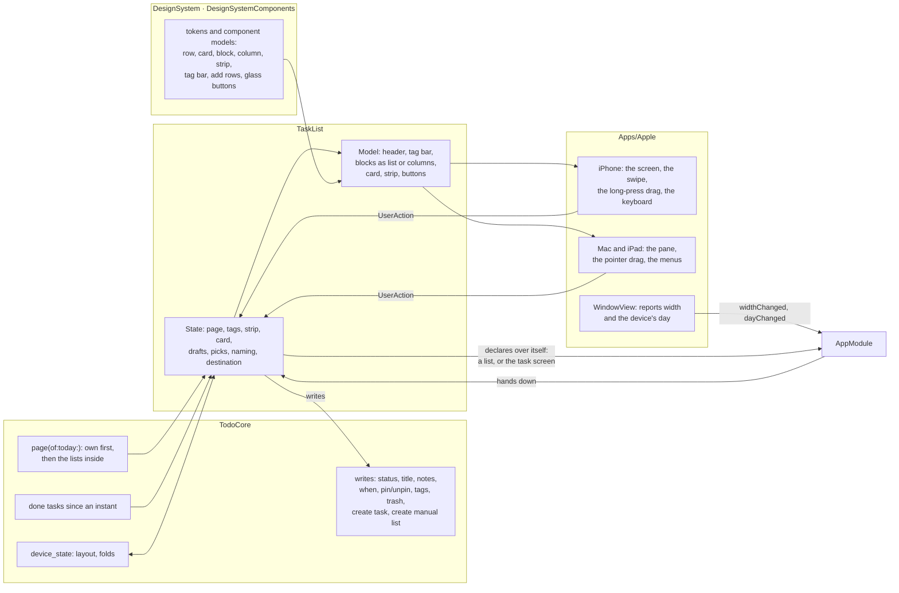

# Spec: The list screen

- Status: Draft, 2026-11-01
- Owner review: to be published
- Issue: to be filed after approval

Written for the owner. The bar is readability: modules and their contracts in prose, types only where the design depends on them. Every type defined outside this document gets a one-line reminder at its first mention and an entry in the glossary at the end. Names in `code` that do not exist yet are working names, settled by a compiler probe in the plan, as the Lists screen spec did.

The look is the canvas "Todo — дизайн", page "List screen" (https://claude.ai/artifact/WWLXn8c4CcV8VKHXwpMqtU#page-413175b0d2f2), which the owner shaped in sixteen rounds of comments on 2026-11-01 and declared finished for the iPhone that day, and which gained five boards from this document's brainstorm the same day: a list with its own tasks and the lists inside it, the same as columns, a new list being named, a row swiped to delete, a row lifted to reorder. This document reads the canvas as its mockup: where the two differ, the canvas is right about the look and this document about the behaviour. The Mac boards of the page predate the brainstorm and are carried over after the owner's review of this document.

## Problem

The list screen is where a person spends their day in the app, and it is still M3's scaffold. `TaskList` (the module of one view's tasks, the screen a tap on a list opens, drawn in the pane beside the sidebar on the Mac and pushed over the Lists screen on a phone) draws the titles of a view's tasks in a plain list, and a tap on one pushes `TaskScreen` (the module of one task), which shows the task's title and nothing else. Nothing can be done on it: a task cannot be completed, added, edited, deleted or moved, the view's groups are not drawn, and a new task comes from quick entry, a sheet over the window that files into the Inbox.

The owner chose this screen as the second piece of M4's product work (2026-11-01): this one screen, redesigned whole, with the functionality the canvas shows, and no other screen in the same epic. Their minute on the finished screen, in their words: create tasks, see them as a list or as columns, add a list, open a list's group as its own screen, complete tasks, give them notes and subtasks, drag tasks between lists, fold a list's group, delete a task, put tasks in the order they want.

## Goals and non-goals

- Goal: the list screen on iPhone, iPad and Mac as the canvas draws it: a list's own tasks first, grouped as the list groups them, then a block for every list inside it; a row with its check, title and meta line; a task opened in place as a card with its title, notes and subtasks editable; completing with the Done strip; adding a task inline from the floating "+" and from "+ Add task" at the end of every block; adding a list from the screen; folding a block and opening it as its own screen; the tag bar that filters; Show as List or Columns, with a card dragged between columns; a row dragged into its place and into another block; a swipe that deletes.
- Goal: a day grouping means the device's own day, and the screen learns when the day changes.
- Goal: every component of the screen is a model in the design system that every platform draws, as the Lists screen's are (ADR-0007, amendment of 2026-10-30), with the tokens the screen needs added to it.
- Non-goal: the list's settings screen: its rule, its sort, its grouping, its colour and icon, what it counts. Grouping is by day and by the lists inside, as the stored views have it today, and nothing on this screen edits a rule (owner, 2026-11-01).
- Non-goal: adding a tag to a list's rule or taking one off it. The owner moved it out of this epic to one of its own (2026-11-01).
- Non-goal: the task's own screen. The card's Open full screen button is drawn and opens the task screen M3 built, pushed as today; the canvas's modal grown from the card is the Task screen page's epic (owner, 2026-11-01).
- Non-goal: editing a task's When, Deadline and tags. The card shows them as pills and the pickers are the Task screen's.
- Non-goal: the new-task flow from the Lists screen. Quick entry stays as M3 built it, opened by the Lists screen's "+" and ⌘N; the owner wants it to become a modal over the Lists screen with a choice of list, Inbox by default, in an epic of its own (2026-11-01).
- Non-goal: search, the "new" badge, the Trash's own actions (restore, empty), the web's and the watch's views.

## Chosen approach

### 1. What the screen is

One scrolling screen for one list. At the top, under the drawn status bar, two Liquid Glass circles float over the content: back at the left, with no title, and "…" at the right, which holds Show as (owner, 2026-11-01). Then the list's tile and title in the rounded face, a subtitle where the list has one (Today's is its date, a day opened from a grouped list reads "This week · Oct 26"), and the tag bar (section 7). Then the blocks (section 2), the empty state when there is nothing to draw, and the Done strip (section 3). At the bottom right floats the accent "+", which adds a task (section 4). Logbook and Trash are lists like any other on this screen, with three differences their rules give them: no "+", no "+ Add task", no Done strip, since nothing is open in either and neither takes a new task.

The screen is the view's tasks as the store reads them for its page, so what a list shows is the store's one answer, drawn: the module decides nothing about which task is in which block that the store did not decide first.

### 2. Blocks: the list's own tasks, then the lists inside it

A list's screen is a sequence of blocks. First come the list's own tasks, the tasks its rule selects that no list inside it claims, grouped as the list groups them: by day for Upcoming, one block with no header for a list that groups by nothing. Then comes one block for every list inside it, in the order of the sidebar, each headed by the list's title in its colour, holding the tasks that list selects as the sidebar counts them, its rule's results, or for a folder the results of the lists inside it, and drawn when it is empty too, so that a list just added has a place to put a task (owner, 2026-11-01: the own tasks first, then the nested blocks). Lists nest to any depth (ADR-0004), and a list inside may have lists inside it and blocks of its own for them; those are drawn on its own screen, opened from its header, and on this screen the list is one block of its tasks, never a block with blocks inside (owner, 2026-11-01: a parent's page draws one block per list inside, its tasks; the blocks inside are seen by opening it). A task a list inside claims is drawn in that list's block and not among the parent's own, which is the page the core already reads for a view (`Store.page(of:today:)`: every child view as a section, an empty one included, then the view's own results that no child claimed, one level deep); what changes in the core is the order, the own section first, since the page is the product's reading of a list and this is the product's order, and the section of a folder inside, which the core reads as empty today and which reads the lists inside the folder from now on, as its count does (`Store.taskCounts(today:)`: a folder counts the union of its lists' rules). A list with no rule, a folder, has no own tasks and draws the blocks of its lists alone; a list with a rule and no lists inside draws its own blocks alone; a grouped list with a list inside it draws its days and then that list.

The canvas's "This week", a list whose rule is a tag and the next seven days, grouped by day, stands for any list with a rule and a grouping. No such list can be made in the app until the settings screen arrives: the store seeds Inbox, Today, Upcoming, Logbook and Trash and nothing else, the Lists screen's "New list" makes a folder and this screen's "+ Add list" a manual list, so Upcoming is the grouped list a person has, and the command line (`todo view create`) the way to make another until then. Whether "This week" becomes a sixth seed is the owner's (section "Open questions").

A block's header is two controls. Its title opens the block as a screen of its own, pushed over this one, with back walking out the way in (owner, 2026-11-01): a list inside opens as itself, the same screen this document describes, on that list, its own tasks first and its own lists as blocks; a day of a grouped list opens as the same list narrowed to that day, titled by the day with the list's name and date under it, with no blocks of the lists inside, no columns and no "+ Add list", and with "+" and "+ Add task" adding to that day. The narrowed list is not a saved view, it is the list's own screen with a day for an argument, and its route carries the day (section 9). The header's chevron folds the block, which the device remembers per list (ADR-0010), as it remembers the sidebar's folded branches. The counts the canvas once drew on headers are gone (owner, 2026-11-01).

### 3. Rows, the card, completing

A row is the round check in the list's colour, the title, and under it the meta line when there is anything to say: the deadline as "Due today", "Due Tue", "Due Oct 30" or "Overdue 2 days", red from the day it is due; the task's tags as "#work"; "2/4" with a list glyph when the task has subtasks, done over all; a note glyph when it has notes. Every text of the meta line arrives finished from the module, as every string a view shows does (`docs/style.md`, "Views").

A tap on a row opens the task in place: the row grows into a card, one open at a time, and the list closes it when another row is tapped, when the screen's background is tapped, or on Esc (owner, 2026-11-01; the closing gestures are the engineer's call, since the canvas closes on a second tap of the title, which the field below takes). The card is the task's title as a field, its notes as a field under it, "Notes" standing in while there are none, its subtasks each with a small check and "Add subtask" after them, which opens an empty row where Return adds the subtask and opens the next and leaving the row adds what was typed, and a row of pills: When, Deadline, and one per tag, drawn and inert in this epic. At the card's top right stands Open full screen, which pushes the task screen M3 built, as a tap on the row did until now. A subtask is a task whose parent is this one, as the core has had it since M1 (`TodoTask.parent`), and its check sets its status; the card reads the task's children when it opens, and the notes with them, since the list's read carries neither. A subtask is drawn in its parent's card and not as a row of the list, unless the list's rule selects it on its own, which the Inbox's rule, tasks at the root, and a manual list's never do. Completing a task leaves its open subtasks open, and completing the last subtask leaves the parent open: the card shows "4/4" and the parent's check is the person's to tap (engineer's call, open to the owner in section "Open questions"). Whether a task has notes, and how many subtasks it has and how many are done, the list's read answers for every task of the page at once, so that the meta line costs no read per row (section 12).

The check completes. The task's status is written done on the tap, and the row's check fills with the canvas's spring, its title strikes through and the row leaves its block as the view's one animation of the write, with no pause in which the module keeps a done task among its rows (engineer's call: a grace period in which the check could be tapped again would be the first timer the host sends a module, and the strip's check is the undo). The Done strip stands under the blocks, "Done today · N" on a capsule with the list's glyph, and opens into the tasks completed today that this screen's page selects when its status conditions are lifted: the list's own rule and the rules of the lists inside it, so that a task completed in a list inside Today, or in a folder's list, is in the folder's strip too, as the folder's count in the sidebar is the union of its lists' (engineer's call, from the builder check). A task done in Today stays visible in Today for the rest of the day, and Logbook keeps the whole history (engineer's call: "today" everywhere, where the canvas wrote "Done" on lists other than Today, since a list's whole history of done tasks is the Logbook's and grows without bound). The strip's own check reopens a task, which leaves the strip and returns to the block the page puts it in. The rows of a list are the open tasks its rule selects that are not in the Trash, which the core's reads already keep out unless a rule asks for them; the tasks its rule selects that are done or cancelled are the strip's; a rule that names only finished statuses, Logbook's, draws them as its rows and has no strip; Trash draws what is in the Trash. A tap on a row of the strip, or of Logbook, opens its card like any row's.

### 4. Adding a task, and adding a list

Adding is inline, with no sheet (owner, 2026-11-01). The floating "+" adds an empty task at the top of the list's first block, with its card open and the caret in its title; "+ Add task" at the end of every block adds one at that block's end the same way. The keyboard rises with the card; Return or leaving the title keeps the title and leaves the card open, Esc closes it, and a task whose card closes with no title is deleted, since it never had anything in it. The task is written to the store at once, so that its card is a card on a task like any other, and its subtasks and notes have a task to belong to (engineer's call; a draft kept in the module until the title exists lost, section "Rejected alternatives").

A new task has to land in the block it was added to, which is to say it has to match the rule of the list that block belongs to, so the module reads the rule for everything a task must carry to match it, one edit per condition: a When condition gives the day nearest today that it allows, today for Today, tomorrow for Upcoming, the block's own day for a day of a grouped list, and no day at all where the rule wants none, the Inbox's; a deadline condition gives a deadline the same way; a tag gives the tag; a manual list, below, takes the task into itself; a negated tag or manual list gives a new task nothing, since it has neither; a conjunction gives each of its conditions; and the tags picked in the tag bar are added too (engineer's call). A rule the module cannot read as edits to one task, a rule of alternatives, since none of them is the one meant, or a condition no edit satisfies, a status other than open, a parent, the Trash, has no "+ Add task" on its block; a list whose own rule reads so has no floating "+" either, which is how Logbook and Trash have none. No list the app seeds or makes has a rule of alternatives; the command line can make one. A list with no rule hands its "+" to its first list, as the canvas has it, and its block on its parent's screen hands its "+ Add task" the same way; a folder with no lists has neither. The same reading of a rule decides what a drop into a block does (section 6).

"+ Add list" stands after the last block in list mode and as a dashed column at the end of the board in columns mode (owner, 2026-11-01). It adds a list inside this one, last among its lists, with the parent's colour and the `list` icon, titled "New list" with its name field open in its header, Return or leaving the field keeping what was typed and an empty name keeping the old one, as a rename on the Lists screen does. The new list is a manual list (owner, 2026-11-01): a view whose rule is "listed in this view", the mechanism M1 built for a project's headings (`Filter.listedIn`, `Store.pin(task:in:at:)`), so a task is in it because it was added there or dragged into it and in no other way, and it leaves when it is dragged out. It is an ordinary list everywhere else: the Lists screen draws it under its parent with its tile and count, it opens from the sidebar, it is renamed, moved and deleted like any list. The core gains a way to make a view whose rule names its own id, which `createView` cannot today, since the id is minted inside it (working name `Store.createManualList(title:parent:)`, settled in the plan).

### 5. Columns

"…" opens Show as, with List and Columns, and the choice is the list's on this device (engineer's call: the layout is how a person reads a list on a given screen and not a property of the list, so a phone may show columns where a Mac shows a list; kept per device like the folds, ADR-0010). Columns show the list's blocks side by side, the own blocks first and then the lists inside, each column headed as a block is, its title opening the block as a screen; a block folded in list mode is a column like any other, since columns do not fold. The board scrolls sideways, snapping to a column on the phone and freely on the Mac, and each column scrolls its own cards; the tag bar filters the cards as it filters the rows. A list with one block and no grouping has no columns to show, and Show as says so under a disabled Columns, pointing at the list's settings (canvas). Every column ends with "+ Add task", and the board with "+ Add list".

### 6. Moving a task: into its place, and into another block

A task is dragged. On iPhone and iPad a long press lifts the row, or the card, and it follows the finger; on the Mac the pointer drags it (owner, 2026-11-01). While it is lifted the place it would land is drawn as a line with a dot in the list's colour between two rows, or a tinted column.

Let go inside its own block, the task takes that place, and keeps it: the order of a block is the manual order the core keeps per view (`Store.pin(task:in:at:)`, whose pinned tasks come first in every group of the view in their manual order, before the tasks the sort orders), so the drop pins the task at its place in the manual list of the view the block belongs to, the list's own for its own blocks and the list inside for its block. A task dropped below the pinned tasks, among the ones the sort ordered, would otherwise jump to the end of the pinned ones; so the drop pins the tasks above it that were not pinned yet too, in the order they stood, in one transaction, and the task lands exactly where it was let go (engineer's call). In a day block of a grouped list, the manual list is the list's own and the order is kept within the day, which is how the core applies a manual list to a group.

Let go in another block, or another column, the task takes everything that block's rule asks of a task, so that it lands there and stays, and leaves what the other blocks of the screen gave it, as a card dropped on a kanban column does (owner, 2026-11-01: a task dragged into a block takes every parameter the block sets for its tasks). What a rule asks is what section 4 reads out of it for a new task, one edit per condition: a When condition asks for a day, the block's own for a day block and the day nearest today the rule allows otherwise, or for no day where the rule wants none; a deadline condition the same for the deadline; a manual list asks to be pinned in it; a tag asks for the tag; a negated tag or manual list asks for it to be taken off; a conjunction asks for each of its conditions, so a day block of "This week" asks for its day and the tag; a folder asks what its first list asks, as its "+ Add task" does (engineer's calls, revisions 2 and 3: the drop asks exactly what adding asks). The one block that takes no drop is one whose rule the module cannot read as edits to one task, a rule of alternatives or a condition no edit satisfies (section 4), which no list the app makes has today; there the slot is not drawn and the column does not tint. And since the screen's blocks are the list's own and the lists inside it, a task that lands in one leaves the others: dropped into a list inside, it leaves the sibling lists' manual lists and the tags their rules ask for; dropped into one of the list's own blocks, it leaves every list inside, so that it returns to the parent's own (the builder check's reading, written down):

| The block it is dropped into | What the task gets | What it leaves |
| ---------------------------- | ------------------ | -------------- |
| a day block of the list's own | that day as its When, and the rest of what the list's rule asks, the tag for "This week" | the lists inside: their manual lists and their tags |
| the list's own block with no grouping, in a list with lists inside | what the list's rule asks: pinned in a manual list, its tags for a rule of tags, the nearest day for a day rule, nothing for a rule the task matches already | the lists inside, as above |
| a manual list inside this one | pinned into that list, last | the sibling lists' manual lists and tags |
| a list inside this one whose rule is a tag, or tags | the tag, or the tags | the sibling lists' manual lists and tags |
| a folder inside this one | what its first list asks | the sibling lists' manual lists and tags |
| a list inside this one whose rule cannot be read as edits to one task: alternatives, or a condition no edit satisfies | no drop | |

Each is a handful of the core's writes, `update(task:)` for the day, `pin` and `unpin` for the manual lists, `add(tag:to:)` and `remove(tag:from:)` for the tags; the plan measures whether the rereads between them show and gives the core one call for the set if they do. A drop that lands the task in the same block it came from is a reorder, above.

Deleting is a swipe. A row swiped to the left slides off a red Delete, which puts the task in the Trash (`Store.trash(task:)`), with no confirmation, since the Trash gives it back; on the Mac the row's right-click menu holds Delete (owner, 2026-11-01). The row leaves as a completed one does. A task in the Trash has no swipe and no menu in this epic.

### 7. The tag bar

Under the title scrolls a row of tag chips: the tags the list's open tasks carry, the most used first and ties by name, and a tag every one of them carries left out, since it would filter nothing. A tap lights a chip and the screen shows only the tasks that carry it, in the rows, the blocks, the columns and the strip alike; several lit show a task carrying any of them; the picks are session state and are forgotten when the list is left (owner's canvas rule of 2026-11-01, the rest the engineer's calls there, not objected to). The chips are drawn in the list's colour when lit. Nothing on the bar edits the list's rule (section "Goals and non-goals").

### 8. Today is the device's day

Every day the screen draws, Today's rows, the days of This week, "Due Tue", "Done today", is the device's own calendar day, and until now the modules took the UTC day from the machine's clock (`TaskList`, `TaskViewList`), a day off for the hours in which the two differ. The core has no time zone by design (ADR-0001), so the platform, which has one, hands the day in: the window's view reports the device's day and the instant it began, as it reports the window's width (ADR-0006, amendment of 2026-10-22), through the host's entrance for events of the world, at the window's start and again when the day changes, at midnight, when the time zone changes, or when the app wakes on another day. The root hands it to every screen of its stack as an event of the world, like the width, and a screen rereads what depends on it: the list its page and its strip, the sidebar its counts. The module formats a day for the screen from the core's `Day` (a calendar day with no time zone), "Saturday, October 24", "Mon, Oct 26", "Tomorrow", with English names, as the rest of the screen's copy is English (engineer's call, in the module, since no other module formats a day yet).

### 9. The module

`TaskList` stays the module, the screen the sidebar declares over itself and the task screen's opener. Its head gains the day a narrowed list is on, its tail becomes what it declares over itself, and its model, its actions and its state grow into the screen above. A sketch, not compiled:

```swift
public struct Route: RouteValue {
    public struct Head: Equatable, Sendable {
        public let view: ViewID
        public let day: Day?           // nil for the list itself, a day for the list narrowed to it
    }
    public enum Over: RouteValue {    // what the list declares over itself
        case task(TaskScreen.Route)   // Open full screen
        case list(TaskList.Route)     // a block opened as a screen: a list inside, or a day
    }
    public let head: Head
    public let over: Over?
}

public struct Model: Equatable, Sendable {
    public let header: ListHeaderModel          // tile, title, subtitle
    public let tagBar: TagBarModel<UserAction>?  // nil when no chip would show
    public let layout: Layout                    // .list(blocks) or .columns(blocks): one shape, two layouts
    public let openTask: TaskID?                 // the card, read beside its row
    public let done: DoneStripModel<UserAction>? // nil for Logbook, Trash and a day with nothing done
    public let addTask: ButtonModel<UserAction>? // the floating "+", nil where no task can be added
    public let addList: ButtonModel<UserAction>? // "+ Add list", nil in a narrowed day and in Logbook and Trash
    public let showAs: MenuModel<UserAction>
    public let empty: EmptyStateModel?
    public let problem: String?
}
```

In the window's text form the list is `view/<id>`, then `day/<yyyy-mm-dd>` when it is narrowed, then either `view/…` for a list opened over it or `task/<id>` for the task screen, so that `view/a/view/b/task/t` is list b open over list a with task t over it, and `view/a/day/2026-10-26` is list a's Monday; the words are the list's own and the task screen's, which the list's route already knows. The sidebar's highlight stays on the list it declared, the base of the chain, while a list inside is open over it (engineer's call: the chain is the pane's history, and the sidebar lights what it opened). A link to a task keeps M3's meaning, the task screen pushed over its list; the card is not in the route, since it is a row grown and not a screen, and a relaunch opens the list with no card, which is accepted (engineer's call, revisited with the Task screen epic that makes the task a modal).

The blocks are the list's model of the page: each a header, its rows, its "+ Add task", whether it is folded, what a drop into it does, and the day or the list it opens as; a row is the model of the row component with its check, title, meta and the actions its gestures send; the open task's card is one more model beside its row. The actions are named for the control and the gesture (`docs/style.md`): `rowTapped`, `checkTapped`, `cardBackgroundTapped`, `titleFieldChanged` and its three ends, `notesFieldChanged` and its ends, `subtaskCheckTapped`, `addSubtaskTapped` and the subtask field's four, `openFullScreenTapped`, `addTaskButtonTapped`, `addTaskRowTapped(in: block)`, `addListTapped`, the list name field's four, `blockTitleTapped`, `blockChevronTapped`, `tagChipTapped`, `showAsChosen(Layout.Kind)`, `rowDropped(TaskID, in: block, after: TaskID?)`, `deleteSwiped(TaskID)` and `deleteMenuItemChosen(TaskID)` for the Mac. Its outputs stay `closeRequested`; a list opened over this one answers the same way and is dropped with it.

What the module keeps between events, beside the destination: the page as last read, the tags' titles, the strip's tasks, the open card and its draft fields, the subtask draft, the picked tags, the list being named, and the sentence. On this device, through the store and outside the journal (ADR-0010): the folded blocks of this list and its layout, under keys of the module's own, read when the module is made and written on each change. The card, the drafts and the picks are session state a relaunch loses (ADR-0009, amendment of 2026-10-25).

### 10. The Mac and the iPad

On the Mac the screen is the detail pane beside the sidebar, drawn by the same module from the same models, with the canvas's Mac boards as its look: the glass circles over the content hold a back button only once a block was opened as a screen, since the sidebar is the base, and at the right a glass capsule with "+" and "…"; one click opens a task in place, and the card's Open full screen pushes the task screen in the pane as today; a row's right-click menu holds Delete; the pointer drags a row, a card and a column's cards, with the same line-and-dot slot; columns scroll freely sideways with no snap; the Done strip, the tag bar and the empty state are the phone's. The sidebar's "+ › New task" and ⌘N open quick entry as today, which files into the Inbox; the screen's own "+" adds inline into the open list. The iPad is the Mac's layout with the phone's gestures: a long press lifts, a swipe deletes, the keyboard rises for the card (owner's rule from the Lists screen, 2026-10-25). An iPhone whose window is wide gets the wide layout, as the Lists screen does, since the module decides the layout from the width the view reports.

### 11. The design system

Everything the screen draws is a component with a model in `DesignSystemComponents` (the root target of the components' models and logic, which every platform draws and which depends on the design system alone), built by the module for the width it is drawn at, as the Lists screen's rows, bar and dialogs are (ADR-0007, amendment of 2026-10-30): the screen header with its tile and subtitle; the tag bar and its chips; the block header with its title, date, fold chevron and name field; the task row with its check, title, meta line, swipe action and slot; the card with its fields, subtask rows, add row and pills; the column; the Done strip; the add rows ("+ Add task", "+ Add list"); the floating button; the glass buttons; the empty state. The Show as menu is `MenuModel`, the fields `TextFieldModel`, the buttons `ButtonModel`, all three the Lists screen's. `DesignSystem` (the root target of the look's decisions in numbers, depending on nothing) gains what the canvas uses here and the Lists screen did not: the check's colours per list colour, its ring, fill and check mark drawn from the same bases as the tile's by the canvas's rule; the glass surface and its line; the red for a deadline due; the fresh highlight of a row just landed; the type of the screen title, the block title, the meta line and the pills; the motions of the check, the row leaving, the card opening and the drop; and the icons the screen draws: the flag, the hash, the note, the list, the expand arrows, the columns, the plus, the chevrons and the ellipsis, some of which the Lists screen's chrome already has. `TodoAppleUI` gains a view per component, and the Lists screen's views are untouched.

### 12. What changes where

| Where | Today | After |
| ----- | ----- | ----- |
| `TodoCore`, the page | child sections first, then the own; tasks with no notes flag and no subtask counts | the own section first, and a folder's section reading the lists inside it; `hasNotes` and the counts of subtasks, done over all, per task in one read; the done tasks of a page, its rules with their status lifted, completed since an instant; the manual list of a view set in one transaction; a view whose rule lists itself made in one call |
| `TodoCore`, the day | `Day` as a count of days | the weekday of a day; nothing else, the names are the module's |
| `FeatureModule` | `WindowWidth` as the event of the world a view reports | the device's day beside it, as the root hands it down |
| `TaskList` | titles in a list; a tap pushes the task | sections 1 to 9: the page as blocks and columns, the card, completing and the strip, adding a task and a list, the tag bar, the drag and the drop, the swipe, the day; a head with a day and a tail of two cases; the layout and the folds per device |
| `TaskScreen` | the title | untouched: it is what Open full screen opens |
| `TaskViewList` | highlights `route.list?.head`; counts by the UTC day | highlights the list's view; counts by the device's day |
| `AppModule` | hands the width down | hands the day down too; its stack's enum of screens unchanged, since a list over a list is one more element of a kind it has |
| `QuickEntry` | the sheet over the window | untouched |
| `DesignSystem`, `DesignSystemComponents` | the Lists screen's tokens and components | section 11 |
| `Apps/Apple`, `TodoAppleUI` | `TaskListView`: a `List` of titles | the screen on iPhone with the gestures, the keyboard and the swipe; the pane on the Mac with the pointer's drag and the menus; the iPad as the Mac with the phone's gestures; the day and its change reported by the window's view |
| docs | | this spec; amendments to ADR-0004, ADR-0006 and ADR-0009 and ADR-0010; `CHANGELOG.md` |

### Testing, CI and the deliverable

The module's tests run on the host and on wasm32, as every feature's do: the blocks of a list with own tasks and lists inside, of a list whose lists have lists of their own, one block each, of a folder, of a grouped list and of a narrowed day; the rows' meta texts and the day formats; the card's fields and subtasks; completing and the strip; where "+" and "+ Add task" put a task and what it carries; "+ Add list" and the manual list; the tag bar's chips and filter; the layout and the folds written and read back by a module made anew; a drop in each row of the table in section 6 and the refusals; the pins a reorder writes; the swipe; the routes read and written, a list over a list and a day among them; the day's change rereading the page. The core's tests cover the page's new order and a folder's section, the notes flag and the subtask counts, the done read, the manual list set in one transaction, the self-listing view, the weekday. The Apple package builds for every platform as today, and the screen is checked by hand on an iPhone simulator, an iPad simulator and the Mac, with screenshots in the pull request, as the Lists screen's were. CI does not change; the wasm size budget is re-measured, as in every epic.

The deliverable is the list screen on iPhone, iPad and Mac as the canvas draws it, in the two layouts, with the tasks of the store behind every row.

## Rejected alternatives

| Alternative | Why it lost |
| ----------- | ----------- |
| A new list made on this screen is a list with no rule, as the Lists screen's "New list" is | On this screen it would be empty for ever: a list with no rule selects nothing and takes nothing. The owner chose the manual list (2026-11-01). |
| A tap on a task pushes its screen, as M3 has it | The owner wants the task to open in place, with the full screen a button away (2026-11-01). |
| The card is a screen declared in the list's slot | A card is a row grown; it has the list's subject and no address of its own, and a slot holding it would close the task screen beside it on the Mac. It is state, as a dialog is (ADR-0009, amendment of 2026-10-25). |
| A draft task kept in the module until its title exists, written to the store then | Its subtasks, notes and pills would need a task that does not exist yet, and the module would hold a second kind of task beside the store's. Writing at once costs an empty task a peer may glimpse and one a crash may leave behind, which is accepted. |
| "Done · N" with the whole history of a list's done tasks, as the canvas wrote on lists other than Today | A list's history grows without bound and is the Logbook's; the strip is about today. |
| A reorder that pins the dragged task alone | The core puts pinned tasks first in a group, so a task dropped among the unpinned ones would jump above them; pinning the ones above it too keeps the place the person chose. |
| The layout as a field of the view, synced | A phone may want columns where a Mac wants a list; the layout is how a device shows the list, not what the list is. |
| A drop into a block with any rule at all, the task edited until it matches | A rule of alternatives has no one edit that is the one meant, and a status, a parent or the Trash is not what a drop means; every other rule is read as edits and takes the drop, and these few refuse it visibly. |
| Delete with a confirmation, as a list's delete has | A task goes to the Trash and comes back; a list's delete is final for its lists. |
| Quick entry retired, every new task inline | The Lists screen's "+" has no list open to add to; the owner wants a modal there with a choice of list, in an epic of its own (2026-11-01). |
| The day computed in the core from the clock and a time zone handed to it | The core has no calendar by design (ADR-0001), and a day's change is an event, not a value: the platform knows both. |
| A narrowed day as a saved view | Nothing of a saved view's is wanted: it is the list, narrowed, for as long as it is open. |
| A list inside drawn with the blocks of its own lists inside it, to any depth | The owner keeps a parent's page one level deep (2026-11-01): a list inside is one block of its tasks, and its blocks are its own screen's, a tap on its header away. A page read to any depth would grow with the tree and indent a phone's rows away. |

## Components and data flow



## Open questions

The owner answered the brainstorm's questions on 2026-11-01: the own tasks come first and then the lists inside; a new list made here is a manual list; "+ Add list" is the last row and the last column; a task is deleted by a swipe and the Mac's menu with no confirmation; a task is reordered by a long press and the pointer; the layout, the strip, the drop rules and the device's day are the engineer's calls as written above. Two questions the builder check raised are the owner's:

1. **Does "This week" become a sixth built-in?** The canvas draws it as the grouped list with a rule, and nothing in the app can make such a list until the settings screen (section 2). As a seed it is a fixed id every store starts with, like the five, a core and sync change and a row in every sidebar; without it, Upcoming is the grouped list the app has, and the canvas's board is a picture of what the settings screen will make. The engineer's recommendation: no sixth seed in this epic, Upcoming carries the grouping, and the plan's hand check makes a "This week" through the command line to exercise the day blocks.
2. **Does completing cascade between a task and its subtasks?** Section 3 says it does not, either way: a completed task's open subtasks stay open, and the last subtask completed leaves the parent open with "4/4". Things does the same for a to-do's checklist. The other answers are a loop of writes in one transaction and a product rule the owner may want.

## Risks

- **Three drags on one screen.** A long press that lifts a row in a vertical list, a card dragged across a board that scrolls sideways, and the drop between them, on iPhone and iPad with SwiftUI: the Lists screen's spike (#145) settled one long-press recognizer on the scroll view for a tree, and the plan opens with a spike that carries it to rows, cards and columns. The fallback is the drag within a block and between columns alone, with the drop between blocks in list mode left out, and the owner decides whether that ships.
- **The card inside a scrolling list.** A field, a growing notes field and the keyboard inside a row of a scroll view, kept in view while typing: checked by hand early in the plan.
- **A drop is several writes.** A task moved between tag lists writes two or three operations, each a change set that rereads the page; the plan measures and the core gains a batched write if the rereads show.
- **The device's day.** A new event of the world through the host, the root and the stack, and a module whose "today" moves under it: the plan's probe is the day's change at midnight and after a time zone change on the simulator.
- **The page's cost.** The read now carries a notes flag and subtask counts per task, and the tags' titles; measured in a release build at 50,000 tasks as the counts were (#153), with the remedy of a narrower read for the rows a screen can show.
- **Two routes of one kind in a chain.** A list over a list is the first time the stack holds two screens of one kind; the stack was built for it and never exercised; its tests cover it in the plan.
- **An empty task left behind.** A crash between "+" and the first letter leaves a task with no title, drawn as "New task" in its row; a person deletes it with a swipe. Accepted.
- **The wasm size budget**, re-measured as in every epic.

## Decisions to record as ADRs after approval

1. An amendment to ADR-0009: a list may declare a list over itself, a list inside it or itself narrowed to a day, whose route carries the day; the same kind of screen stands twice in a stack; a task opened in place is the list's state and not a screen, and the task screen is still what the list's `task/<id>` tail means.
2. An amendment to ADR-0004: a list made inside a list on the list screen is a manual list, a view whose rule lists itself, which the core makes in one call; a task is in it by being put there.
3. An amendment to ADR-0006: the device's calendar day and its change are events of the world the view reports through the host, as the width is; the core computes no "today".
4. An amendment to ADR-0010: a list's layout and its folded blocks are the device's own state, under keys of the list's module.

## Glossary of external types

| Type | Defined in | One-line reminder |
| ---- | ---------- | ----------------- |
| `Store` | `TodoCore` | the core's data layer: one synchronous, single-threaded class per database; `onChange` is called after a transaction commits |
| `TaskView` | `TodoCore` | a view row as read: title, parent, rank, kind, colour, icon, filter, sort, grouping |
| `TodoTask`, `NewTask`, `TaskChange` | `TodoCore` | a task as read, its `parent` the subtask link and `trashed` effective from the tree; what a caller knows before it exists; one field set to one value |
| `Filter`, `Filter.listedIn` | `TodoCore` | the tree of conditions a view is defined by; the condition that selects the tasks pinned in a view, the heading mechanism |
| `TaskViewPage` | `TodoCore` | what one opened view shows, one level deep: its sections, a child view's or its own, each in groups by the view's grouping |
| `GroupBy`, `GroupKey` | `TodoCore` | how a view groups its results, by day, tag, parent or status; the key of one group |
| `Store.pin(task:in:at:)`, `unpin`, `manualList(of:)` | `TodoCore` | a view's manual list: pinned tasks come first in every group of the view, in their order |
| `Store.trash(task:)`, `delete(task:)` | `TodoCore` | puts a task in the Trash, from which `restore` brings it back; tombstones it for good |
| `Day` | `TodoCore` | a calendar day as a count of days since 1970-01-01, printed `YYYY-MM-DD`; the platform passes today, the core never asks |
| `Placement` | `TodoCore` | where a new or moved item ranks among its siblings: first, last, or after a given one |
| `ChangeSet` | `TodoCore` | the sets of task, tag and view ids a committed transaction addressed, handed to every module as `.changed` |
| `Store.deviceState(_:as:)`, `setDeviceState(_:_:)` | `TodoCore` | a device's own UI state as JSON of a `Codable` type, outside the journal (ADR-0010) |
| `ViewID`, `TaskID`, `TagID` | `TodoCore` | a lowercase UUID string naming a view, a task or a tag |
| `TaskList` | `TaskListFeature` target | the tasks of one view, the screen a tap on a list opens: this document's module |
| `TaskScreen` | `TaskScreenFeature` target | one task on a screen of its own, its title and nothing else yet; what Open full screen opens |
| `TaskViewList` | `TaskViewListFeature` target | the list of views a person keeps: the base of the window's stack, a sidebar on the Mac and the iPad, a screen on a phone |
| `QuickEntry` | `QuickEntryFeature` target | the modal that creates a task from a typed title, opened by the window's root; untouched here |
| `AppModule` | `AppFeature` target | the root of a window's modules, the owner of its stack, which hands the width and now the day down |
| `Destination`, `ScreenStack`, `WindowWidth` | `FeatureModule` target | what a screen declares open over it; the flat stack of screens over a flow's base that follows the declarations; the width class a view reports |
| `RouteValue`, `Routable` | `FeatureModule` target | a route with a head that identifies the live screen; a module made from and reporting a route |
| `DesignSystem`, `DesignSystemComponents` | root targets | the look's decisions in numbers; the component models every platform draws, generic over the action they send |
| `ListRowModel`, `TextFieldModel`, `MenuModel`, `ButtonModel` | `DesignSystemComponents` | the Lists screen's components, reused where they fit |
| `TodoAppleUI`, `RootView`, `WindowView` | `Apps/Apple` | the Apple views: the root of the tree, which draws the stack and the split view; the window's view, which reports the width |
| Liquid Glass | Apple | the translucent material of iOS 26's and macOS 26's controls |
| Things | Cultured Code | the task manager the brief names as the product's model |
