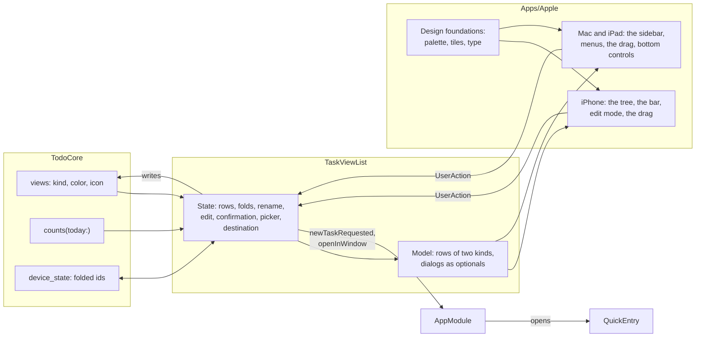

# Spec: The Lists screen

- Status: Approved 2026-10-25 (revision 3)
- Owner review: https://claude.ai/artifact/DuLLjcQ3NLA4uNzztLU35U
- Issue: #138

Written for the owner. The bar is readability: modules and their contracts in prose, types only where the design depends on them. Every type defined outside this document gets a one-line reminder at its first mention and an entry in the glossary at the end. Names in `code` that do not exist yet are working names, settled by a compiler probe in the plan, as the navigation spec did for `Seat`.

The look is the canvas "Todo — дизайн", section "Lists · iteration 2" (https://claude.ai/artifact/WWLXn8c4CcV8VKHXwpMqtU), which the owner signed off on iPhone light on 2026-10-25 and which was then carried to the dark theme and the Mac, with four boards added for this document (naming a new area, the long press on an area, the delete confirmation, Move to…). This document reads the canvas as its mockup: where the two differ, the canvas is right about the look and this document about the behaviour.

## Problem

The Lists screen is the first screen a person sees and it is still M3's scaffold. `TaskViewList` (the list of views a person keeps: a sidebar on the Mac and the iPad, a screen of its own on a phone, and the base of the window's stack) draws flat rows indented by depth, highlights one, and offers Rename and Open in New Window in a context menu and a toolbar button that makes a folder. Nothing else: no colour or icon tells one list from another, no count says what is in it, a branch cannot be folded, a list cannot be reordered, moved under another or deleted, and there are no areas. It looks like a default SwiftUI list and behaves like one. The owner chose it as the start of M4's product work (2026-10-25): one screen, redesigned whole, with the functionality the canvas shows, and no other screen in the same epic.

Underneath, the core's view, `TaskView` (a view row: title, optional parent, rank, filter, sort, grouping; a view without a filter is a folder), has no colour, no icon and no notion of an area. `Store.delete(view:)` tombstones one view and lets its children surface at the root by the reading rule. Nothing counts the tasks a view selects. And nothing keeps a device's own UI state, such as which branches are folded, which the feature-module spec left to the first module that needs it. This is that module.

## Goals and non-goals

- Goal: the screen as the canvas draws it, on iPhone and on the Mac, in both themes, and on the iPad as the Mac's sidebar inside the split view with the phone's touch gestures (owner, 2026-10-25).
- Goal: a person sees their lists, adds one, renames it, moves it, deletes it, nests lists to any depth and folds a branch.
- Goal: areas. A person adds one, with or without a name, renames it and deletes it; the line defines the area (owner).
- Goal: a count on every list.
- Goal: the five built-in views are default views and nothing more: they move into areas, rename and delete like any list (owner).
- Goal: the bottom bar: "…" with Edit, the search capsule, "+" with New task / New list / New area.
- Goal: the design foundations in code, since this is the first screen drawn in the product's own look: palette, type, tiles, motion, for every screen after it.
- Non-goal: what a list counts, and whether it shows a count or a badge at all. That is the view's own choice, a setting on the list's own screen in the task list's epic (owner, 2026-10-25); in this epic every list counts its open tasks.
- Non-goal: the red badge. The owner wants it to count a list's new tasks, the tasks a person has not yet seen in it, which asks the store to remember what each device has shown and the task list to say what it showed: an epic of its own, after this one (owner, 2026-10-25). In this epic no list shows a badge.
- Non-goal: search. The capsule is drawn and a tap on it opens nothing until the search epic (owner).
- Non-goal: what a tap opens. It opens today's list of tasks, `TaskList` (the tasks of one view). A list with no rule opens that page too, empty; the page that shows its child lists' tasks grouped by child, as the canvas has it, is the task list's epic.
- Non-goal: choosing a list's colour and icon. The picker lives on the list's own screen, later; in this epic every list a person creates looks the same, and the built-ins wear the canvas's tiles.
- Non-goal: editing a list's rule, and quick entry's redesign: "New task" opens the quick entry that exists.
- Non-goal: the watch and the web, beyond the compile checks CI already runs; sync of any UI state; undo.
- Non-goal: localisation. A string this module writes is English, as today, until the formatting service arrives.

## Chosen approach

### 1. What the screen is

One scrolling tree and no title. A list is a row: a tile with its colour and icon, its title, the count of its open tasks at the right edge, and a chevron when it has lists inside that folds and unfolds the branch. An area is a line across the tree: a named area carries its name on the line, an unnamed one is the line alone (owner, 2026-10-25). Lists nest to any depth, with guides down the levels; past a depth the tree is wider than the screen and scrolls sideways while the counts and chevrons stay pinned at the right (canvas). At the bottom, three controls on glass: "…" at the left, which holds Edit; the search capsule in the middle; "+" at the right, which opens New task / New list / New area.

A long press on a list lifts it and opens Rename / New list / Move to… / Delete; a long press on an area's line opens Rename / New list / Delete area. Edit mode, from "…": every row gets a grip and drags to a new place and a new level, every area shows a label that renames it ("Area" standing in for a missing name), a tap on a row renames it, the bar becomes +List / +Area and a Done check. Counts leave the rows while editing.

The five built-in views, Inbox, Today, Upcoming, Logbook and Trash, are the default views every store starts with and nothing more: a person moves them into an area, renames or deletes them like any list, and the screen pins none of them (owner, 2026-10-25). The canvas draws Logbook and Trash at the very bottom, where a person who has dragged them there sees them; by default they stand where the seed ranks them, after Upcoming at the root and so above every area a person adds, until the person moves them, and the module makes no exception for the two (owner, 2026-10-25).

### 2. A view's kind, colour and icon

The core's view gains three fields. All three are written when a view is created; the kind never changes afterwards, and the colour and the icon get their change cases when the picker that edits them arrives, since nothing in this epic would call them (`docs/style.md`, no API without a caller).

- **Kind**, `list` or `area`, absent reads as `list`. An area is a view at the root with no rule, no tile and no count, which never opens: its children are lists, and that is all it is for (owner: "an area is in essence a folder, a view with no tasks but with one or more views, told apart from a folder"). The store refuses a write that would nest an area: `createView` of an area under a parent, and `move` of an area under anything, throw `.invalid`, as a move into a view's own subtree does today. An area that arrives nested anyway, from an app older than this field that moved it as a plain view, reads as a list with no rule, a folder: drawn with a tile, openable, its lists its children. That is a reading rule and not a repair, as `TreeRules` (the one reading of parent links: a link to a missing, deleted or circular parent reads as root) treats a broken link.
- **Colour**, one of eleven names or absent: blue, amber, rose, green, stone, indigo, teal, pink, orange, violet, sky, the palette the canvas tiles use. The name is the core's; the shade it means in each theme is the platform's. A name this app does not know reads as absent, the way a value the type cannot hold reads as absent everywhere (`docs/style.md`).
- **Icon**, the name of an icon in the app's own set, as text, or absent. The platform maps a name to a glyph, SF Symbols on Apple, and draws the default glyph for a name it does not know. The set is the plan's to list; it starts with the canvas's.

Three nullable text columns in schema version 5 and three names among the journal's known fields of a view. An app older than this version journals an operation on a field it does not know and applies nothing, as it does today, so a build from M3 syncing with this one loses nothing and shows plain rows. The seed of the built-ins gains their colour and icon at clock zero, tray on blue for the Inbox, the sun on amber for Today, the calendar on rose for Upcoming, the logbook on green, the bin on stone, so a person's own choice, later, outranks it the way a rename does today.

### 3. Areas: a line, and the lists under it

The screen is the store's tree order, parents before children and siblings by rank, read as today. An area is an item of the root, and what stands under its line is its children. A list of the root stands above the first area, and this module's writes keep it so: a new list from "+" goes into the last area when there is one, and to the end of the root when there is none; a new area goes to the end of the root; a drop under an area's line is a drop into that area and never onto the root; and every write that puts a list at the root, "Top level" in the picker, a drop above the first line, the lists of a deleted first area, places it after the last list of the root that stands above the first area, never at the root's end, which would draw it under the last line. So the line defines the area (owner): everything under it, down to the next line, belongs to it. A list of the root that another device or an older app ranked after an area is drawn where its rank puts it, under that line; Move to… and the drag show where it truly is, and one drop puts it right.

Naming. "+ → New area" adds the line at the end with its name field open and empty; Return or Done keeps what was typed, and nothing typed leaves the area unnamed (owner). A name is changed from the long press, the right click on the Mac, or in edit mode, where every area shows its label and a tap on it opens the field. An unnamed area is a line alone outside edit mode; that is the whole of how it looks, and it is what the owner asked for.

Deleting an area asks first and leaves its lists where they stand: the line goes, so they stand under the line above, in that area, or at the root when there is none above. The module writes that, one move per list into its new parent at the end, then the area's tombstone. The store's `delete(view:)` is unchanged for it, and a crash between the writes leaves lists already moved and an area still there, which the next attempt finishes (risk, accepted).

### 4. Counts

What a list shows beside its title is the list's own choice: which number, or none at all, is a setting of the view, edited on the list's own screen in the task list's epic and not in this one (owner, 2026-10-25). This epic ships the default every list starts with, and the screen draws what the store answers for each list with no rule of its own, so the setting, when it arrives, changes the store's answer and nothing on this screen.

The default count is the number of open tasks a list selects: the tasks its rule matches that are open and not in the trash. By that one rule Logbook and Trash count nothing, since nothing in them is open, and their rows show no number, as the canvas has it: a count of zero is drawn as nothing on every list. A list with no rule counts the union of its children's open tasks, each task once, not their sum: two lists whose rules overlap share tasks, and a person reads the folder's number as how many tasks are in it. A view this app cannot read counts nothing and shows nothing, and contributes nothing to a folder above it. The core answers for every view in one call, `Store.counts(today:)` (working name): a list with a rule is one count statement over the filter the page reads with; a folder's count is one count statement over the disjunction of its children's rules, the children's own folders folded in the same way, built by a walk over the tree from the leaves up and never by recursion over its depth, so a folder costs one statement too and no ids travel. That is the canvas's own reading of a folder, a list with no rule matches what the lists inside it match, written as a query. The module reads the counts beside the rows at every reread, since a change to any task can move any count. `today` is the UTC day of the machine's clock, read again at every read, as the task list reads it; the event that tells a module the day has changed is still ahead of this epic, so a count is stale across midnight until the next change arrives (risk).

The red badge the canvas draws on Today is the next epic's, not this one's (owner, 2026-10-25). What its review settled, so that the next spec starts there: the badge is the number of a list's new tasks, the tasks it selects that a person has not yet seen in it on this device, such as a task that arrived in Today because its day came, and never the overdue; a task stops being new when this device shows it in that list or writes it there, and is new again when it leaves the list and comes back; the pairs seen are the device's own, kept in the store outside the journal beside the folded branches of section 5, and a device that joins by sync sees every task as new until each list is opened once.

### 5. The module

`TaskViewList` stays the module, the base of the window's stack with no head and the list it declares as its tail (navigation state spec, section 1); its route does not change, and the window's text form does not change. What changes is its model, its actions and one more thing it asks of the root. A sketch, not compiled:

```swift
public struct Model: Equatable, Sendable {
    public struct Row: Equatable, Sendable {
        public enum Kind: Equatable, Sendable {
            /// An area's line: its label, nil for an unnamed area outside edit mode, and "Area" in it.
            case area(label: String?)
            case list(ListRow)
        }
        public let id: ViewID
        public let depth: Int
        public let kind: Kind
        public let draft: String?
    }
    public struct ListRow: Equatable, Sendable {
        public let title: String
        public let color: String?      // a name of section 2, the platform's to shade
        public let icon: String?       // a name of section 2, the platform's to draw
        public let countText: String   // "" for nothing
        public let hasChildren: Bool
        public let isCollapsed: Bool
        public let isSelected: Bool
    }
    public let rows: [Row]
    public let selection: ViewID?
    public let isEditing: Bool
    public let confirmation: Confirmation?   // a title and a message; nil when none is up
    public let movePicker: MovePicker?       // a title and rows of the same shape; nil when closed
    public let problem: String?
}
```

A row is an area's line or a list's row, and its kind is an enum, so that a row is one of the two explicitly and never both or neither (owner, 2026-10-25, on revision 1's two optionals). The view switches over it to pick the row to draw, every case drawn and no `default`, which is the dispatch the style's rule for views describes; the rule names two enums a view may switch over, the layout and the stack, and gains this third, the kind of a row, by the owner's call, in `docs/style.md` with this epic. The move picker draws the same rows again. Everything a row shows arrives finished: the count as text, the label "Area" chosen by the module in edit mode. The view keeps what only it can know: focus, the scroll, hover, and a drag in progress until it is let go.

The actions are named for the control and the gesture, never for what follows (`docs/style.md`). Beside today's `rowSelected`, `renameMenuItemChosen`, the four of the title field and `openInNewWindowMenuItemChosen`: `disclosureTapped(ViewID)`; `newListMenuItemChosen(in: ViewID?)` from a list's menu, an area's menu, "+" and the edit bar, nil meaning the screen's end; `newAreaMenuItemChosen`; `newTaskMenuItemChosen`; `moveToMenuItemChosen(ViewID)`; `deleteMenuItemChosen(ViewID)`; `deleteConfirmed` and `deleteCancelled`; `movePickerRowTapped(ViewID?)`, nil being the top level, and `movePickerCancelled`; `editMenuItemChosen` and `doneButtonTapped`; and the drag's one report, `rowDropped(ViewID, after: ViewID?, depth: Int)`: the row let go after that row, nil for the top of the tree, at that depth. The module turns the position into a parent and a placement: deeper than the row above makes it that row's first child, the same depth its next sibling, shallower the next sibling of the ancestor at that depth, and a row under an area's line at depth zero goes into the area. `createFolderButtonTapped` goes with the toolbar button it named.

Two things the module asks of the root, as `Output`: `openInWindow`, as today, and `newTaskRequested`, which the root answers as it answers its own toolbar button, by opening quick entry over the window.

**Dialogs are the module's state, not screens.** The confirmation and the move picker have no subject of their own, no address a link could name and nothing a relaunch should restore, so they are session state beside the rename draft, and the view draws them from the two optionals, as an alert and a sheet. They are not declared in the module's slot: a slot holds a push or a modal and never both (navigation state spec, section 5), and a picker declared there would close the list open beside the sidebar on the Mac. The rule this records: a dialog over a screen, with no subject and no stack, is that screen's state; a screen with a subject is declared in the slot. Edit mode is session state too, and none of the four survives a relaunch.

**Collapsed branches are the device's.** They are neither the route's, since a window's address does not say what is folded, nor the journal's, since the owner wants them kept per device and not synced. The store gains a small table outside the journal, `device_state(key, value)` (working name), read and written through `Store.deviceState(_:)` and `Store.setDeviceState(_:_:)`, in the same schema version. The module keeps the folded ids under one key, reads them when it is made and writes them on every fold. Two windows of one Mac read the same row and learn of each other's fold at their next reread; until then they may disagree, which is accepted. This answers the open question the feature-module spec left for "the first module that needs it in M3".

### 6. Creating, renaming, moving, deleting

- **A new list** is a view of kind `list` with no rule, titled "New list", with the colour of the list it is made inside when there is one, none when it is made in an area or at the root, and the icon `list`. It is placed last among its new siblings and its name field opens at once, as today's folder does; the empty name is refused with the sentence it is refused with today. The branch it was made in unfolds.
- **Rename** works as today, for lists, areas and the built-ins alike; an area accepts the empty name, a list does not.
- **Move to…** opens the picker: "Top level" first, then the whole tree in tree order, every level of it and folds ignored, the areas as lines and the lists indented under them; the list being moved and everything inside it greyed out, and its present parent marked. A tap on a row moves the list under it, last among its new siblings, unfolds the destination and closes the picker; Cancel closes it. A built-in moves like any list.
- **Delete** always asks (owner). For a list: "Delete “X”?" and, when it holds lists, how many go with it, then that no task is deleted. The store then tombstones the list and every list under it in one transaction, `Store.delete(viewTree:)` (working name), where today's `delete(view:)` tombstones one and lets its children surface; the tasks are untouched, since a rule selects them and a rule gone selects nothing, and the manual-list rows of the deleted lists stop being read, as today. For an area: "Delete the “X” area?" and that its lists stay, then section 3's writes. For a built-in: the same as for any list.
- **Fold and unfold** is `disclosureTapped`, remembered per device (section 5).

### 7. Edit mode, the drag and the bottom bar

On iPhone and iPad the tree is touched. Outside edit mode a tap opens a list, a long press opens its menu, and the bar holds "…", the capsule and "+". "…" holds Edit alone for now (owner, 2026-10-25). The capsule is drawn as the canvas has it and a tap on it does nothing in this epic (owner). "+" opens New task, New list, New area.

Edit mode, entered from "…" and left with Done: grips on every row, a tap on a row renames it, the bar becomes +List, +Area and Done, and a drag lifts a row and drops it after another row at a depth the finger chooses, which `rowDropped` reports. An area drags too, as one block with every list under it, and lands only where an area can stand: between two areas or above the first, and the slot the view draws for it offers nothing else. Should a drop of an area reach the module anyway with a row inside a block as its position, the module puts the area after that block, at the root, since an area is never nested; a list dropped onto the line of an area, at depth zero, goes into that area. The engineer's calls, both. The slot the canvas draws while dragging, dashed at the depth the drop would take, is the view's own feedback and sends nothing until the drop. SwiftUI's `List` moves a row up and down a flat list and knows nothing of depth, so the drag is a gesture of the Apple package's own over the rows; the plan starts with a spike that settles it before anything is built on it (risk).

### 8. The Mac and the iPad

On the Mac the tree is the sidebar, 280 points wide at the least where it is 220 today, and it has no edit mode: a row drags at any time, with the line-and-circle indicator the Finder draws for a drop between rows and into a parent, and the same `rowDropped` arrives. A right click on a list opens Rename / New list / Open in New Window / Move to… / Delete; on an area's line, Rename / New list / Delete area. The chevrons fold branches as disclosure triangles do. At the bottom of the sidebar stand the search field, inert as the capsule, and a "+" that opens New task, ⌘N, New list, ⇧⌘N, and New area. The toolbar's New Folder button goes; the Quick Entry button on the list's toolbar stays, since it is the list's and not this screen's.

On the iPad the tree is the Mac's sidebar in the split view, 280 points too, with the phone's gestures on it: a long press for the menus, "…" for edit mode and the bar at the bottom of the sidebar's column (owner, 2026-10-25). Open in New Window stays where a window can open beside this one, as today. An iPhone whose window is wide, a Plus or a Max turned sideways, reports the regular width class and gets the same shape, since the module decides the layout from the class the view reports and not from the device (navigation state spec, section 4): the sidebar in the split view with the phone's gestures, as it gets the split view today. A regular-size iPhone stays compact when turned and keeps the phone's screen.

### 9. The design foundations in code

The first task of the epic puts the canvas's foundations into `TodoAppleUI` for every screen after this one: the palette as named colours with a shade per theme (paper, surface, sidebar, fill, line, ink, a second and a third ink, red), the accent (the canvas's "Ink", #3653C9), the eleven list colours with their tile background and glyph shades per theme, SF Pro Rounded for titles, the tile view, the icon set that maps the names of section 2 to SF Symbols, and the motion constants. No third-party code. They are applied to this screen; the task list, the task screen and quick entry keep their system looks until their own epics, so a window after this epic shows the new tree beside the old list, which is the price of one screen at a time and is accepted.

### 10. What changes where

| Where | Today | After |
| ----- | ----- | ----- |
| `TodoCore`, the view | title, parent, rank, filter, sort, grouping | kind, colour and icon beside them; `NewTaskView` takes the three; the seed gives the built-ins theirs |
| `TodoCore`, the store | `delete(view:)` tombstones one view | `delete(viewTree:)` beside it; `createView` and `move` refuse a nested area; `counts(today:)`; `deviceState` read and written; schema version 5 |
| `TaskViewList` | flat rows with a depth, a highlight, a rename, a folder, one output | rows of two kinds with tiles, counts and folds; edit mode; the confirmation and the move picker as state; eleven more actions; `newTaskRequested` |
| `AppModule` | reacts to `openInWindow` | reacts to `newTaskRequested` by opening quick entry |
| `Apps/Apple`, `TodoAppleUI` | `TaskViewListView`: a `List` with a context menu and a toolbar button | the foundations; the tree on iPhone with the bar and edit mode; the sidebar on the Mac and the iPad with the drag, the menus and the bottom controls; the alert and the sheet |
| docs | | this spec; an amendment to ADR-0004; an ADR for the device's own state; the third enum in `docs/style.md`; `CHANGELOG.md` |

### Testing, CI and the deliverable

The module's tests run on the host and on wasm32, as every feature's do: the rows for a tree with areas, folds and depths; counts as the model spells them; where "+" puts a list and an area; an area that takes the empty name and a list that refuses it; the confirmation and what it deletes; a move from the picker and from a drop, index and depth to parent and placement, and the refusals; the fold written and read back by a module made anew. The core's tests cover schema version 5, the three fields written and read back, an unknown colour read as absent, an area with a parent read as a list, the refused nested area, the tree delete in one transaction, the counts for a rule, a folder and a view the app cannot read, and the device state. The Apple package builds for every platform as today, and each screen is checked by hand on an iPhone simulator, an iPad simulator and the Mac, with screenshots in the pull request. CI does not change; the wasm size budget is re-measured, as in every epic.

The deliverable is the Lists screen on iPhone, iPad and Mac as the canvas draws it, with the design foundations under it. M4 closes with the epics after this one, so no version is cut by this epic alone.

## Rejected alternatives

| Alternative | Why it lost |
| ----------- | ----------- |
| An area as an entity of its own, with a table and operations | ADR-0004 forbids a container entity without revisiting it, and an area needs nothing a view does not have: a title, a parent, a rank, children. One field on the view keeps one tree, one order and one journal. |
| An area told from a folder by its place alone: a filterless view at the root is an area, nested it is a folder | A folder at the root could not exist, an older app's move would turn a folder into an area, and the owner asked for the two to be told apart explicitly. |
| Folded branches in the window's route | A route is the window's address and a relaunch's state, not a record of what is folded; two windows would fold independently, and the owner wants it per device. |
| Folded branches in `UserDefaults` behind a new protocol the platform implements | More plumbing for one set of ids, and the web would need its own implementation; the store is already per device and already on every platform. |
| Folded branches synced through the journal | The owner wants them per device. |
| The confirmation and the move picker as screens declared in the module's slot | A slot holds a push or a modal, never both: the picker would close the list open beside the sidebar on the Mac. Neither has a subject a link could name. |
| Counting in the module from `tasks(in:today:)`, one read per view | Tens of full reads of thousands of rows on every change; a count statement over the same filter reads nothing it does not need. |
| The badge in this epic, as the overdue (revision 1) or as the new tasks (revision 2) | The owner wants the badge to say what a person has not yet seen, which asks the store to remember what each device showed and the task list to report it: an epic of its own after this one, so that this one stays one screen (owner, 2026-10-25). |
| Logbook and Trash drawn last while they stand at the root (revision 1's alternative) | The owner chose the plain rule: nothing pins a built-in and nothing names one. |
| What a list counts as a setting in this epic | The owner put the setting on the list's own screen, in the task list's epic; the default ships now and the setting changes the store's answer, not this screen. |
| Delete without asking, with an undo toast | The owner chose the confirmation, always. |
| Move to… only, or the drag only | The drag is fast and the picker is precise in a deep tree and reachable without edit mode; the canvas has both. |
| Children surfacing at the root when a list is deleted, as today | A person who deletes "Projects" means its projects too; the lists surfacing would land between other areas' lists, wherever their ranks fall. |

## Components and data flow



## Open questions

None open. Revision 1 asked two, and the owner answered them on 2026-10-25: Logbook and Trash stand by the plain rule, with no exception for the two (section 1); the badge is to count a list's new tasks and not its overdue ones, and it left this epic for one of its own (section 4).

## Risks

- **The drag with a change of depth on iPhone and iPad.** SwiftUI's `List` reorders a flat list and gives no horizontal position, so the drag is a custom gesture over the rows, with the lift, the slot and the sideways scroll to keep working under it. The plan opens with a spike on it; the fallback is a drag that changes order alone, with Move to… for the depth, and the owner decides whether that ships.
- **The tree wider than the screen.** The canvas scrolls the rows sideways while the counts and chevrons stay at the right edge, which a `List` does not do. A horizontal `ScrollView` around the rows loses the list's own gestures; the spike above covers it, and the fallback is a title that truncates at depth.
- **Counts on every change.** Tens of count statements on every commit are cheap at this scale and are measured in a release build in the plan; the remedy, should they show, is one statement over all views or a recount of the views a change set can touch.
- **Counts across midnight.** Stale until the next change, until the day-change event exists.
- **Two writes for an area's deletion.** A crash between the moves and the tombstone leaves lists moved and the area in place, which the next deletion finishes.
- **Marked text in the rename field**, the feature-module spec's risk, now with a field on an area's line too.
- **Built-ins deletable.** A person who deletes the Inbox has no Inbox, and quick entry files into it. The seed does not bring it back, by design. Quick entry's own epic decides what it does then; in this epic it reports the error in its sentence.
- **The wasm size budget**, re-measured as in every epic.

## Decisions to record as ADRs after approval

1. An amendment to ADR-0004: a view has a kind, a colour and an icon; an area is a view of the root that holds lists and never tasks, drawn as a line, and an area that ends up nested reads as a folder; the UI's areas are views like everything else in the sidebar.
2. A device's own UI state, folded branches first, lives in the store outside the journal, is never synced, and is read and written through the store like everything else, so that every platform keeps it the same way.
3. A clause beside ADR-0009's amendment: a dialog over a screen, with no subject and no stack, is that screen's state and is drawn from its model; a screen with a subject is declared in the slot.

## Glossary of external types

| Type | Defined in | One-line reminder |
| ---- | ---------- | ----------------- |
| `Store` | `TodoCore` | the core's data layer: one synchronous, single-threaded class per database; `onChange` is called after a transaction commits |
| `TaskView`, `NewTaskView`, `TaskViewChange` | `TodoCore` | a view row as read; what a caller knows about a view before it exists; one field of a view set to one value |
| `BuiltInTaskViews` | `TodoCore` | the fixed ids of Inbox, Today, Upcoming, Logbook and Trash, seeded at clock zero on every store |
| `Filter` | `TodoCore` | the tree of conditions a view is defined by, stored as JSON in the view row; a view without one is a folder |
| `TreeRules` | `TodoCore`, internal | the one reading of parent links: a link to a missing, deleted or circular parent reads as root |
| `Placement` | `TodoCore` | where a new or moved item ranks among its siblings: first, last, or after a given one |
| `ChangeSet` | `TodoCore` | the sets of task, tag and view ids a committed transaction addressed, handed to every module as `.changed` |
| `StoreError` | `TodoCore` | the typed error every store call throws: SQLite, not found, a view that needs a newer app, an invalid value |
| `ViewID`, `TaskID` | `TodoCore` | a lowercase UUID string naming a view or a task |
| `Day` | `TodoCore` | a calendar day as a count of days since 1970-01-01; the platform passes today, the core never asks |
| clock zero, `HLC` | `TodoCore` | the hybrid logical clock a journal operation carries; zero is the seed's, which any later write outranks |
| the journal's known fields | `TodoCore`, internal | the list of field names per entity the store applies; an unknown field is journaled and ignored |
| `TaskViewList` | `TaskViewListFeature` target | the list of views a person keeps: the base of the window's stack, a sidebar on the Mac and the iPad, a screen on a phone |
| `TaskList` | `TaskListFeature` target | the tasks of one view, the screen a tap on a list opens |
| `QuickEntry` | `QuickEntryFeature` target | the modal that creates a task from a typed title, opened by the window's root |
| `AppModule` | `AppFeature` target | the root of a window's modules, the one module a host holds |
| `Destination`, `ScreenStack` | `FeatureModule` target | what a screen declares open over it, a push or a modal; the flat stack of screens over a flow's base that follows the declarations |
| `Output` | each module | what a module asks of its parent because it cannot do it itself |
| `ModuleHost`, `RootView` | `Apps/Apple`, `TodoAppleUI` | the one observable object a window's views read; the root of the tree of views, which draws the stack and the split view |
| `NavigationSplitView`, `NavigationStack`, `List` | SwiftUI | the two- or three-column container; the push-and-pop container; the scrolling list, whose `onMove` reorders a flat list |
| `.alert`, `.sheet`, `.contextMenu` | SwiftUI | the modifiers that present an alert or a sheet while a bound optional holds a value, and that attach a right-click or long-press menu |
| SF Symbols, SF Pro Rounded | Apple | the system's icon set and the rounded cut of the system typeface |
| Things | Cultured Code | the task manager the brief names as the product's model; its sidebar has areas and projects, and a Logbook and Trash pinned at the bottom |
