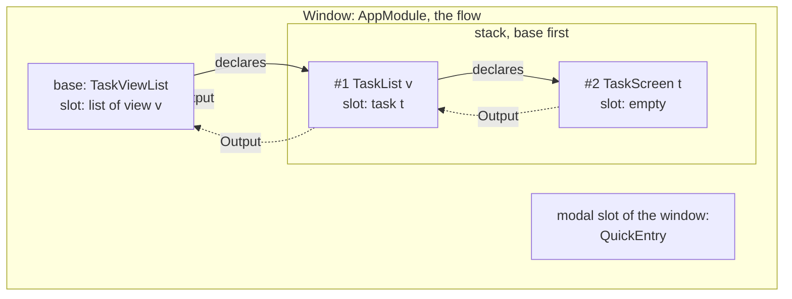
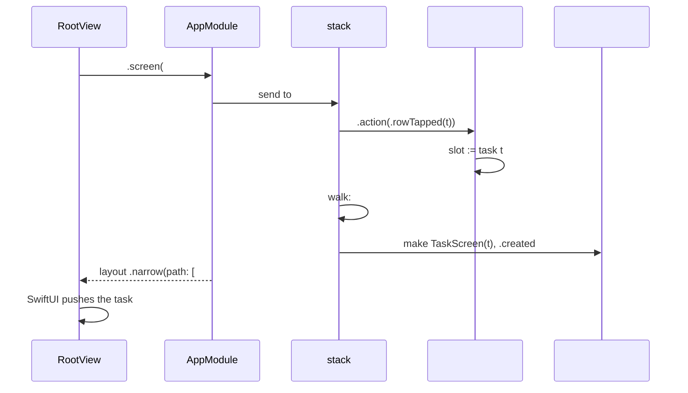

# Spec: Navigation state the view only reads

- Status: Draft
- Owner review: https://claude.ai/artifact/U3wtm2JcKqC9QEZe3p3mJv
- Issue: #117

Written for the owner. The bar is readability: modules and their contracts in prose, types only where the design depends on them. Every type defined outside this document gets a one-line reminder at its first mention and an entry in the glossary at the end. Names in `code` that do not exist yet are working names, settled by a compiler probe in the plan, as the navigation spec did for `Seat`.

## Problem

The root view assembles the navigation of the window itself. `RootView` (the root of the Apple app's tree of views) reads the window's route from the host, not the model, and builds the stack's path from it: in a wide window the task open in the list becomes a one-element array, and in a narrow window the list and the task become a `NavigationPath` (SwiftUI's type-erased list of pushed values) with a wrapper type, `PushedList`, so that a list's id and a task's id do not collide. On the way back it reads the length of what SwiftUI left and guesses whose back button that was: zero elements is the sidebar's, one is the list's.

So the view knows the tree of modules: that the sidebar holds the list, that the list holds the task, and in what order they stand. That knowledge grows with every screen. A subtask opened from a task is one more level the view has to know, and the web would have to know it again in its own code. The owner dislikes both halves: that the view puts the stack together, and that it does so from `host.route`.

How it got there. The navigation spec bound each screen's push to its own `navigationDestination(item:)` (the SwiftUI modifier that pushes while a bound optional holds a value). On macOS 26.7 that lost the task a window opened with (2026-10-18), so the root view took the fallback the spec's Risks named: map the module tree into a path. On iPhone the collapsed split view pushed from state no binding reaches, so the narrow window became one stack whose path is the route (#107, PR #115). Each step was right on its own, and together they put the module tree into the view.

The owner reopened navigation before closing M3 (2026-10-21), and settled the shape in chat on 2026-10-22, one question at a time. This document records those answers. Where it decides something the chat did not, it says so and marks it as the engineer's call.

## Goals and non-goals

- Goal: the view gets every stack's path ready in the model and binds it. It reads neither the route nor the tree, and it hands a pop back whole without interpreting it.
- Goal: the screen that opens another decides what is open over it, as ADR-0009 has it. The decision is a value in its own state.
- Goal: the screens open over each other live flat, in the stack of their flow, and what an opened screen answers reaches the screen that opened it.
- Goal: the module decides the layout of the window, from the width the view reports.
- Goal: a modal is declared the same way, and is a flow of its own with its own stack, recursively.
- Goal: everything M3 shipped keeps working: the text form of links and restoration unchanged, windows, sentences, the Back rules of #107, quick entry.
- Non-goal: new screens. Task over task must be possible, and is shown on paper; building subtasks is M4's.
- Non-goal: a modal with screens of its own, built. It is designed here, and built when the first such modal exists, by the rule that nothing is added before its caller (`docs/style.md`). Quick entry, the one modal, has no stack.
- Non-goal: the web's and the watch's views, and any change to the text form.

## Chosen approach

### 1. The opener declares what is open over it

Every screen that can open another keeps, in its own state, what is open over it. It has two slots: one for a push and one for a modal. A slot is empty, or holds the route of the screen opened there, whole, as the opener declared it: its head, what it opens with, and what the opener wants open over it at that moment, which is usually nothing. A tap fills the slot, Back empties it, and nobody but the screen writes it. That is the whole of the decision, and it stays with the opener, as ADR-0009 says: when subtask B opens subtask A, B decides.

On today's screens:

| Screen | Its push slot | Filled by |
| ------ | ------------- | --------- |
| the sidebar, `TaskViewList` (the list of views, drawn as a sidebar on the Mac and the iPad and as a screen of its own on a phone) | the list of a view | a click on a view |
| the list of tasks, `TaskList` (the tasks of one view) | a task | a tap on a row |
| the task screen, `TaskScreen` (one task on a screen of its own) | nothing today; a subtask in M4 | a tap on a subtask |

The sidebar's slot is the highlight. Today the highlight and the open list are two facts the sidebar keeps in step; with a slot they are one fact, so they cannot disagree.

A slot is part of the screen's route: a screen's route becomes its own head and what it declared. A parent reads a child's route today and never its model (ADR-0006, amendment of 2026-10-03), and the flow below reads the slot the same way, so the rule that a model is the view's alone holds.

### 2. The flow holds the screens flat and follows the declarations

A flow is the window today, and a modal with screens of its own tomorrow. It holds its base screen, which for a window is the sidebar, and a stack of the screens open over it, base first. The stack is a new generic value in the `FeatureModule` target, beside `Seat` (the value a parent holds one child in, which makes, keeps, replaces and drops it by the head of its route).

After every event the stack walks up from the base and compares each slot with what stands above it:

- the same head: the screen above is kept, with its session state, its scroll and its draft;
- another head: the declared screen is made and told it was created, and it replaces everything above;
- an empty slot: everything above is dropped.

This is the seat's rule walked along the stack. The new screen is made before the old one is let go, so a screen that cannot be made leaves what was open. Its opener is told that it could not be opened, why, and what stays open, and takes that back as its slot. So "The task is gone." stays the list's sentence, under its rows, as it is today.

**A slot written again is a new declaration.** The walk compares heads, so a slot written with the head it already holds keeps the screen above. That screen still gets the declared route, once, as the seat hands a kept child its route today, and reconciles its own slot to it. This is how a click on the view already highlighted returns to its list and closes the task open in it, as the owner set on 2026-10-16 and two tests hold. Between two writes the screen above owns its own slot, and the stack never hands it an old declaration again. The slot therefore tells a new write from an old one even when the value is the same; how it does is the plan's (the engineer's call).

**Answers go to the opener.** The stack hands each screen's answer, its `Output`, to the screen right below it, which is the one that opened it. The base's answers go to the flow's owner, the root. B therefore hears everything A asks for without holding A. A screen whose subject is gone asks to be closed, as today; its opener empties its slot, and the stack drops the screen and everything over it.

**Each element of the stack has an id** the stack hands out in order. It gives SwiftUI a stable identity for the pushed screen, lets the view find the element's model without a search, and lets the same kind of screen stand twice, a task over a task. It is never written into the text form.

**The flow names the screens its stack can hold.** Screens of different types stand in one array, so the flow declares one enum of them, with the mappings a stack needs: make a screen from its route, read its model, hand it an event, read its slot, hand it the answer of the screen above, and, for the window's route (section 3), read the part of a route meant for the screen above and put it back. These are switches that decide nothing. The root knows which screens can stand in the window's stack, and still never learns which screen opens which.



### 3. Back and links stay one road each

**Back.** The back button, the swipe and the back button's menu all end with SwiftUI writing a shorter path. The view sends what is left, whole, as one action of the window. The flow finds the screen now on top and tells it that what was over it was closed. That screen empties its slot, and the stack drops the rest. A screen cannot keep a slot the person closed, since the screen is already gone from the display (the engineer's call). On iPhone, Back from the list to the views empties the sidebar's slot, and the highlight goes with it: the rule of #107, now with no action of its own (`listBackButtonTapped` goes).

**A pop the model drove.** SwiftUI may write the path back after the module has already shortened it, for a task deleted under its screen. The stack keeps only a prefix it holds, by id, so such a write and any id it never gave move nothing.

**Links and restoration.** The window's route keeps the shape it has today: the sidebar's route, whose list carries its task, with quick entry beside it. A link is a write of the base's slot: the base takes the route and declares the list in it whole, and the stack makes or keeps the list and hands it its part, which declares the task, and so on up. What already matches is kept, with its session state, as today. The other way, the root writes the window's route down from the stack: each screen's route, with its slot replaced by the route of the screen that actually stands over it, from the top down, so a declaration that has aged since it was written never reaches the text. Neither way teaches the root which screen opens which; it uses the two mappings of the screens enum named in section 2. A string that does not read, a gone task, a relaunch, a second window and `openWindow`: unchanged.

**The text form does not change.** `/view/<v>/task/<t>?quick-entry` reads and writes as today, and every test of the codec stays as it is, since the route types it reads into keep their shape. Tomorrow `/view/<v>/task/<t>/task/<s>` is a subtask, since each slot reads its own segment and the chain is as long as the declarations. A task alone, `/task/<t>`, stays unwritable: nothing declares a task over the sidebar.

### 4. The module decides the layout

The view reports the width of the window as one of two classes, narrow or wide. It is an event of the world, delivered through the host's entrance for such events, the one links take, and not a user action, since nobody pressed anything. The window is made with the class it opens with, so the first frame already has the right shape (the engineer's call, checked by a probe).

The flow's model is a ready shape for exactly that layout:

| Layout | Sidebar | Root of the stack | Path the view binds |
| ------ | ------- | ----------------- | ------------------- |
| narrow: iPhone, a narrow iPad window | the root of the one stack | the sidebar | every screen over the base: list, task, … |
| wide: the Mac, a wide iPad window | its own column | the first screen over the base, or the placeholder when there is none | the rest: task, … |

The view switches over the shape, binds the path and draws each element through one destination. In a wide window the list is the column's root and not in the path, so SwiftUI cannot pop it: "in a wide window the highlight cannot be removed" holds by construction. A window that narrows or widens is told so; the module recomputes the shape in the same event, and the screens and their state stay as they were.

This moves one rule. `docs/style.md`, "Views", lists the window size among what only the view can know. It still is, but the view now reports its class, and the layout is the module's decision. ADR-0006 gets an amendment, and the rule a clause.

### 5. Modals

A screen declares a modal in its second slot, as it declares a push. The flow presents it: a modal is a flow of its own, whose base is the declared screen and whose stack holds what is pushed inside it, with the same reconciliation, recursively. What the modal's base answers reaches the screen that declared it.

The engineer's calls, all open to the owner:

- one modal per flow at a time, since that is what the platform shows;
- a modal goes when the screen that declared it leaves the stack;
- the window itself declares quick entry, from its toolbar button, as the root does today; it keeps the `?quick-entry` query item;
- a modal's own stack is drawn as one stack in a sheet, whatever the width;
- how a modal with screens of its own is written in a link is settled with the first such modal, as the navigation spec left the form of an argument.

Built in this epic: the window's own modal slot, which is today's seat for quick entry. A screen's modal slot and a modal with a stack are on paper until a screen needs one.

### 6. The view

A sketch, not compiled:

```swift
// Apps/Apple, RootView: the whole of the navigation the view does.
switch host.model.layout {
case .narrow(let path):
    NavigationStack(path: bound(path)) {
        sidebar.navigationDestination(for: StackElementID.self, destination: screen)
    }
case .wide(let column, let path):
    NavigationSplitView { sidebar } detail: {
        NavigationStack(path: bound(path)) {
            Group { if let column { screen(column) } else { placeholder } }
                .navigationDestination(for: StackElementID.self, destination: screen)
        }
    }
}

/// One switch over the screens the window's stack can hold: it picks a view per case and decides nothing.
@ViewBuilder func screen(_ id: StackElementID) -> some View {
    switch host.model.screens[id] {
    case .list(let model)?: TaskListView(model: model) { host.send(.screen(id, .list($0))) }
    case .task(let model)?: TaskScreenView(model: model)
    case nil: EmptyView()
    }
}

/// Read from the model; a write is sent back whole, as one action, and interpreted by the module.
func bound(_ path: [StackElementID]) -> Binding<[StackElementID]> {
    Binding(get: { path }, set: { host.send(.stackPopped(to: $0)) })
}
```

Gone from the view: `stackPath`, `narrowPath`, `PushedList`, every read of `host.route`, and the list view's own destination. The sheet and the sentences are as today. `docs/style.md` gains a clause beside the one above: a view may switch over the screens of a stack, once, to pick a view per case. It is dispatch and not a condition over data: every case is drawn, and a screen added to the stack and not drawn stops the view compiling.

### 7. What changes where

| Where | Today | After |
| ----- | ----- | ----- |
| `FeatureModule` | `Seat`, `Routable`, `RouteValue` | adds the stack, its element id and the protocol of a flow's screens enum; `Seat` stays for the window's modal |
| `AppModule` (the root, the one module a host holds) | the sidebar as a field, quick entry in a seat, the root's sentence | adds the stack and the width class; its model is the sidebar's model, the layout shape, each element's model by id, quick entry and the sentence; its action gains `.screen(id, action)` and `.stackPopped(to:)` |
| `TaskViewList` | a seat holding the list; `selection` and `listBackButtonTapped` | a push slot instead of the seat and the selection, and the model's selection is read from it; the model loses `taskList`; the back action goes |
| `TaskList` | a seat holding the task; `backButtonTapped`; the model carries `task` | a push slot; it hears the task's answers from the stack; the model loses `task`; the back action goes |
| `TaskScreen`, `QuickEntry` | | unchanged |
| `ModuleHost`, `WindowView` (the window's view, which holds the window's host and takes links) | publish the model and the route, take links | also report the width class |
| `RootView`, `TaskListView` | assemble the path from the route; a destination in the list | section 6 |
| docs | | this spec; amendments to `docs/specs/navigation.md` (sections 1, 3, 4, 6), ADR-0009 and ADR-0006; two clauses in `docs/style.md` |

### 8. Three flows, end to end

**A tap on a task row, narrow window.** `TaskListView` sends `.rowTapped(t)`; the root view wraps it as `.screen(#1, .list(.rowTapped(t)))`. The stack hands it to element #1, the list, which checks the row is one it shows, clears its sentence and fills its slot with task `t`. Then the stack walks: the sidebar's slot matches #1, the list's slot names `t` and nothing stands over #1, so `TaskScreen(t)` is made as #2 and told it was created. The model's shape is `narrow(path: [#1, #2])`; SwiftUI sees one more element and pushes the task. The route's text becomes `/view/<v>/task/<t>`, written into the window as today.



**Back twice, narrow window.** SwiftUI writes `[#1]`; the view sends `.stackPopped(to: [#1])`. The flow tells #1 that what was over it was closed; the list empties its slot; the stack drops #2. The text is `/view/<v>`. The second Back writes `[]`; the sidebar is told; it empties its slot, and the highlight goes; the stack drops #1. The text is `/`, and a relaunch opens the Inbox, as a new window does.

**A task deleted while its screen is open, wide window.** The host delivers `.changed`; the stack hands it to every element, base first. #2 finds its task gone and answers that it asks to be closed; the stack hands that answer to #1, which empties its slot; the walk drops #2. The shape is `wide(column: #1, path: [])`, SwiftUI pops, and the write it may make afterwards names a prefix the stack holds, so it moves nothing.

## Rejected alternatives

| Alternative | Why it lost |
| ----------- | ----------- |
| Keep the tree, B holding A in a seat, and project it into a path in the model (the chain, 2026-10-21) | Set aside by the owner. Holding A is not needed for B to hear A's answers, and projecting a tree into a path is the very glue this spec takes out of the view, moved one layer down. |
| The root decides what is pushed (the mini-spec of 2026-10-21) | The owner: the opener decides. The root then held every transition of the app, which is the concern ADR-0009 answered. |
| Commands: the opener says "push A" to a router, or builds the element of the stack itself (the owner's `StackRouter` draft; Point-Free's `NavigationLink(state:)`) | The owner chose a declaration. A command is a one-shot: a link or a relaunch would have to replay it, and the stack could drift from what the screens think is open. A slot is state, so the stack always follows it. |
| The view cuts the stack into a column and a path | The owner: the module decides the layout. The cut would be the last piece of navigation the view still does, and a web host would repeat it. |
| `navigationDestination(item:)` per screen | Lost the task a window opened with, macOS 26.7, 2026-10-18 (PR #106, and the comment on `RootView`'s path). |
| The list view supplying its part of the path and the meaning of a pop | The view would still compose the navigation, a piece per screen; not taken by the owner on 2026-10-21. |
| Point-Free's swift-navigation or The Composable Architecture as a dependency | ADR-0001 holds the core to the standard library and FoundationEssentials, and ADR-0006 rejected TCA. Their shapes informed this one: an optional per destination, a flat stack with ids, answers through the stack's owner. |
| A path of routes with no ids | The same screen could not stand twice, and the view would have to search for the model of an element. |

## Open questions

- **The sidebar after a list that could not be opened.** Today the highlight moves to the chosen view and the old list stays beside it, so the two disagree. With the slot as the highlight, the highlight goes back to the list that stays open, and the sidebar says "The list could not be opened." (the engineer's call).
- **Where a modal of a pushed screen is drawn.** Section 5 draws it over the whole flow, as quick entry is drawn today. A screen in the middle of a stack, with screens pushed over it, may declare one; whether its modal then shows, or waits until the screen is on top again, is settled when the first such modal exists.

## Risks

- **A frame of the wrong shape on rotation.** The view learns the new width, reports it, and the module answers in the same synchronous event, but SwiftUI may draw one frame of the old tree at the new width first. A probe on an iPhone 17 Pro Max in the simulator, rotated with a task open, as in #107; the fallback is the view choosing the tree from the width it already has, while the module keeps deciding the path.
- **The width at the window's creation.** The window is made before its view has drawn. If the class is not known by then, the window is made wide and told otherwise on its first frame; the probe above shows whether that frame is visible.
- **A declaration that cannot be met.** A slot naming a screen the store refuses would be tried on every walk. The opener is told once and takes back what stays open, so the slot and the stack agree again; a test holds it.
- **The screens enum grows with every screen of a stack.** A case and a line in each mapping, all compiler-checked with no `default`. It is mechanical, and a macro could write it later; none is proposed.
- **The wasm size budget.** The stack joins the probe; the budget is re-measured, as in every epic.

## Decisions to record as ADRs after approval

1. An amendment to ADR-0009: the opener decides what is open over it by declaring it in a slot of its own state; a flow holds the screens open over its base flat, in a stack that follows the declarations after every event by the seat's rule, hands each screen's answer to its opener, and gives each element an id; a modal is a flow of its own, declared the same way; the window's route is the chain of its screens' routes, and its text form does not change.
2. An amendment to ADR-0006: the width class of a window is an event of the world, which the view reports and the module answers; the layout of navigation is the module's decision, and the model carries its ready shape.
3. Two clauses in `docs/style.md`, "Views": the width is reported, not acted on; a view may switch once over the screens of a stack to pick a view per case.

## Glossary of external types

| Type | Defined in | One-line reminder |
| ---- | ---------- | ----------------- |
| `FeatureModule` | `FeatureModule` target | the protocol of a screen's logic: a class with a value `Model`, one synchronous `send(Event) -> Output?` |
| `Output` | each module | what a module asks of its parent because it cannot do it itself; a parent learns a child's choice only from it |
| `Routable`, `RouteValue` | `FeatureModule` target | a module made from a route, which says its route at any moment; a route is a plain value with a head, what makes the screen this screen, and a tail |
| `Seat` | `FeatureModule` target | the value a parent holds one child in; makes, keeps, replaces and drops it by the head of the route it is handed |
| `AppModule` | `AppFeature` target | the root of a window's modules, the one module a host holds |
| `TaskViewList` | `TaskViewListFeature` target | the list of views: a sidebar on the Mac and the iPad, a screen of its own on a phone |
| `TaskList` | `TaskListFeature` target | the tasks of one view |
| `TaskScreen` | `TaskScreenFeature` target | one task on a screen of its own |
| `QuickEntry` | `QuickEntryFeature` target | the modal that creates a task from a typed title |
| `ChangeSet` | `TodoCore` | the ids a committed transaction touched, handed to every module as `.changed` |
| `ModuleHost` | `Apps/Apple` | the one observable object a window's views read: it holds the root, publishes its model and route, and takes one event at a time |
| `WindowView`, `RootView` | `Apps/Apple` | the window's view, which makes the host and takes links; the root of the tree of views |
| `NavigationStack`, `NavigationSplitView`, `NavigationPath` | SwiftUI | the push-and-pop container; the two- or three-column container; a type-erased list of pushed values |
| `navigationDestination` | SwiftUI | the modifier that says which view to push for a value of the path, or while a bound optional holds a value |
| `horizontalSizeClass` | SwiftUI | the environment value that says whether the window is compact or regular across |
| swift-navigation, The Composable Architecture | Point-Free, open source | a library of state-driven navigation tools for SwiftUI and UIKit; an architecture library built on reducers, with a flat stack whose elements have ids |
