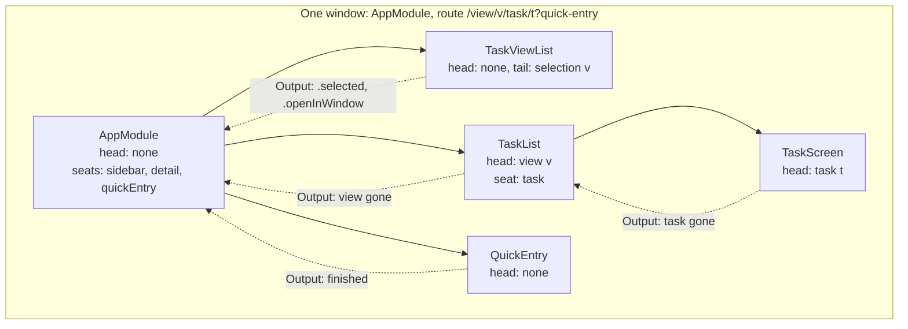
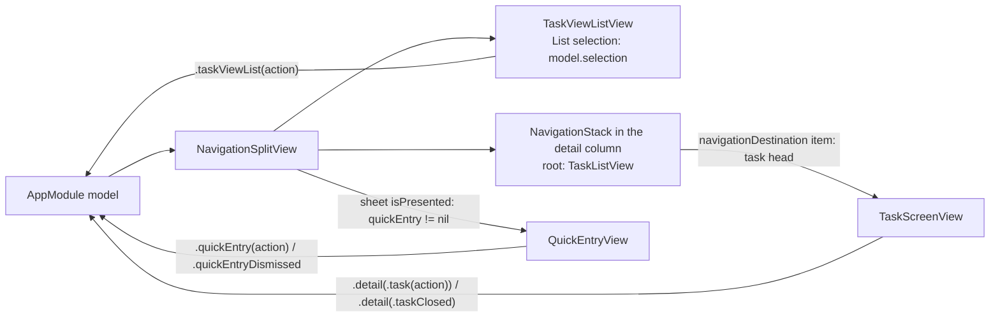
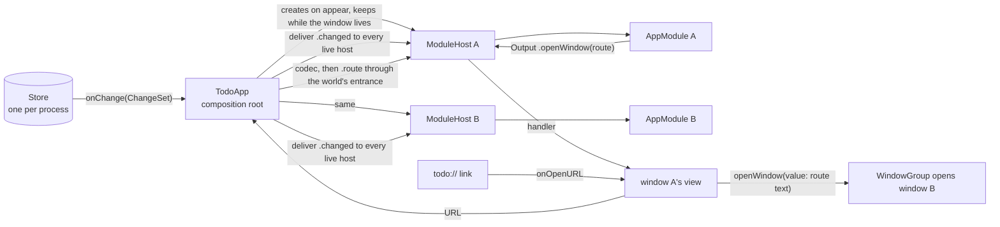

# Spec: Navigation

- Status: Approved 2026-10-14 (revision 4)
- Owner review: https://claude.ai/artifact/Y9Wdu9U1ZtC65xZb9LcLEv
- Issue: #67

Written for the owner. The bar is readability: modules and their contracts in prose, types only where the design depends on them. Every type defined outside this document gets a one-line reminder at its first mention and an entry in the glossary at the end.

## Problem

The feature-module spec settled the principle of navigation and deliberately not its mechanics. The principle, recorded in ADR-0006 (the decision that a feature is a module with one synchronous `send`, a value model and an output to its parent, and that views hold no logic): which screens are open is data in a module's model, a screen is a child module that asks through its `Output` for what it cannot do itself, the way back from the platform is an action, and the platform renders the same model as a split view, a stack or a route. The mechanics went to this epic, to be settled after `M3 Product functionality` once a list, an editor and quick entry existed to try them on, because the first draft had fixed them before any screen existed and the owner withdrew that draft to candidates.

On 2026-10-14 the owner chose to settle navigation before product work instead, so that the screens of the product are built on decided mechanics rather than on mechanics that change under them. The reason for the deferral does not go away: a stack, a sheet and a second window have to be tried on something. So the epic brings screens of its own, skeletal ones, with exactly the behaviour that makes the navigation between them real and none of the product's.

What is missing today, concretely. The app is one window over one host over one root module, `AppModule`, whose pane beside the sidebar is a placeholder with the chosen view's title. There is no stack, no sheet, no second window, no link into the app and no restoration after a relaunch. The scene is a single `Window` behind `#if os(macOS)`. The host refuses a root module that has anything to ask of its parent, since there was no one to ask. The root reads the store itself to learn whether the view its pane shows still exists. None of this is wrong for M2; all of it has to change for a second screen, and the issue lists what the change must settle:

1. The shape of the navigation state once there is more than one screen: a flat stack in the root, or ownership by the screen that opened the next one.
2. Where a modal's module lives, given that a push or a sheet is the platform's rendering choice, so a module's home cannot depend on it.
3. How the root's `Model` and `UserAction` grow with every screen.
4. Windows on macOS and iPadOS, where one host and one root per process no longer hold.
5. Deep links and state restoration.
6. Routes on the web and the stack on the watch.

The decisions below were made with the owner in a brainstorming session on 2026-10-14. This document records them for review.

## Goals and non-goals

- Goal: answer the six questions above, with the owner's one concern about the module architecture answered first: that the root grows into a module that knows every screen and every transition of the app.
- Goal: three skeletal screens that make every mechanic real on macOS before an iPhone exists: a list of the chosen view's tasks in the pane, a task screen opened from it, and quick entry as a modal.
- Goal: a second window on macOS over the same store, and the first build for iPhone and iPad, with the thin Xcode shell ADR-0008 promised (the decision that the Apple app is a `@main` over a library built by SwiftPM alone until a bundle is needed).
- Goal: a link that opens any screen, and a relaunch that reopens what was open, on macOS and on iPhone, from one serialisation of the navigation state.
- Goal: the web's routes and the watch's stack designed on paper on the same state, so that neither host invents its own.
- Non-goal: the product behaviour of the three screens. The editor, dates, tags, the view quick entry files into, ordering: all of it is `M4 Product functionality`, which fills the seats this epic makes.
- Non-goal: the web host, the wire format for wasm and the store in a browser. The watch app target and its views; the library goes on compiling for watchOS as it does today.
- Non-goal: a floating quick-entry panel on the Mac, the way Things has one. Section 5 says why it is not this epic's.
- Non-goal: the formatting service and the change of the day. The task list takes `today` the way the command-line demo does and the day's change stays M4's.
- Non-goal: the module contract beyond what section 4 adds beside it. `FeatureModule` and `FeatureEvent` (the protocol every module's logic conforms to, and the protocol of its event with the static `action(_:)` that lets a host lift what a view sent) keep their requirements.
- Non-goal: the App Store, signing in CI, entitlements and an App Group. The Xcode shell carries what the first iPhone screen needs and nothing more.

## Chosen approach

### 1. Every screen is a child of the screen that opened it

This is the owner's choice, and the answer to the first question. The root holds the first screens and nothing below them; every screen holds the screens it opens itself. The tree of live modules is the navigation state, which is what the feature-module spec already said in its section 4, taken at its word.

In this epic the root, `AppModule` (the one module a host holds, composing the list of views and the pane beside it), holds three children: the sidebar, `TaskViewList` (the list of views a person keeps, drawn as a sidebar on the Mac and as a screen of its own on a phone), the pane, a list of the chosen view's tasks, and quick entry, when it is open. The list of tasks holds the task screen opened from it. The root knows its three children and what each asks for; it never learns that a list opens a task, and it does not grow when the task screen learns to open a tag picker.

> **Amended 2026-10-16, in the owner's review of #103.** The task list is the sidebar's child, since a choice in the sidebar opens it: ADR-0009's rule, every screen is a child of the screen that opened it, applied. The sidebar is a field of the root's state and not a seat, and the root holds quick entry in a seat.

What follows for the second question is that the difference between a push and a sheet leaves the core altogether. A child is a child; the view that draws its parent decides whether to draw it pushed, in a column or in a sheet, and that is rendering. A modal's module therefore lives with the screen that presents it, like every other child. Quick entry lives in the root because the root is what presents it: the button is on the window's toolbar, which is the root view's, and the sheet opens over the whole window.

What this changes in ADR-0006: "the root creates the screen's module with the store and drops it when the screen closes" becomes "the opener creates it and drops it; the root is the opener of the first screens". "The way back from the platform is an action of the root" holds: a pop or a dismissal arrives at the root and travels down to the owner of the screen by the same path every action of a child takes.

The costs of this shape are real, and the sections that follow pay each of them. The duties the root carried alone in M2 are now every parent's, so they are collected into one shared form rather than copied (section 4). The navigation state is a tree and not a list, so restoration and links need an address per screen (section 2). A request only the root or the platform can serve has to climb from the screen that makes it (section 4, the rule of bubbling).

### 2. A route is the address of a screen, and a tree of them is the address of a window

Every module that can be opened has a `Route`, a plain value with a head and a tail. The head is what makes this screen this screen: the id of a task, the id of a view, or nothing for a screen of which there is one, such as quick entry. The tail is the rest: the routes of what is open inside it and, where a module defines one, the argument it opens with. The route of the root is the route of the window: the view the sidebar is on, the list in the pane, the task open in it, and whether quick entry is up.

A route is not a model. A `Model` is what a view draws, and a parent carries a child's model into its own and decides nothing in it, which is the amendment of ADR-0006 and holds unchanged. A route is the parent's and the host's: it is what a parent reads from a child to serialise the window, and what it hands a child to open it. The two are separate surfaces so that neither has to serve the other's reader.

**The text form.** The route of a window has one text form, a path with a query, written and read by one codec in the core so that it is tested on the host and on wasm32 like everything else in the core:

| Route | Text |
| ----- | ---- |
| the default window; the sidebar chooses Inbox itself, as it does today | `/` |
| a view in the pane | `/view/<id>` |
| a task open from that view | `/view/<id>/task/<id>` |
| the same, with quick entry up | `/view/<id>/task/<id>?quick-entry` |

The chain of main screens is the path and a modal is a query item, because a modal is open beside the chain and not below it. Ids are written as the command-line demo prints them, the lowercase UUID string of `EntityID` (the id of a task, tag or view; `ViewID` and `TaskID` are aliases). On Apple a link is the scheme followed by the path, `todo:///view/<id>`, and on the web it is the site's address followed by the path; the scheme and the site are the platform's wrapping, stripped before the codec sees the string, so that the path and the query are what reach the core on every platform. A route is data from outside: an unknown segment, a segment out of place or an id that does not parse refuses the whole route with a typed error that names the offending segment, as `docs/style.md` asks of input from a person or a file, and nothing traps.

> **Amended 2026-10-17, in the owner's review of #103.** The query holds the root's branches beside the chain, quick entry today, and not every modal: a modal that a screen presents is that screen's child, as section 1 has it, and lives in that screen's part of the path, like every other child. The query is a set of items, so their order means nothing, and the window hands each item alone, by its name, to the route that owns that name.

One codec, three uses: a link from outside the app, the state a window is restored from after a relaunch, and the URL in the browser's address bar. Each is a route written down, and section 7 and section 8 say where each is read.

**What a route does not carry.** Session state: a draft in a field, a quick entry half typed, the scroll position, the sentence a person was last told. A route is what the next launch opens again, not a record of gestures. A link to a task that no longer exists opens the view it names and a sentence in the list, not a task screen; an id that is gone is data from outside too.

**An argument to open with is not session state.** A route may say what a screen opens with: a quick entry that opens with a given text, a list that opens scrolled to one task. Such an argument sits in the tail, never in the head, because a quick entry opened with one text and a quick entry opened with another are the same screen. It is read once, in `init(store:route:)`, and becomes the first value in the model; what the person types after that is session state, which `var route` does not collect, so three keystrokes later the route of the window is `?quick-entry` again, without the text. Were it otherwise, every keystroke would change the address of the window, on the web the address bar, and a relaunch would restore a half-typed draft, which the rule above refuses. One consequence follows from section 3: a screen whose head is empty, such as quick entry, is kept alive when a route with an argument arrives while it is up, so the argument reaches the live module as `.route` with the tail, and whether it fills an empty field or is ignored over a draft is the module's own rule, written in its contract and not in the parent. Focus is rendering: the view moves focus to the field whose value is new, through SwiftUI's focus state, and neither the route nor the model names a focused field. No screen in this epic takes such an argument; quick entry's query item is a bare flag, and a text form for an argument is settled when the first screen needs one.

### 3. One entrance for navigation: apply a route

Inside a module, navigation has one entrance: apply a route. A tap on a task is "the current route plus a child, applied". A link is "the route it carries, applied". A relaunch is "the saved route, applied". The way back is "the route without the child, applied". One piece of code and four occasions for it, so that what a link opens and what a tap opens cannot drift apart.

Applying a route is a reconciliation and not a rebuild. For each child seat, the incoming route's segment is compared with the live child's head: the same head keeps the child alive, with its session state, and hands it the rest of the route to apply to its own children; a different head replaces it; no segment drops it. Without this, a link into an open task would recreate the list and lose the half-typed name of a folder in the sidebar.

A route arrives at a live module as an event of the world, `.route(Route)`, beside `.changed` (the event that carries a `ChangeSet`, the ids a committed transaction touched) and `.created`. The door stays one, `send`, as ADR-0006 requires, and no view can send it: a view's closure spells user actions only. The head of a live module never changes, because the seat replaces the module when the head differs, so a module that gets `.route` looks at the tail alone.

A module is created from its route, with the store: `init(store:route:)` throws `StoreError` (the typed error every store call throws), the way the sidebar's `init` does today. A screen that cannot read what it shows is not made, and its parent says so with a sentence in its own model and keeps whatever was open, which is the rule `AppModule` already follows for its pane: a screen that could not be made leaves the one that was open.

**Four flows, end to end.**

- A tap on a task in the list. The list's view sends `.rowTapped(id)`; the root hands it to the list as `.detail(.rowTapped(id))`; the list applies its route with the task as its tail; the seat creates the task screen from `(store, route)` and sends it `.created`; the list's model now carries the task's model; the root's model carries the list's; the view pushes.
- A swipe back on iPhone, or the back button in the Mac's column. The binding's set sends `.detail(.taskClosed)`; the list applies its route without the tail; the seat drops the task screen; the view pops.
- A link to a task in another view, while a task from a third view is open. The root applies the route: the sidebar gets `.route` and moves its highlight; the pane's seat sees a different head and replaces the list, which creates its own task screen in its `init` from the tail. One event, the whole chain.
  > **Amended 2026-10-16, in the owner's review of #103.** The task list is the sidebar's child, since a choice in the sidebar opens it: ADR-0009's rule, every screen is a child of the screen that opened it, applied. The sidebar is a field of the root's state and not a seat, and the root holds quick entry in a seat.
- A link to a task that was deleted. The list is made; the task screen's `init` throws `.notFound`; the list keeps no child and puts a sentence in its model. The link opened what still exists.

**A screen whose subject is gone asks to be closed.** Today the root reads the store itself on every `.changed` that names its pane's view, and closes the pane when the view is gone. With a module in the seat that knowledge is the child's, not the parent's: the list whose view was deleted and the task screen whose task was deleted answer `.changed` with an output that says so, and the parent drops the child. On iPhone that is a pop; on the Mac an empty column. It is the same mechanism as the way back, with the occasion coming from the store instead of the platform. The M2 rule that a pane on a view that is gone is a pane on nothing holds; only who knows it moves.

### 4. The shared form of a parent: an addressed module and its seat

The duties `AppModule` carries for its one child in M2 are every parent's now. Written once per parent, they would make six copies of the root, which is the cost the owner's concern is really about. So they are collected into two things beside the contract, in the `FeatureModule` target.

**An addressed module** conforms to a second protocol beside `FeatureModule`, working name `Addressed`, which requires four things: its `Route`, with a head and a tail; `init(store:route:)` throwing `StoreError`; `var route`, its current route assembled from its state, its own head and its children's routes; and that its `Event` can spell `.route(Route)`, the way `FeatureEvent` already asks that it spell `.action(_:)`. Because of `Store` and `StoreError` the contract's target starts depending on `TodoCore`. Every module depends on both already, so nothing moves.

**A seat** is the small generic value a parent holds each child in, working name `Seat<Child>`. It does what does not depend on who the child is: create the child from a route with the store, send `.created` once and hand its answer back, compare heads on `.route` and keep, replace or drop, and give the parent the child's route and model. The parent calls one method of it where it used to write ten lines.

**What a parent still writes per child, and this is all of it:** the field in its `Model` and the case in its `UserAction`; one line that hands the child's actions to it and one that hands it `.changed`; and the reaction to the child's `Output`, in the one place `AppModule` already has, `react(to:)`. That reaction is the only real logic a parent holds: what the child asked for and what the parent does about it, with a `switch` that has no `default`, so that an answer a child learns to give stops the parent compiling until the parent has decided what it means.

**The rule of bubbling.** A request a parent cannot serve, it re-emits as an output of its own under its own name. "Open this view in a new window" from the sidebar reaches the root as the sidebar's output and leaves the root as `.openWindow(Route)`, and when a task screen one day asks for something only the platform can do, the list passes it up the same way, deciding only for itself at each step.

**Names are provisional.** `Addressed`, `Seat` and the rest are settled by a compiler probe against SwiftUI and Foundation before any task uses them, because a name the core exports is a name its consumers lose (`docs/style.md`). The probe is the plan's first verified fact.

**What this changes in the code that exists.** The sidebar becomes addressed with an empty head and the selection as its tail, and `.route` moves its highlight, which is how a link to a view highlights it in the list. `AppModule.State.detail` becomes a seat holding the task list where the placeholder stood; the module M3 was to put there arrives now. `.created` keeps its meaning from the amendment of ADR-0006: a child created from a route answers with the choice the route carries, the root reconciles the pane to it and finds it already there, and a child created from no route answers with its own first choice, Inbox for the sidebar. Launch, a click and a link all take that one path.

> **Amended 2026-10-16, in the owner's review of #103.** The task list is the sidebar's child, since a choice in the sidebar opens it: ADR-0009's rule, every screen is a child of the screen that opened it, applied. The sidebar is a field of the root's state and not a seat, and the root holds quick entry in a seat. The sidebar therefore opens its list in its own `init`, as the task list opens its task screen, and answers `.created` with nothing: no parent acts on its first choice any more, so the root reconciles no pane to it. `.created` keeps its meaning: a child whose parent acts on its first choice answers with it, and today no child has such a parent.

`.changed` goes on being handed to each child in one line of each parent. The world has two events today and a third, the change of the day, is M4's; the moment a third one has to be forwarded by every parent is the moment to fold the world's events into one case of `Event`, and not before (open questions).

### 5. A window is a tree of modules; a process is one store

A window is its own tree of modules with its own root and its own host, `ModuleHost` (the one `@Observable` object a view observes: it holds a module, publishes its model and takes one event at a time). A process is one store and one composition root, `TodoApp` (the composition root: the store, the device identity, the root module and the host, put together once per launch), which now creates a host for every window, keeps it while the window lives, and hands every `ChangeSet` the store reports to every live host. The feature-module spec's "one host and one root per process" becomes "one host per window, one store per process". On iPhone and on the watch there is one window, and that is the same code with no special case. The selection in the sidebar, the list in the pane, the open task and quick entry are all state of the window, which is to say of `AppModule`, and two windows have two of each.

**How a window appears.** The scene is a `WindowGroup(for:)` (the SwiftUI scene that opens as many windows as are asked for, each identified by a value it keeps) on every Apple platform, so the `Window` scene and the `#if os(macOS)` around it go. Its value is the text form of the window's route, the same string a link carries: a `String` is `Codable` and `Hashable`, which is what the scene requires of its value (read in the macOS 26.2 SDK's SwiftUI interface on 2026-10-14), so the route itself needs no conformance it would otherwise get with the wire. Cmd-N opens a window with the default route, Inbox. "Open in New Window" on a row of the sidebar, on the Mac and the iPad, is the sidebar asking `.openInWindow(id)`, which the root re-emits as `.openWindow(Route)`: the first output of the root, and one that goes not to a parent but to the platform. The host hands it to the window's view, which calls `openWindow(value:)` (the SwiftUI environment action that opens a window of a group with a value). On iPhone there is no such menu item, so nothing there has to decide. `ModuleHost` therefore loses its `Output == Never` constraint, and the root's output goes to a handler the window's view installs.

> **Amended 2026-10-20, from the owner's answer in chat (#95).** The window's value is the route's text beside an identity of the window's own, a type of the Apple package whose `Codable` and `Hashable` are synthesized; the route gains no conformance and keeps its one codec for its text. "Open in New Window" mints a new identity, so it opens a new window on the view a window shows too, where `openWindow(value:)` with a value an open window already has brings that window forward instead of opening one (probed 2026-10-20). Every write of the route keeps the window's identity and moves its text alone, and the scene's storage keeps the text.

The window, when it appears, creates its host from its value, and after every event it writes the host's current route back into the value. That is what makes a relaunch find the last state (section 7), and it is why the host publishes `route` beside `model`. On iPadOS, more than one window needs the Info.plist of the Xcode shell to say the app supports multiple scenes, and then it is the same scene.

**Fan-out and the queue.** Every host keeps its own rule of one event at a time, and the queue is per host. A write in one window fires `onChange` inside that window's event; the composition root delivers the `ChangeSet` to every host; the host whose event is in flight queues it, as today, and a host that is idle processes it at once, inside the other window's event. That is sound because the store has already committed: `onChange` is called after the transaction commits (read in `Store` on 2026-10-14), and the idle host reads a store in which the write is done. It stays sound on one condition, which this spec makes a rule: a module never writes to the store in answer to `.changed`. Nothing does today; a module that did would fire `onChange` inside `onChange`. If the rule proves too tight, the alternative is for the composition root to hand the change set to every other host on the next turn of the main actor, and a probe in the plan decides between the two.

**Quick entry** is the root's child on every platform and is drawn as a sheet on every Apple platform. Its swipe down, Esc or Cancel button arrive as the root's action `.quickEntryDismissed`, and the root applies its route without it; when quick entry has created its task it asks to be closed through its output, and the root drops it, which is the modal's own half of the way back. The floating panel Things has on the Mac is not this epic's: it needs a global shortcut and a bundle, and it would make the module's home depend on the platform, with a parent in the root on iPhone and no parent on the Mac, which is exactly what the issue forbids. If it is wanted later, it is a window of its own over a `ModuleHost<QuickEntry>` in a task of its own, and the host already allows it, being generic over the module.

### 6. One tree of views on every Apple platform

**The containers are the epic's choice; the rule they obey is the product's.** `NavigationSplitView` and `NavigationStack` are what this epic draws on macOS, iPhone and iPad today. Modules, routes and the text form know nothing of them: no SwiftUI container appears in the decisions listed for ADRs at the end, which name the seat, the route and the host alone. A later tree of views, a container of the product's own, three columns the way Notes has them, whatever M4 and the milestones after it want, replaces this one inside the Apple package with no change to the core and no new ADR. The one thing any tree must keep is the rule below: every binding is read from the model and set only by sending an action.

The root view keeps its `NavigationSplitView` (the two- or three-column container that collapses into one stack on iPhone). The detail column holds a `NavigationStack` (the push-and-pop container) whose root is the list of the chosen view's tasks, and the task screen pushes in it. On iPhone SwiftUI collapses the split view into one stack, sidebar, list, task; on iPad and on the Mac the columns stay and the task pushes inside the column. Quick entry is a `.sheet` over all of it. No `#if` is left for the shape of the interface, and `NavigationSplitView` is available on watchOS 9 and later, so the same tree compiles for the watch too (read in the SDK's interface on 2026-10-14; what the watch draws is its own, section 8).

> **Amended 2026-10-21, from the owner's answers in chat (#107, #113, #114, #116).** A narrow window, iPhone's and a narrow iPad's, is not the split view collapsed but one `NavigationStack` of the root view's own: the sidebar at its root, and the list and the task pushed over it, its path read from the window's route as the column's path is. The collapsed split view pushed and popped from state of its own, which no binding reaches: in the iOS 26.3 simulator a tap on the view still highlighted after Back pushed nothing, a window opened on the sidebar pushed no list for any tap or link, and a list closed in the module was slid back in over the sidebar. A wide window, the Mac's and the iPad's, keeps the split view. The root view chooses between the two by the window's width, which only the view can know, so no `#if` is added. On a narrow window the list has a back button, and it is the sidebar's action `listBackButtonTapped`: it closes the list with its task and takes the highlight away, so nothing stays chosen on a screen the person has closed, as on iPhone's System Settings. On a wide window the list has no back button and the highlight still cannot be removed. A window whose list was closed has the default path, `/`, and a relaunch opens it on the Inbox as it opens a new window.

**Every binding keeps the shape `TextField` has.** The item of `navigationDestination(item:)` (the modifier that pushes a screen while a bound optional holds a value, available from iOS 17, macOS 14 and watchOS 10, which are the package's minimums) and the state of `.sheet` are read from the model and set only by sending an action. The item is the child's head, the id, never its model: SwiftUI hashes the item, and only ids are hashed, never a model with hundreds of rows. The destination draws the child's model out of the parent's model with one `if let`, which is an `if` over an optional of the model and what the view rule allows. A pop by swipe sets the item to nil, and the set sends `.detail(.taskClosed)`; a sheet dismissed sends `.quickEntryDismissed`; both arrive at the root and go down to the owner.

**A push in the column on the Mac is the epic's choice, not the product's.** M4 may draw the task inside the list the way Things does, or in a third column the way Notes does, without touching the state: it is the same child drawn otherwise. The epic needs a stack on the Mac to check the stack before an iPhone exists, and this is the cheapest way to have one.

### 7. Deep links and restoration

**A link into a running app.** `onOpenURL` (the modifier through which SwiftUI hands a view a URL the system opened) arrives in the window's view. The view hands the URL to the composition root, which strips the scheme, reads the route with the core's codec and delivers `.route` to that window's host through the world's entrance, the one `.changed` comes through. The view goes on sending user actions only; a URL is not a control a person pressed. On the Mac the key window takes the link when there is one, and a new window opens only when there is none. SwiftUI's default for a `WindowGroup` is the opposite, a new window for every URL; `handlesExternalEvents` (the modifier that tells SwiftUI which view claims an external event, available on macOS and iOS and not on the watch) is the lever, and the plan verifies the exact form by a probe.

**Restoration is the same link read at launch.** macOS restores every window of the group with the value it had, and iPhone restores the scene with what `@SceneStorage` (SwiftUI's per-scene storage that survives a relaunch) kept. In both the window creates its host from that string as it would from a link, and because the view writes the route back after every event, a relaunch finds the last state. A string that does not read gives the default window; a route whose entities are gone opens what still exists and a sentence for the rest, as in section 3.

**A link that cannot be read is ignored silently in this epic.** The root has no sentence of its own since M2, and giving it one for this alone is not proposed here; it is an open question for the owner.

> **Amended 2026-10-20, from the owner's answers in chat of 2026-10-16 and 2026-10-20 (#95).** A link that cannot be read leaves the window as it was, and the root says "The link could not be opened." in a sentence of its own, drawn across the bottom of the window. The composition root delivers such a link through the same entrance as a route, as an event of the world of its own, and the root writes the sentence and moves nothing else. A successful route takes the sentence away at its start, and so does the Quick Entry button, the root's own gesture, while a gesture in one of the root's children and a change leave it. A window restored from a string that does not read still opens the default window and says nothing, and so does an unreadable `TODO_ROUTE`, the executable's stand-in for a link, as a restored text does.

**The Mac executable has no URL scheme.** An executable without a bundle cannot register `todo://`, so on the Mac built by SwiftPM a link is fed at launch through an environment variable, the way `TODO_DB` names the database, and a running `todo-mac` cannot be reached by a link until the app has a bundle. The app the Xcode shell builds registers the scheme in its Info.plist, and the iPhone and the iPad are where a link into a running app is checked by hand.

### 8. The web and the watch, on paper

**The web.** The route is the address bar. After every event the web host writes the window's route into the browser's history; the back and forward buttons bring the route out of the URL through the world's entrance as `.route`; a reload is a restoration from the URL; a tab is a window with one host and one root. That is everything the web needs from the core for navigation. What a sheet does to the history and how the store lives in a browser are the web host's questions and not this epic's.

**The watch.** One window and one stack: sidebar, list, task, and quick entry as a sheet with dictation. The tree of modules is the same and `AppModule` does not change; the tree of views is the watch's own, as every platform's is. In this epic the watch stays where it is: the library compiles for watchOS in the macOS job, and that step is what tells us if a view this epic adds does not.

### 9. The Xcode shell and the first iPhone build

The shell is what ADR-0008 described and nothing more: one iOS app target whose `@main` opens the scene from `TodoAppleUI`, an Info.plist that registers the `todo` scheme and allows multiple scenes for the iPad, automatic signing under the owner's team for a device, and no entitlements. The Mac stays on `todo-mac` through SwiftPM.

**The project file.** An `.xcodeproj` holds its configuration in one file. Up to Xcode 26 that file is `project.pbxproj`, a property list that no diff reads, which is why revision 1 generated it with XcodeGen (a tool that writes an `.xcodeproj` from a YAML description, installed through Homebrew) and kept the `.xcodeproj` out of the repository. In Xcode 27 the file can instead be `project.xcproj`: JSON, hierarchical and self-describing, made by Apple for the two things XcodeGen was for, a diff that reads and merges that do not conflict. Xcode 27 and later open it, Xcode 27.2 writes it by default, Xcode 26 does not open it (Apple's "Updating your Xcode project configuration file format", read 2026-10-14; Xcode 26.3's binaries carry no trace of the name). Apple's library `xcode-project-format` (version 0.1.0, Apache-2.0) models the file as value types and ships `xcprojformatter`, a canonical pretty-printer; it reads and writes the file and generates nothing from a description, and it builds with the pinned Swift 6.3.3 (built on 2026-10-14). The owner asked in review whether it replaces XcodeGen; it does, and better than a generator would, and the owner accepted the one condition it carries. So:

- **The shell.** The JSON file is itself the text that reads in a diff, so the shell is one committed `Todo.xcodeproj/project.xcproj` of a few dozen lines for the one target, written once by hand, kept canonical with `xcprojformatter` run through `swift run` from a package that depends on the library, and decoded by that library in a test so a malformed file fails before Xcode sees it. Nothing is generated, because there is nothing left to generate from, and the ids in the file are strings the writer chooses, so it is stable by construction.
- **The toolchain.** Xcode 27 ships Swift 6.4 and needs macOS 26.6 (its release notes, read 2026-10-14). ADR-0008 wants the pinned toolchain and Xcode's at one version, so the pin moves from 6.3.3 to the 6.4 the installed Xcode 27 ships, with the wasm SDK of that version (swift.org publishes 6.4.0 and 6.4.1 with their wasm SDKs, checked 2026-10-14); the owner updates macOS from 26.5 to 26.6 and installs Xcode 27; the CI macOS job moves to GitHub's `xcode-27` image, a public preview today; `.swift-version`, the CI's SDK URL and checksum and `scripts/wasm-size.sh` change together and the size budget is re-measured. A probe on 2026-10-14 with Swift 6.4.1 from swift.org, run on the Mac from this branch: the core builds, every host test passes, and on wasm32 every test passes but one, which is the sentinel written for this day: it holds that the test runner's clock lies and says what to do when it stops lying, and Swift 6.4.1 bundles WasmKit 0.3.1, whose clock is the real one (6.3.3 bundled 0.1.6), so the toolchain task flips that test and the note on `Store.systemNow` with it. The release wasm bundle gzips to 6.28 MB against 6.60 MB with 6.3.3, under the budget. SwiftPM's build layout moved to `out/Products/`, so `scripts/wasm-size.sh` changes the path it measures.
- **The order.** The toolchain move is an `infra` task at the start of the plan, before any Apple task, with the probe above as its test; the shell is the plan's last task, as it was.

The owner installs a new Xcode either way, the pin moves to 6.4 within the year regardless, and a shell generated for a format the project would leave within months is work done twice; so revision 1's XcodeGen goes to the rejected alternatives.

CI: the macOS job builds the iOS app for the simulator, unsigned, after its existing steps. Running it in the simulator and on a device is by hand.

### 10. The screens the epic builds

Each is built with exactly what makes the navigation between them real and nothing of what M4 gives it.

- **The list of tasks**, working name `TaskList`, in the `detail` seat where the placeholder stood. Head: the id of a view. It reads the titles of the view's tasks through `Store.tasks(in:today:)` (the core's query for a view's tasks on a given day), with `today` handed to it at creation the way the command-line demo passes it. A tap on a row, `.rowTapped(id)`, opens the task screen as its child; a `.changed` naming its view rereads, and a view that is gone is its output. Its product behaviour, sections, grouping, ordering, completion, is M4's.
- **The task screen**, working name `TaskScreen`, the list's child. Head: the id of a task. It shows the task's title read through `Store.task(_:)`, nothing editable. It is the first screen that needs a stack, which the issue says is built here and not before. A `.changed` naming its task rereads, and a task that is gone is its output. The editor is M4's.
- **Quick entry**, working name `QuickEntry`, the root's child. Head: none. A field and a button; the button creates a task in the Inbox through `Store.createTask` and the module asks through its output to be closed. Which view it files into, a date, a tag: M4's.
- **The sidebar** gains its route, with the selection as the tail and `.route` moving the highlight, and one output, `.openInWindow(id)`, from a context menu item the Mac and the iPad draw and the iPhone does not.
- **The root** holds three seats and learns three things: `.quickEntryButtonTapped` from its toolbar, `.quickEntryDismissed` from the sheet, and the output `.openWindow(Route)`, which is the sidebar's request re-emitted with the route the root builds for it.

> **Amended 2026-10-16, in the owner's review of #103.** The task list is the sidebar's child, since a choice in the sidebar opens it: ADR-0009's rule, every screen is a child of the screen that opened it, applied. The sidebar is a field of the root's state and not a seat, and the root holds quick entry in a seat.

### Testing, CI and the deliverable

In the core, run on the host and on wasm32 as every core test is: the route codec, every row of the table in section 2 written and read back, and every refusal with the segment it names; the seat, with a stub child, keeping on the same head, replacing on a different one and dropping on none, and `.created` answered through it; the root, a tap that opens, a pop that closes, a `.route` that moves the sidebar and replaces the pane, a link to a deleted task that leaves the list and a sentence, a deleted view that closes the pane through the child's output, quick entry that asks to close, and "open in new window" climbing from the sidebar to `.openWindow`; and the three screens' own reads, rereads and sentences. In the Apple package: the host handing an output to its handler, two hosts over one store both receiving a `ChangeSet` with the idle one processing it at once, and the route written back after an event. By hand on the Mac with the accessibility driver: a push and a pop in the column, a second window, the sheet, a relaunch that restores, and a route fed at launch. In the simulator and on a device: the collapsed stack, a `todo://` link into the running app, a relaunch.

CI: the Linux job is unchanged in shape and re-measures the wasm size budget, since three modules and the codec join the probe. The macOS job gains the iOS build for the simulator.

The epic is a milestone of its own, `M3 Navigation`, and product functionality moves to `M4`, because a milestone is one increment with one tag and something runnable, and the first iPhone build is that. The deliverable, `v0.3.0`: the Mac app with windows, a push and a pop, the sheet, restoration and a route at launch; the iPhone app in the simulator and on a device with the stack, links and restoration; and the three skeletal screens for M4 to fill.

## Rejected alternatives

| Alternative | Why it lost |
| ----------- | ----------- |
| A flat `path` of screens in the root, with modals beside it (revision 5 of the feature-module spec) | The root grows with every screen and holds the transition table of the whole app, which is the owner's one concern; and the core has to tell a push from a modal, although that is the platform's rendering choice. One value in one place is its real merit, and the route tree keeps that merit for links and restoration without the cost. |
| A coordinator service that modules call to navigate | Rejected in the feature-module spec and stays so: the set of open screens would leave the model and could not be tested as a value. |
| Navigation in the views, with `NavigationLink` and `@State` | Rejected there too: a view deciding what opens is a view holding logic, and nothing of it runs on wasm32. |
| One root per process holding every window in a table | Every action and every model would carry a window id, the root would grow with the windows instead of with the screens, and iPhone would carry the table for its one window. A root per window keeps each root small and the host as it is. |
| Quick entry as a window of its own on the Mac, a sheet on iPhone | The module would have a parent on one platform and none on the other, and the route of a window would differ by platform. Out of this epic; possible later as a second scene over `ModuleHost<QuickEntry>`. |
| Routes as text inside the app, with each parent opening a child by a URL | The codec would run on every tap, every parent would parse, and a malformed string would be possible in the middle of the app. The route is a typed value inside; text exists at the edge only. |
| `Codable` on the route so that `WindowGroup(for:)` takes it directly | A second serialisation beside the text form, with no test on wasm32 and with a conformance ADR-0006 said comes with the wire. The window's value is the text form, one codec. |
| A model as the item of a destination or a sheet | SwiftUI hashes the item; hashing a list of hundreds of rows on every update is a cost for nothing, and `Hashable` on every model is a conformance without a caller. The item is the head. |
| The view parsing the URL it receives | A parser in a view is logic in a view, and it would exist once per platform. The composition root reads the URL with the core's codec. |
| XcodeGen from a committed `project.yml`, the `.xcodeproj` not committed (revision 1) | Right for `project.pbxproj`, which no diff reads; with `project.xcproj` the readable form is the file itself, and the tool would be a Homebrew dependency for a format the project leaves within months. |
| A generator script over Apple's `xcode-project-format` | There is nothing to generate from: the JSON file is the readable form, and a script would be a second description of the same one target, kept in step with the first. The library's place is reading the committed file back in a test and formatting it. |
| Replacing the module tree on every `.route` | A link into an open task would recreate the list and lose the session state of everything on the way. Reconciling by head keeps what did not change. |

## Components and data flow

> **Amended 2026-10-16, in the owner's review of #103.** The task list is the sidebar's child, since a choice in the sidebar opens it: ADR-0009's rule, every screen is a child of the screen that opened it, applied. The sidebar is a field of the root's state and not a seat, and the root holds quick entry in a seat.

The tree of modules in one window, each module with its route, and the view tree that draws it:





A process with two windows over one store, and where outputs and links go:



A link to a task in another view, while a task from a third view is open:

```mermaid
sequenceDiagram
  participant V as window view
  participant C as TodoApp
  participant H as ModuleHost
  participant R as AppModule
  participant S as sidebar seat
  participant D as detail seat
  participant L as TaskList (new)
  V->>C: onOpenURL(todo:///view/v2/task/t9)
  C->>C: strip the scheme, read the route with the codec
  C->>H: deliver(.route(route))
  H->>R: send(.route(route))
  R->>S: route(tail: selection v2)
  S->>S: same head, keep: sidebar.send(.route) moves the highlight
  R->>D: route(head: view v2, tail: task t9)
  D->>D: different head: drop the old list
  D->>L: init(store, route: v2 with task t9)
  L->>L: init creates its task seat from the tail
  D->>L: send(.created)
  R->>H: model assembled, route now /view/v2/task/t9
  H->>V: model and route published; the view writes the route into the window's value
```

## Open questions

- **A link that cannot be read.** Ignored silently in this epic, since the root has no sentence of its own. Whether the root should get one for this, and say "the link could not be opened", is the owner's call.
  > **Amended 2026-10-20, from the owner's answers in chat of 2026-10-16 and 2026-10-20 (#95).** Answered: the root says "The link could not be opened." in a sentence of its own, cleared by a successful route and by the Quick Entry button (section 7).
- **Folding the world's events into one case.** `.changed` is forwarded in one line per child per parent today, and `.route` is the seat's. When the change of the day arrives in M4 as a third event every parent forwards, `Event` may gain one case `.world(WorldEvent)` that every parent forwards in one line regardless of how many events the world has. Not done here, because nothing needs it yet.
- **Fan-out to an idle host inside another host's event, or deferred to the next turn.** Section 5 chooses the first with the rule that a module never writes in answer to `.changed`; the plan's probe confirms it or switches to the second.
- **Two windows on one route.** Whether `WindowGroup(for:)` lets two windows carry equal values once their routes converge, or brings the first forward when the second is asked for. Harmless either way for "open in new window"; settled by a probe in the plan.
  > **Amended 2026-10-20, from the owner's answer in chat (#95).** Answered, and not harmless: two windows whose values converge both stay, but `openWindow(value:)` with a value an open window has brings that window forward, so "Open in New Window" on the view a window showed opened nothing. Settled by the identity the window's value carries beside the route's text (section 5).
- **The lever for the key window taking a link.** `handlesExternalEvents` is the modifier; which of its forms gives "the key window if any, else a new one" is a probe in the plan.
- **Where the host of a window is held.** It must be created once when the window appears and never in the initial value of a `@State`, which is evaluated on every creation of the view's struct (the composition risk of ADR-0008). The plan's Apple task settles the form, with a probe.
- **Which 6.4 the pin becomes.** Xcode 27.0 is released and 27.1 is at its release candidate (Apple's releases page, 2026-10-14); the pin takes the exact version the owner's installed Xcode 27 prints with `xcrun swift --version`, and the toolchain task reads it there. Until that Xcode is installed the Mac builds with 26.3's 6.2.4 as it does today.

## Risks

- **A push two levels deep in one update.** A link into a task sets the list's item and the task's item in one event. `navigationDestination(item:)` pushes when its item takes a value; whether a chain of two set in one update pushes both, in order and without a warning, is what the simulator has to show; the fallback is a view that maps the model's chain into a `path` for `NavigationStack(path:)`, which is a map and not a decision, and leaves the state untouched.
- **SwiftUI opening a window for every link on the Mac.** The default of a `WindowGroup`; the lever is known and the exact form is a probe.
- **Writing the route back into the window's value.** If setting the group's value binding re-identifies the window or recreates its view, the write-back has to go elsewhere, into `@SceneStorage` on every platform; the plan's probe tells.
- **The host created twice per window.** The composition risk of ADR-0008 returns with a host per window; the open question above names it, and the plan's task holds the host once.
- **Nested processing in an idle host.** An idle host handling a change set inside another window's event is sound while no module writes in answer to `.changed`; the rule is new and a test in the Apple package holds it.
- **The wasm size budget.** Three modules and a codec join the probe; the budget is re-measured and the ceiling moves by the reading, as it did in M2.
- **Fan-out cost.** A write rebuilds the root model of every window; with two or three windows on a Mac that is nothing, and the first large list of M4 is where the cost of a whole-window model per event is measured anyway, as the feature-module spec says.
- **A project format weeks old.** `project.xcproj` arrived with Xcode 27.2's betas and the library is 0.1.0, with open bugs in its decoder on malformed input. The shell's file is small, hand-written, decoded by the library in a test and read by Xcode 27 on every build, so an error shows at once; the fallback is XcodeGen on the same Xcode, since Xcode 27 reads `project.pbxproj` as before.
- **A preview CI image.** GitHub marks `xcode-27` a preview. The macOS job runs on `main` and on demand only, so a flaky image blocks no PR, and the image is swapped for the GA one when it lands.
- **Swift 6.4 for the core.** The pin moves one minor version; a change in the language or in FoundationEssentials that the core trips over is found by the probe above and fixed in the toolchain task, before any navigation code is written.

## Decisions to record as ADRs after approval

1. A new ADR: every screen is a child of the screen that opened it, held in a seat; a screen has a route with a head and a tail, applied through one entrance that reconciles by head; the route of a window has one text form, which is the link, the restored state and the web route; a window is a tree of modules with its own host, and a process is one store that fans its changes out to every window; a module never writes in answer to `.changed`.
2. An amendment to ADR-0006: the opener creates a screen's module and drops it, and the root is the opener of the first screens; `.route` is an event of the world beside `.created` and `.changed`; a screen whose subject is gone asks to be closed.
3. An amendment to ADR-0008: the Xcode shell arrives as a committed `project.xcproj` kept canonical by `xcprojformatter` and decoded in a test, and the pinned toolchain and Xcode's are one version from Xcode 27 on.

## Glossary of external types

| Type | Defined in | One-line reminder |
| ---- | ---------- | ----------------- |
| `FeatureModule`, `FeatureEvent` | `FeatureModule` target | the protocol every module's logic conforms to: a class with a value `Model`, one synchronous `send(Event) -> Output?`; and the protocol of its event, whose static `action(_:)` lets a host lift what a view sent |
| `AppModule` | `AppFeature` target | the root module, the one a host holds: composes the sidebar and the pane beside it |
| `TaskViewList` | `TaskViewListFeature` target | the list of views a person keeps, flat rows with a depth; a sidebar on the Mac, a screen on a phone |
| `ModuleHost` | `Apps/Apple`, `TodoAppleUI` | the one `@Observable` object a view observes: holds a module, publishes its model, takes one event at a time through two entrances |
| `TodoApp` | `Apps/Apple`, `TodoAppleUI` | the composition root: the store, the device identity, the root module and the host, put together once per launch |
| `Store` | `TodoCore` | the core's data layer: one synchronous, single-threaded class per database; `onChange` is called after a transaction commits |
| `ChangeSet` | `TodoCore` | the sets of task, tag and view ids a committed transaction addressed |
| `StoreError` | `TodoCore` | the typed error every store call throws: SQLite, not found, a view that needs a newer app, an invalid value |
| `EntityID`, `ViewID`, `TaskID` | `TodoCore` | a lowercase UUID string naming a task, tag or view; the other two are aliases |
| `Day` | `TodoCore` | a calendar day as a count of days since 1970-01-01; the platform passes today, the core never asks |
| `BuiltInTaskViews` | `TodoCore` | the fixed ids of Inbox, Today, Upcoming, Logbook and Trash |
| `Store.tasks(in:today:)`, `Store.task(_:)`, `Store.createTask` | `TodoCore` | the query for a view's tasks on a day, the read of one task, and the write that creates one |
| `Equatable`, `Hashable`, `Codable`, `Sendable` | Swift standard library | comparable for equality; hashable, which SwiftUI asks of a navigation item; encodable and decodable; safe across a concurrency boundary |
| `@Observable`, `@MainActor` | Observation, Swift concurrency | the macro that lets SwiftUI redraw from reads of a class's properties; the actor of the main thread |
| `NavigationSplitView`, `NavigationStack` | SwiftUI | the two- or three-column container that collapses into one stack on iPhone, available on watchOS 9 and later; the push-and-pop container |
| `navigationDestination(item:)` | SwiftUI | the modifier that pushes a screen while a bound optional holds a value and pops when it is nil; iOS 17, macOS 14, watchOS 10 |
| `.sheet` | SwiftUI | the modifier that presents a view over the current one while a bound flag or optional says so |
| `WindowGroup(for:)`, `openWindow(value:)` | SwiftUI | the scene that opens as many windows as asked for, each keeping a `Codable & Hashable` value, and the environment action that opens one with a value |
| `onOpenURL`, `handlesExternalEvents` | SwiftUI | the modifier through which a view receives a URL the system opened, and the one that says which view claims an external event; the second is unavailable on watchOS |
| `@SceneStorage` | SwiftUI | per-scene storage that survives a relaunch on iOS |
| `Window` | SwiftUI, macOS only | the single-window scene M2 used |
| Info.plist, `CFBundleURLTypes`, `UIApplicationSupportsMultipleScenes` | Apple platforms | the bundle's property list; the key that registers a URL scheme; the key that lets an iPad app open more than one window |
| XcodeGen | open source | a tool that generates an `.xcodeproj` from a YAML description, installed through Homebrew; revision 1's choice, rejected in revision 4 |
| `project.xcproj` | Xcode 27 | the JSON project configuration file inside an `.xcodeproj`, in place of the `project.pbxproj` property list; Xcode 27 and later open it, Xcode 26 does not |
| `xcode-project-format`, `xcprojformatter` | Apple, open source | the Swift library that models `project.xcproj` as value types and reads and writes it; and its command-line tool that pretty-prints a file in canonical form |
| the History API, `popstate` | Web platform | the browser's way to change the address bar without a reload, and the event the back and forward buttons fire |
| deep link | platforms | a URL that opens the app at a given screen; here, the text form of a window's route |
| Things | Cultured Code | the task manager the brief names as the product's model; on the Mac it has a floating quick-entry panel |
